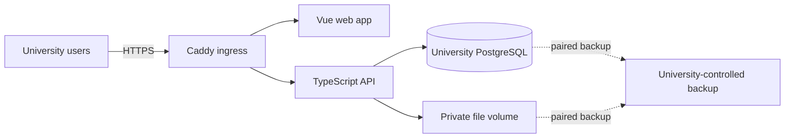

# Rafik architecture

## Workout templates and group results — unreleased beta.3

Program, template and group-participant authoring share WorkoutExerciseCard, while WorkoutFields owns single-workout structure and PlanEditor retains its cycle/day/draft lifecycle. Existing alternative IDs and snapshot validation are unchanged; this adds no API or schema. WorkoutPreview owns the shared read-only prescription presentation. ExerciseMediaPreview reuses ExerciseDemo and its authorized ResourceAsset path; only reviewed reference posters/frames are eligible for desktop thumbnails, with full media opened explicitly in a locale-aware dialog.

GroupWorkoutPanel embeds the existing delegated recorder and review through explicit session props and completion/lock events. It does not bypass their authenticated requests or create another recording implementation. EventDetail retains one attendance implementation and mounts group recording across tab switches. Group UI query parameters identify only local selection/search/review; current event authority remains server-owned. Embedded drafts use account/institution/session keys and the observed record revision; stale drafts remain separate until explicitly discarded. Exact command keys and receipts are unchanged.

`institution_workout_templates` stores staff-shared single-workout prescriptions. Calendar creation freezes one template revision and roster; each designated coach starts a separate participant record, optionally adapted before start. The existing measured actuals, revision receipts and attributed history are reused. Additional records have no assignment and never advance an individual cursor; existing assignment-backed rows remain unchanged. Athletes read only their own result, administrators review, designated coaches record. Attendance is separate; each present/started participant must complete or be explicitly skipped before event finish. Cancellation retains readable records. See [ADR 0034](../decisions/ADR-0034-workout-templates-and-group-results.md). Native offline capture, group plans and workout sections remain deferred.

## Viewer timezone

The existing account profile owns the preferred timezone; no new storage or API is required. `lib/display-time.ts` derives a reactive display zone from the profile with validated device/UTC fallback. Timestamp dates and times use that zone, including activity grouping, event/workout summaries, messages, diagnostics and calendar views. `lib/dates.ts` keeps date-only values fixed to their calendar day; default calendar-date formatting uses UTC even when transported as midnight timestamps. Explicit authoring/recurrence timezones and date-only eligibility rules remain authoritative. Display preference changes never rewrite event timestamps, recurrence clocks, historical documents or exact commands. The navigation clock consumes the same preference and links to the existing account settings flow.

## Calendar scheduling entry point

EventComposer separates plan-workout scheduling from custom attendance events and assessments. The plan path embeds the existing WorkoutAgenda planning projection and posts to the same `/v1/institution/workout-scheduling` command service; it never creates a parallel `/calendar` event or calculates eligibility locally. Search is server-side athlete-name matching, with server totals and bounded pagination. The new entry point has a distinct durable command scope, keeps command recovery mounted across mode changes and guards post-acknowledgment navigation against leaving the original route. Existing custom-event drafts/receipts and makeup links retain their original identities. There is no schema or native contract change in this slice.

## Individual preparation policy and worker

The existing recurrence model stores one active per-assignment weekly or automatic policy. workout-scheduler.ts rechecks its creator’s current authority under the institution → assignment lock order, then calls the same scheduleIndividualWorkout service as manual writes. Rule saves/stops use existing exact receipts; initial preparation and periodic retry are separate. Worker checkpoints, unresolved-position uniqueness and same-day history prevent duplicate automatic work; generation does not consume sequence positions. See [ADR 0032](../decisions/ADR-0032-opt-in-workout-preparation.md).

institution_events now requires either real timed bounds or day-only training with null bounds, explicit training_date and a prescription snapshot. Calendar API serializes that date as YYYY-MM-DD. Web opts into includeDayOnly; default attendance list reads remain timed-only, with an upgrade error for unsupported day-only detail. Day-only eligibility follows its own timezone; reports may use the local-day boundary for grouping without inventing an appointment time. Timed collision ranges exclude day-only events. Pending historical commands, clinical boundaries and assignment-specific progression remain unchanged.

## Role dashboard composition

DashboardPage delegates overview layout to CoachDesk, AthleteDay and AdminOverview. AthleteDay derives its coaching team from the authorized messaging-contact read and sends existing `/messages?to=` links through communication authority; it does not create a new contact grant. `/nutrition?section=diary` selects the existing food diary tab and changes no access/sharing rule. AdminOverview reads the existing period-scoped institution analytics API, keeps returned dates with retained results and clears unauthorized results. Completed workout counts, current active-roster participation and per-event athlete attendance have distinct units; no assessment aggregate or health/readiness metric is implied. Source inventories record their consumers and outgoing navigation.

## Assigned-plan web ownership

The staff assignment directory is `/training`; `/training/:assignment` owns one authorized plan's review, workout actions and embedded adaptation. Athletes use the role-specific `/training` workout-card screen and cannot enter the staff detail route. Adaptation clones the assigned immutable version into a distinct recoverable program draft. Saving/publishing does not rewrite that assignment; the existing explicit assignment flow remains authoritative. The shared PlanEditor serves both contexts, avoiding a duplicate editor and preserving API behavior.

## Individual workout web projection — unreleased beta.3

`GET /v1/institution/workout-scheduling` projects the next non-rest day and unresolved occurrence for each authorized assignment. It does not allocate work or advance progression. Pagination and athlete-name filtering happen after institution/role/plan-sport scope is applied in SQL. The dashboard requests due work; plan details request one assignment; athletes receive only their own assignments. General participation restrictions expose no injury-record identifiers or sensitive details.

The shared web WorkoutAgenda uses existing exact-receipt schedule/reschedule/skip and session-start commands. Recording receives the occurrence identity; server start time and sequence checks remain authoritative. Existing unfinished unlinked records are surfaced for recovery and block scheduling in that assignment. Older unlinked start compatibility remains until historical occurrence reconciliation; it is not the new UI's creation path. Recurring/day-only preparation is now described above; group prescriptions/results are described above; native offline workout recording remains a later beta.3 slice.

## Program and conversation visibility

Athletes browse only programs with an assignment to their own institution membership. Read-only details and version requests are constrained to their assigned immutable versions; staff publication does not grant athlete-wide library access. Browser staff-route guards complement server authorization.

Conversation contact discovery uses the communication service, independently of the staff people directory. Athletes can initiate private pairs with their active primary/supporting coaches; the coach is the manager. Pair uniqueness and exact command receipts remain authoritative. Coaches can discover groups they created or belong to, but assigned membership alone does not grant group editing. Unstarted group discovery excludes groups already linked to a channel. Opening an authorized group derives participants from its current active roster; individual conversation privacy remains separate.

## Individual sequence transaction service

`server/workout-sequence.ts` owns fixed-time individual binding, start eligibility, completion resolution, skip, rescheduling and assignment shutdown. The programming command layer supplies existing plan-specific authority and exact operation receipts. Every request rechecks membership and primary/supporting-coach scope before replay. Institutional mutation locking and an assignment row lock serialize binding/resolution; the cursor changes in the same transaction as its resolution, event state, audit and receipt. Slot creation/rescheduling never advances the cursor. Non-rest days repeat in published array order.

An unresolved position blocks only its assignment. Historical unlinked unfinished work must be resolved before binding. An old start without an occurrence cannot create arbitrary-day work once that assignment has sequence positions; acknowledged old receipts still replay unchanged after current authorization. Existing unlinked historical records retain their recording path. Completed actual-result corrections append existing history without changing progression. Paused/skipped/cancelled bound records reject new result writes; retained device work must remain available for recovery.

New fixed-time bookings may use a calendar rest day, but an active effective cannot-train status blocks booking/start. The response is a general restriction, never the underlying injury record. Existing timestamp/date/day uniqueness remains authoritative. Generic calendar reschedule/cancel/staff/finish mutations reject bound individual occurrences: use the sequence command so event status cannot masquerade as workout resolution. Attendance remains independent. Ending/replacing assignments cancels unstarted bound work and recurrence rules and pauses started work without deleting documents/history.

Recurring/day-only contracts and web scheduling controls are implemented in the later preparation slice above. Group additional recording and native queue upgrade remain separate slices.

## Beta.3 additive workout storage

The additive migration extends existing assignments/events/workout records. Assignments have a zero-based sequence cursor; bounded weekly recurrence rules describe dates without consuming a position. Position rows identify assignment, cycle, day and occurrence, with one pending/paused position per assignment and attributed completion/skip fields. An assignment row lock serializes position validation. The fixed-time domain service above now implements transactional cursor advancement and permission checks; the schema alone does not establish worker behavior.

Workout occurrence links reference the same institution and participant. Existing historical documents provide frozen source snapshots; original documents, history and receipt bodies remain unchanged. Existing workouts stay unlinked until a safe occurrence cutover can represent day-only work. Calendar dates are derived from real timestamps in the event timezone. Required timestamps and assignment IDs remain, so additional group workout writes and day-only events are not enabled yet. New tables are server-only; no grants expose them through the generic user gateway.

## Next-release institution routing

Each installation serves one institution. Browser routes resolve membership rather than accepting an institution or role from the URL. Institution records and supported v1 API scope identifiers remain; Tasks and additional-institution creation are removed. [ADR 0026](../decisions/ADR-0026-single-institution-routing-and-task-retirement.md) records compatibility, migration and draft boundaries.

**Status: current architecture, 17 October 2026.** The university-owned Compose deployment and Stage 5 prototype workflows are implemented locally. Optional Stage 6 provider-specific VM templates exist as unverified starters; provider validation is deferred and does not block Stage 7. The Stage 7 coach-first Android beta.1 is accepted and published; broader coverage remains follow-up work. The [requirements and stage gates](../requirements/README.md) define delivery status; this page describes the system as it exists and the constraints new work must preserve.

## Web frontend reference

The [frontend inventory](../reference/frontend/README.md) records every local Vue screen/component, role/resource boundary and route, with incoming/outgoing links and visual maps. One role-aware DashboardNav supplies sidebar and phone navigation. Detail/editor routes normalize to the parent navigation section. The workout recorder requires current sign-in, institution membership and matching local owner/institution before rendering. Guest adoption is retired; historical account-owned pending data and export/deletion compatibility remain. Notifications no longer expose independent-coaching destinations after the corresponding web screens were retired. No native API contract or stored historical data was removed by this audit.

## Repository components

Android beta distribution uses a directly signed APK with bundled JavaScript, package ID `org.rafik.field` and a persistent private signing key. Release manifest/network rules allow HTTPS plus only the existing local-development HTTP addresses. The configured native minimum is API 24. Signing files stay outside Git and runtime/server images; artifact installation/upgrade evidence is separate from source/API evidence. See [ADR 0024](../decisions/ADR-0024-android-beta-distribution.md).

Android recovery uses separate fresh authorized reads; comparisons never call `saveRoster` or change pending operation IDs/revisions. Participant history is online-only and not stored in the offline roster. The API returns bounded 25-row attendance audit or score-version pages after event and participant authorization. Revoked reads clear the fetched comparison/history and block original-owner capture while retaining encrypted local work.

Recovery sharing re-reads durable records for the exact account/server/workspace/event. It includes only unresolved commands, score drafts, involved athlete names and event metadata; credentials and unrelated roster members are omitted. The OS chooser receives plain text only after an explicit privacy confirmation. Sharing never changes queue state or implies delivery; exported copies leave app encryption/retention. Oversized text is refused without truncation and individual-item sharing is available. No automatic import or forced conflict merge exists. Locale preference is device-local SecureStore metadata, independent of account tokens and draft ownership.

Staff **Events & assessments** is a separate, server-paginated index of scheduled training and assessments across dates. It keeps existing calendar authority: administrators see institution events; coaches see events where they are designated staff. Summaries include athlete counts, not participant records. Existing event details provide attendance, results and correction history. Athlete workout logs remain in Session history. Profile timezone reads use `asActor` and the profile RLS boundary; workspace data continues through explicit membership checks.

Staff browse-first pages separate assigned programs, recorded workouts and published nutrition guidance. Athlete plans and nutrition summaries use server-paginated workspace reads (24 rows with full matching totals); coaches are restricted to their assigned athletes. Workout history uses the existing bounded delivery cursor. Assignment previews resolve immutable program versions. Nutrition overview returns identity, revision, dates and derived status only; opening a version uses the existing subject authorization and diary-sharing boundary. These web-only routes are outside the supported coach field OpenAPI subset.

Event-template creation can open a separate tab. A same-origin BroadcastChannel scoped to account/institution sends the event-draft ID and new template ID; the composer re-fetches the template through its authorized API before selecting it. Refresh remains available when cross-tab messaging is unavailable.

The backend serves its coach OpenAPI contract and bundled Swagger UI at `/v1/openapi.json` and `/v1/docs` (`/api/v1/…` through the Compose web proxy). Documentation is public; protected requests retain native bearer authorization. The viewer permits local development requests, disables them in production, omits cookies, does not persist tokens and restricts requests/assets to its own origin. See the [API guide](../reference/api.md).

| Component                     | Responsibility                                                                                                                                                                            |
| ----------------------------- | ----------------------------------------------------------------------------------------------------------------------------------------------------------------------------------------- |
| `apps/frontend/`              | Vue 3 and TypeScript web application. Presents public and organization-scoped administrator, trainer and athlete tasks; stores recoverable drafts and queued commands in browser storage. |
| `apps/backend/`               | TypeScript HTTP API, Prisma schema/client, PostgreSQL migrations, domain authorization, content sources, and private-file lifecycle.                                                      |
| `apps/mobile/`                | Expo/React Native Android coach field app. Beta.1 coach scope is implemented and released; its supported API subset is exported as OpenAPI.                                               |
| `packages/shared/`            | Shared API contracts and generated database transport types.                                                                                                                              |
| `infrastructure/compose.yaml` | One Compose definition with local-development and self-host profiles. Production profile runs PostgreSQL, migration job, API, web and Caddy.                                              |

The browser calls the API; it never connects directly to PostgreSQL or receives database credentials. PostgreSQL is the durable server store. IndexedDB is for recoverable client work, not backup or acknowledged server state.

The Stage 7 Android workspace has native bearer login/refresh/logout, a bounded coach schedule and field capture for explicitly opened events. The backend serves a versioned OpenAPI subset at `/v1/openapi.json`; see the [API reference](../reference/api.md). Event snapshots, assessment definitions/results, raw score drafts and exact queued commands are partitioned by instance URL, account and workspace in SQLCipher SQLite; native initialization refuses a build without SQLCipher. The key and instance-bound session are kept in SecureStore, and Android app-data backup is disabled. Attendance, assessment entry, event completion and online correction history are implemented. Focused API/emulator evidence and remaining device/release limits are recorded in [verification](../verification/README.md). See [ADR 0023](../decisions/ADR-0023-android-coach-field-app.md) and the [Android guide](../development/android.md).

The attendance queue commits device persistence before reporting it, then sends each immutable operation in order while the app is active. Acknowledgment atomically advances the participant or result revision and marks the command confirmed. A result can be queued after the same athlete’s present command; completion requires all event commands acknowledged and no unresolved drafts. Network/acknowledgment failures retain the exact retry; a process restart treats an interrupted send as uncertain. Authorization/revision rejection pauses later commands for review. A pending roster cannot be overwritten by a newer read. Sign-out removes credentials and attempts device-session revocation while retaining encrypted pending work for its original owner. A confirmed finish evicts the event/roster/results/drafts and local receipts in the same transaction. Completed/cancelled rosters are also evicted on an authorized refresh only after every command is acknowledged; unresolved records require explicit resolution or discard.

## Identity, institution and authorization

Each university runs a separate instance and owns its users, data, secrets, files, backups, retention and infrastructure. There is no default Rafik-hosted tenant or operator access. The supported web experience is organization-scoped. Legacy independent-coaching data and APIs remain isolated during transition, but standalone coach screens are retired; see [ADR 0021](../decisions/ADR-0021-organization-only-web-experience.md). Institution-owned training history belongs to the organization and survives a trainer reassignment.

Every institutional membership has one role: administrator, trainer or athlete. Sign-in opens that role's dashboard; there is no role selector. Administrators manage people, permissions, analytics and programs; trainers receive coaching tools; athletes receive their own training and support navigation. Sidebar groups collapse so the primary navigation stays compact. The platform-administrator grant is separate and appears only for explicitly authorized operators.

Every protected request is authorized against the current actor, selected organization context, resource and lifecycle state. The API derives available actions from its own capabilities; hiding a navigation link is not authorization. Assignment changes or revocations must take effect on subsequent reads, commands and retries. A forward migration reduces legacy multi-role memberships and invitations to one role, prioritizing administrator, then trainer, then athlete; it clears a trainer assignment if that membership no longer retains the athlete role. The [role and scope audit](../archive/role-scope-audit-2026-09-23.md), [ADR 0005](../decisions/ADR-0005-organization-and-independent-scopes.md) and [ADR 0019](../decisions/ADR-0019-single-role-dashboards.md) record this model.

## Commands and durable client work

Domain writes use explicit API commands. The server validates current authority and input, then records related state and its command receipt transactionally. Revision checks, stable operation identifiers and server-owned authorization prevent stale edits or replay from silently creating another result. Client persistence, request dispatch and server acknowledgment are distinct states; the UI must not report a cloud save before acknowledgment. See the [API conventions](../reference/api.md) and [Prisma API ADR](../decisions/ADR-0006-prisma-api-transition.md).

## Institution data boundaries

- Programs, assignments and published training history are organization-scoped. Publishing creates an immutable version and makes the program available in the institution library without a separate visibility hold; assignment is still explicit. A trainer’s access follows current assignment; reassignment does not transfer unrelated personal data.
- Sports and coaching specialties are institution metadata in `institution_sports`, with a kind of `sport` or `specialty`. They are linked to athletes and coaches through `institution_member_sports`. They are separate from the single system role and grant no access on their own. Only administrators change them, and each change is recorded as an institution event.
- **Coaching team ([ADR 0025](../decisions/ADR-0025-coaching-team.md)), access as amended by Release 1c:** each athlete has at most one primary coach and any number of supporting coaches, recorded in `institution_coaching_links`.
  - `trainer_id` mirrors the active primary link. The trigger `institution_members_sync_coaching_links` keeps links consistent on every write path, and ends them when a membership is deactivated or loses its role.
  - Server checks call `recipient()` with an explicit scope, which defaults to `primary`. Training-scope reads use `coachedBy()` or an `EXISTS` on active links.
  - Supporting coaches read training records and include the athlete in their own events, groups and messages. Everything sensitive, and plan changes, stay with the primary coach.
- **Concurrent plans:** an athlete may hold several active plans. Each plan has an optional goal and sport label, and only one active plan per published version is allowed.
  - Assigning either adds a plan or explicitly replaces a named one; `end` archives one. Overlapping dates are reported to staff and a same-day notice is shown to the athlete, without blocking.
  - Workout sessions stay keyed by assignment, so history follows each plan. Supporting coaches are narrowed to plans and sessions labelled with their linked sport. The one intentional exception: overlap warnings show them other plans' title, goal and dates only.
- **Member profiles:** `/members/:member` is the shared profile route; old athlete links remain aliases. Its identity read uses existing roster scope (administrators: institution members; coaches: coaching-linked athletes and self; athletes: self). Staff activity is administrator-only: current primary roster/supporting-link/upcoming-event counts and completed staffed events/coach-recorded workouts over the last 30 days. These are activity counts, not ratings. Account email is returned only to administrators. Profile management preserves existing administrator-only commands and optimistic revisions; display names are institution-local.
- **Invitation sports:** `institution_invitations.sport_ids` records optional descriptive labels selected by administrators. Issuance validates institution, active metadata and role compatibility; acceptance applies links in the same transaction as membership creation/reactivation. Athletes take sports only; coaches may also take specialties; administrators carry none. Pre-existing invitations default to no labels. Archived labels already issued on a valid invitation remain descriptive on acceptance; they grant no coaching access.
- **Staff athlete profile** (`/athletes/:member`): gathers what the viewer may already see about one athlete, using existing authorized endpoints only. It adds no API or access.
  - Primary coaches and admins also see nutrition. Primary coaches see current participation status; admins see consent setup only.
  - Supporting coaches see their sport's plans and sessions, and assessments from events they staffed.
  - Unlinked coaches get a refusal.
- **Coach workout logging:** a coach with plan authority may start a delegated record (`recorded_mode = delegated`, `recorded_by`) or finish unfinished athlete-started work. Preserve the original recording mode/starter and append attributed actuals history; first completion separately records its member/name/role. New coach edits to completed self-logged actuals remain forbidden, while an exact acknowledged completion can be retried after current authority checks. Athletes retain correction rights. See [ADR 0031](../decisions/ADR-0031-coach-completion-of-athlete-started-workouts.md). Coach recording remains online-only with persisted exact-command recovery, not a native offline queue.
- Training groups are reusable scheduling rosters. Administrators can include active coaches and athletes; trainers can manage their own groups of assigned athletes. Selecting a group preselects coaches as event staff and athletes as participants, while each event keeps its own fixed roster.
- Messages are participant-scoped. Direct conversations have one institution-wide record per participant pair; each training group has one linked conversation. The conversation list search also matches the other participant’s name in direct conversations, and reports existing pair members so they no longer appear as new People choices. Existing duplicate direct conversations are archived by the forward migration so their message history remains retained.
- The web message composer previews the selected uploaded attachment before sending. Draft writes are serialized; an acknowledged send removes the device draft and resets the uploader, while uncertain or failed sends retain recovery state. Removing a pending attachment changes only the draft, not the server's file-retention rules.
- Messages support up to 10 ordered uploaded files through `institution_message_assets`. A forward migration backfills existing single-file links; legacy `asset_id` remains the first attachment for compatibility. API writes validate every attachment against sender/institution/channel before receipt replay, then commit message, ordered links and receipt together. Private reads and account exports resolve all linked files. Thread reads also return each attachment's file name and media type, under the same channel authorization as the bytes. Device drafts preserve the ordered list, with compatibility for older single-file drafts.
- Publishing a program exposes its immutable version in the institution library. Other coaches can review it and assign it only to athletes currently assigned to them; drafts remain private to their author and administrators.
- Assessments are assessor-led performance records with defined units and correction history. They are not clinical findings.
- Nutrition plans and athlete-recorded actuals have separate ownership and sharing choices. Withdrawal or reassignment is checked before later reads or command replay.
- Injury participation status is an explicitly limited, consent-gated vertical slice. Coaches see only the assigned athlete’s current status and effective date. Athletes can review, correct, close, withdraw and export their records. The product deletes closed content after 12 months. University privacy/security approval is still required before real athlete data is used. See [ADR 0017](../decisions/ADR-0017-injury-status-minimum.md) and the [Stage 4 workflow audit](../requirements/stage4-workflow-audit.md).
- Exercise names, instructions, still images and videos have separate sources and rights. The software license does not grant rights to bundled media. Manifests pin their source, attribution, license and content hashes; unreviewed assets must not be imported.

## Self-hosted operation

The self-host Compose profile keeps PostgreSQL on an internal container network. Caddy provides HTTPS ingress; the API serves authenticated operations and private-file bytes and stores files on a persistent Docker volume. On an empty instance, the first completed setup creates the super admin and institution in one transaction; setup is then closed. Password sign-in does not depend on mail. Admins create one-time invitations that expire after seven days and share them directly with invitees. Each instance has its own project name, credentials and volumes. No SMTP service, Google service-account key or cloud service credential is required. Keep the instance private until initial setup is complete.

Optional AWS, Google Cloud and Azure starter templates create one VM and provider-specific network/access resources, then prepare the same Compose deployment. PostgreSQL and private files remain on the VM's persistent disk. The templates do not provision managed databases, object storage, DNS, backups or monitoring and are not yet provider-verified. See the [cloud deployment guide](../../infrastructure/cloud/README.md).

Use the [infrastructure guide](../../infrastructure/README.md) for first deployment, [development](../development/README.md) for local setup and [operations](../operations/README.md) for secrets, backups, restore, updates and retention monitoring. Production readiness still depends on the open release and university review gates.

## Instance branding and support boundary

Instance name, accent, custom light/dark page backgrounds and optional logo are stored in PostgreSQL so they survive image upgrades and are included in the normal database backup. Surface colors derive from the page backgrounds, and text/accent colors adjust for contrast. The initial super admin owns these settings; active institution administrators can see the branding panel but cannot change it. The API validates image signatures and permits PNG, JPEG or WebP up to 512 KB. The logo endpoint serves only the configured public brand image with a fixed content type and `nosniff`; no SVG, remote logo URL, arbitrary CSS or script is accepted. Rafik attribution remains visible. Support cases and diagnostics remain local; no telemetry or email delivery is configured.

## Android connection and authority feedback

Connectivity and authorization are separate. A transport failure produces localized connection feedback; HTTP denial remains a server refusal. Following an offline access failure, the signed-in runtime rechecks coach contexts after a successful authenticated response or active retry. Only the context read clears its access warning. Cached work opens after local storage loads rather than waiting for a network timeout. The check does not replace event snapshots or unmount open editors; revoked institutions have their cached packages blocked. Saved workspace selection remains available for recovery; a removed workspace with no device package yields to the remaining authorized workspace or the no-access screen. Command acknowledgment/revision handling remains independent of this feedback and still requires the exact response to each saved command.

Saved event packages open directly from device storage. With cached events present, startup schedule refresh runs separately and does not lock roster controls. **Refresh roster** explicitly downloads newer event data and remains unavailable while unsent commands/drafts need resolution. Background schedule feedback cannot replace an open event’s capture message.

## Data-flow boundary

No default telemetry or outbound data transfer is configured. Optional support flows must be explicit and must not include athlete health data by default. Browser drafts and queued commands are not part of server backup; server database and private files must be backed up and restored together.

## Related decisions

- [ADR 0001: university-owned deployments](../decisions/ADR-0001-university-owned-deployments.md)
- [ADR 0005: organization and legacy independent-data boundaries](../decisions/ADR-0005-organization-and-independent-scopes.md)
- [ADR 0006: Prisma API, identity and file boundary](../decisions/ADR-0006-prisma-api-transition.md)
- [ADR 0017: minimal injury-status boundary](../decisions/ADR-0017-injury-status-minimum.md)
- [ADR 0019: one institutional role per dashboard](../decisions/ADR-0019-single-role-dashboards.md)
- [ADR 0021: organization-only supported web experience](../decisions/ADR-0021-organization-only-web-experience.md)

Previous architecture notes are preserved as dated material in the [documentation archive](../archive/README.md); they are not current implementation guidance.

## Web list and editor lifecycle

Operational lists accept an optional bounded `limit` (1–100), retaining each API’s existing default when absent or invalid. The web exposes curated choices and URL persistence; matching totals remain server-scoped. Task `id` reads use the same institution/assignee authorization as the list and can resolve completed records independently of the active status filter. No new grant is introduced.

Dedicated template/group/exercise editor routes preserve the existing command payloads and server authority. Device drafts are isolated by account, institution, role and entity; legacy drafts move only after durable storage of the scoped copy. A small in-memory active-dispatch registry prevents another mount of the same command scope from offering replay while the original runs. Reload after process loss still uses the durable exact command. Successful navigation waits for settlement and checks that the original screen is still mounted.

## Coaching follow-up after Tasks retirement

The dashboard reads `/v1/institution/follow-up`; it derives outstanding work from existing records, not a Tasks table or cron-generated assignments. It returns up to eight rows and the full count per category.

| Category        | Appears when                                                                                           | Leaves the category when                                                                               |
| --------------- | ------------------------------------------------------------------------------------------------------ | ------------------------------------------------------------------------------------------------------ |
| Workout reviews | An active athlete has a completed workout with no `reviewed_at`                                        | The workout receives a review                                                                          |
| Event outcomes  | A scheduled event has passed its end time                                                              | Staff complete or cancel it                                                                            |
| Missed training | An active athlete was absent/excused from completed training, with no non-cancelled linked replacement | Attendance is corrected or a replacement is linked; cancelling that replacement exposes the item again |
| Plan coverage   | An active athlete has no assignment marked `active`                                                    | An assignment is marked active                                                                         |

Administrators see institution-wide results. Coaches see their primary athletes for reviews, missed training and plan coverage, and events where they are designated staff for outcomes. Athletes cannot read this staff endpoint. Results refresh when the dashboard loads or its read is retried; they are not persisted task assignments, automatic notifications or a realtime queue. Plan coverage currently checks assignment state, not assignment date validity.

The cleanup migration deletes the legacy Tasks table, attributable saved-command results and `trainer_task_*` audit events. It retains scheduled activities, attendance, workout records, reviews and unrelated institution audit history. The `institution_audit_events` audit table and `institution_events` schedule table serve different purposes; neither retains the retired task workflow. Existing Task rows are purged when the guarded upgrade migration runs, rather than modifying developer preview data during verification.

## Explicit backend boundary

The breaking beta.3 migration removes personal/team/business storage and generic command/query/file gateways. Explicit own profile/support/account lifecycle services replace their current dependencies. Current institution records, histories and exact receipts remain. Canonical `/v1/institution` paths are the only supported scope routes; published beta.2 clients require a coordinated upgrade. The response normalizer may read old field names in preserved institutional receipt envelopes; it does not expose old routes or rewrite stored documents. See [ADR 0030](../decisions/ADR-0030-retire-standalone-storage-and-apis.md) and the [complete backend reference](../reference/backend/README.md).

### Coaching dashboard action discovery

The shared follow-up panel composes workout priorities with review and attendance follow-up. Its `due=true` agenda read also includes plans awaiting scheduling; it does not allocate positions or enable automatic scheduling. Future scheduled work remains in plan details. Role/sport access and existing pagination are unchanged.

### Coaching desk queue boundaries

The coach overview uses `queue=actionable|planning` on the existing scheduling projection; recording/today remain narrower API reads. Queue predicates apply inside the authorized database scope before pagination/counting. Recording contains unfinished records; today contains due positions without an unfinished record; planning has neither unresolved positions nor unfinished records. Shared controls retain exact commands. The previous due-dashboard command scope remains available for recovery after layout upgrade. Calendar-linked workout events are omitted from the desk’s separate event summary. Limited participation status still comes from the existing primary-coach/consent-gated audited read; absence is unknown. Compact follow-up retains its explicitly labelled primary-roster/state-based coverage. No clinical projection or aggregate readiness score was introduced.

### Consolidated coach action queue

The desk now uses `queue=actionable` for the union of unfinished records and due unresolved positions, once per assignment, and `queue=planning` for assignments with neither. Existing recording/today filters remain available as narrower API reads. Both counts and paging stay server-scoped. The response echoes queue identity; the web rejects missing/mismatched identity and explains the required backend update. Acknowledged changes refresh the other collection through a token, retaining active components, async-navigation guards and durable command scopes.

Program prescriptions may carry a boolean `automaticPreparation` default. Publishing freezes it with the version; delivery confirms/overrides the default and atomically creates a bounded automatic policy with each new assignment. Editing a program never mutates existing plan policies. No schema migration is required for this optional JSON metadata.

### Personalized athlete plans

An assignment may carry a validated `adaptation` snapshot with title, prescription, source version and its own revision. It overrides the source only for that plan’s future work. Adaptation uses current plan authority, assignment locks/revision and exact receipts; before/after snapshots remain in institutional audit history. The source library version, assignment ID, progression cursor, schedule policy and already materialized workout snapshots are preserved. Bound starts read their occurrence snapshot even after a day is removed from the adapted plan. Current assignment-scoped media reference checks cover adapted prescriptions/covers. See [ADR 0033](../decisions/ADR-0033-assignment-local-adaptations.md).
