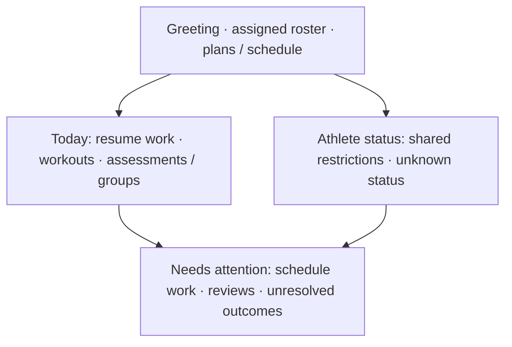

# Web UI/UX audit and standardization plan

**Audit date: 21 October 2026. Status: final Claude audit applied; candidate release PR open, see the final audit section for remaining limits.** Scope is the web dashboard first. Android is a separate follow-up. The current uncommitted People/profile/settings changes predate this audit request and form part of the baseline; they are not evidence that the proposed platform-wide design system has been implemented.

The [design system proposal](../DESIGN_SYSTEM.md) is the one proposed visual specification. This report records problems and sequencing, not a competing style guide. Business rules, API contracts, routing, permission boundaries and persistence behavior must remain intact.

## Group recording workspace — 30 October 2026

Founder-approved correction implemented: attendance-first event tabs, one shared prescription preview, searchable paginated desktop athlete roster/phone selector, and recording/review within the event. This supersedes the earlier participant-action/side-panel recording flow; Skip remains a confirmation panel. The recorder and review are reused, not duplicated. Local drafts are revision-scoped and distinct from acknowledgment. Final selector review corrected first-query clearing, keyboard selection and the native-looking trigger; adaptation collapses the preview to preserve working space. See the [design specification](../DESIGN_SYSTEM.md#group-recording-workspace), [verification limits](../verification/README.md#group-recording-workspace--30-october-2026) and [canonical walkthrough](../testing/instance-validation.md#workout-templates-and-group-workouts--unreleased-beta3).

## New workout screen review — 30 October 2026

Scope: WorkoutTemplatesPage, WorkoutTemplateEditor, WorkoutFields, WorkoutPreview, WorkoutTemplatePicker and GroupWorkoutPanel, including their program/event insertion points. Founder screenshots establish the People tabs/search/pagination arrangement and Programs full-width Add exercise as the references. This correction preserves commands, routes, copies and participant permissions.

| Finding                                                                                           | Evidence                                                | Resolution                                                                                      |
| ------------------------------------------------------------------------------------------------- | ------------------------------------------------------- | ----------------------------------------------------------------------------------------------- |
| First-use exercise state floated above Add exercise; Save/Cancel touched it                       | Founder-rendered screenshot; source                     | One shared empty card with its action; existing editor footer owns save/cancel separation       |
| Grid gaps compounded legacy form-label/control margins; picker labels also lost their own spacing | Source and component-rendered editor/adaptation         | One spacing owner per section; explicit 8px label/control spacing at the new component boundary |
| Directory tabs shared the search row instead of matching People                                   | Founder reference and source                            | Tabs row, then search/pagination toolbar                                                        |
| Preview/list typography and generic heading styles did not fit subsection hierarchy               | Source and component-rendered preview/picker/group rows | Shared section/panel/body/caption tokens; no oversized inherited headings                       |
| Phone identity fields stayed in two cramped columns                                               | Component-rendered Arabic editor                        | Stack identity fields; keep compact prescription controls in two columns                        |

Rendered checks and limits are in [verification](../verification/README.md); a synthetic component fixture is not authenticated whole-platform acceptance. No new business rule or Android work belongs to this visual correction.

## Evidence labels

- **Rendered:** the named screen/state was actually opened and its screenshot inspected.
- **Source:** confirmed in the named source; rendered impact must be verified before claiming a visible defect everywhere.
- **Hypothesis:** plausible risk that still needs a reproducer.
- **Proposed:** an improvement or standard awaiting approval, not implemented behavior.

Automated layout/Axe results are observations, not full visual or usability acceptance. A screenshot file that has not been inspected is not rendered-review evidence.

## Architecture and existing patterns

The source inventory found **101 Vue components**, **57 route declarations** and **34 selection-control consumers** using a regex scan of the current tree. Route declarations include redirects, compatibility routes and error paths; these counts do not mean 57 independently validated screens.

| Layer                 | Existing source                                                                                                                    | Observation                                                                     |
| --------------------- | ---------------------------------------------------------------------------------------------------------------------------------- | ------------------------------------------------------------------------------- |
| Global presentation   | `apps/frontend/src/style.css` (3,886 lines at inventory)                                                                           | Theme tokens, typography, controls and many feature rules share one cascade     |
| Shell/layout          | `styles/navigation.css`, `styles/dashboard.css`, `App.vue`                                                                         | Shell rules override global page headings, gutters, panel padding and scrolling |
| Feature styles        | Institution/nutrition CSS and scoped Vue styles                                                                                    | Local variants add further dimensions and spacing                               |
| Utility layer         | Prefixed Tailwind utilities, no Preflight                                                                                          | Additive; not the application-wide component specification                      |
| Existing reusable UI  | `PageState`, `ListPagination`, `MemberPicker`, `MultiChoice`, `TimezonePicker`, `ExercisePicker`, `MonthCalendar`, `CommandStatus` | Useful foundations to retain and standardize                                    |
| Accessible primitives | Reka tabs, comboboxes and dialogs                                                                                                  | Present already; do not replace with bespoke keyboard implementations           |

Source paths in the rest of this report are relative to `apps/frontend/src/` unless stated otherwise. The raw source inventory is an audit receipt, not an onboarding guide.

## Findings and priorities

P1 means a task, accessibility or reflow problem; P2 means repeated inconsistency/usability friction; P3 means restrained visual polish. No security defect or whole-product release blocker is inferred from a design inconsistency alone.

| ID    | Priority | Finding and evidence                                                                                                                                                                                                                                                                                                                    | Impact                                                                                                    | Proposed repair                                                                                                                                                                                                        |
| ----- | -------- | --------------------------------------------------------------------------------------------------------------------------------------------------------------------------------------------------------------------------------------------------------------------------------------------------------------------------------------- | --------------------------------------------------------------------------------------------------------- | ---------------------------------------------------------------------------------------------------------------------------------------------------------------------------------------------------------------------- |
| UX-01 | P2       | **Source + rendered:** title/description spacing depends on several layers. `style.css` supplies heading margins, `.form-stack` adds grid gaps, and `AthleteProfile.vue` adds 12px block padding to `.small-print:only-of-type`. Athlete management screenshots show the primary-coach explanation separated from its title and picker. | Related instructions do not read as one group; equal-height layouts stretch sparse forms.                 | A shared compact header group with 8px title/description gap and 16px gap to content. Remove the broad descendant padding when migrating its named consumers.                                                          |
| UX-02 | P2       | **Source:** global `.panel` padding is 28px, dashboard panels override it to 22px, new management uses its own grid and feature layouts add margins. `.panel + .panel` adds 22px outside any layout-owner decision.                                                                                                                     | Nested/adjacent panels can double space or drift when moved into grids.                                   | One spacing scale, layout-owned gaps, named panel variants, no implicit sibling margin inside managed grids.                                                                                                           |
| UX-03 | P2       | **Source + rendered:** institution sports/specialties use one creation form and two groups, with wrapping flex row actions and native kind radios. Existing phone screenshots show a long section; long/mixed labels need dedicated review.                                                                                             | Group purpose and action placement become hard to scan; sparse page and crowded rows alternate.           | Separate the creation header from a compact grouped list. Keep sport/specialty kind visible, archived state clear and row actions contained; stack editing controls naturally. No change to metadata/access semantics. |
| UX-04 | P2       | **Source:** native radios/checks, styled role buttons, native selects, inline MemberPicker, disclosure-based MultiChoice and portaled comboboxes coexist without one documented choice rule.                                                                                                                                            | Similar choices can look and behave differently.                                                          | Map choice size/semantics to existing components. Shared field/selection styling; preserve native/REKA keyboard behavior.                                                                                              |
| UX-05 | P2       | **Source:** password fields in `LoginPage`, `SetupPage`, `PasswordSetupPage` and `InvitationPage` use password inputs without a shared reveal control.                                                                                                                                                                                  | Users cannot inspect a typing mistake consistently.                                                       | Accessible localized show/hide button without changing password policy, validation or submit behavior.                                                                                                                 |
| UX-06 | P2       | **Source:** public heading sizes, workspace headings and dashboard overrides use different scales; Arabic global heading line-height is 1.6 while some local heading rules override size/spacing.                                                                                                                                       | Page/card hierarchy and vertical rhythm vary by route and locale.                                         | Semantic heading scale separate from HTML level; Arabic-safe line heights/zero negative tracking.                                                                                                                      |
| UX-07 | P1/P2    | **Source; specific failures require rendered evidence:** the desktop shell owns scrolling, conversations have bounded local scrolling, selectors have their own overflow, and many feature grids declare fixed minimums.                                                                                                                | Risk of clipped actions, nested scroll friction and short-height collisions.                              | Audit actual scroll owners at 320px, tablet, desktop and landscape; fix containment at the source. Never globally hide overflow.                                                                                       |
| UX-08 | P2       | **Source:** status copy and surfaces vary between `PageState`, inline notices, plain empty paragraphs, feature-specific empty cards and SweetAlert toasts.                                                                                                                                                                              | Empty, denied, refresh and uncertain-write states can be visually ambiguous.                              | Shared state conventions with task-specific text and recovery. Retain separate command durability/acknowledgment semantics.                                                                                            |
| UX-09 | P2       | **Source + previous focused checks:** pagination is now shared, but data arrival and URL completion are separate. A directory reload race was corrected before this audit; a nutrition test initially read old rows during a refresh.                                                                                                   | Incorrect tests or consumers can mistake preserved rows for the new page.                                 | Keep previous results with visible busy state, accept only fresh responses, and validate range plus record identity after loading.                                                                                     |
| UX-10 | P1       | **Confirmed and corrected before audit:** a selected role button used white text on a pale dark-theme accent; automated contrast check found 1.64:1. It now uses `--on-accent`. Removing the redundant Manage heading also required correcting child heading levels.                                                                    | Theme-derived colors and semantic structure can regress through isolated styling changes.                 | Token-only foreground/background pairs and shared heading rules; test custom palettes, not just fixed defaults.                                                                                                        |
| UX-11 | P2       | **Source:** mobile navigation uses a Reka dialog, institution closure has another dialog surface, and inline disclosures serve other tasks.                                                                                                                                                                                             | Dialog sizing, action layout and error placement have no shared visual contract.                          | Standardize existing primitives' surfaces/actions, keep typed-name closure and in-dialog recovery.                                                                                                                     |
| UX-12 | P3       | **Proposed:** restrained transitions/elevation are already partly present, but not expressed as a common motion/elevation scale.                                                                                                                                                                                                        | New additions may drift toward unnecessary decoration.                                                    | Short shared motion tokens and opaque default surfaces; optional glass only where justified and reduced-motion safe.                                                                                                   |
| UX-13 | P2       | **Rendered:** administrator overview/analytics still say “trainees”/“trainers”; the missed-session helper mentions a “free session”. Activity rows for newer operations fall back to “Institution updated”.                                                                                                                             | Copy conflicts with the university athlete/coach vocabulary and makes real actions harder to understand.  | Update localized presentation strings and action labels; do not restore deprecated package logic or alter attendance policy.                                                                                           |
| UX-14 | P2       | **Rendered:** People/activity/settings repeat the institution name as the main heading and retain “Invite people” even on settings. Profile overview displays “Athlete profile”/“Coach profile” under institution role.                                                                                                                 | Current task and role are less explicit than their surrounding page context.                              | A task-specific page header with smaller institution context; correct role labels and contextual actions.                                                                                                              |
| UX-15 | P1       | **Automated + rendered:** the new-program view has an `h3` without a preceding section `h2`; Axe reports `heading-order`.                                                                                                                                                                                                               | The empty authoring state has an inconsistent document outline.                                           | Correct semantic section headings while keeping the approved visual scale separate from heading level.                                                                                                                 |
| UX-16 | P2       | **Rendered:** event composition date/time and timezone controls have different vertical alignment despite sharing a row.                                                                                                                                                                                                                | Paired scheduling inputs look unrelated and complicate scan order.                                        | Apply the shared field header/helper convention and align control edges; retain native date/time and existing timezone behavior.                                                                                       |
| UX-17 | P1       | **Rendered + source:** `features/public/PrivacyPage.vue` still describes a “local Supabase backend” and a local preview. The runtime is Prisma/PostgreSQL and beta.1 is already published.                                                                                                                                              | Users receive obsolete technical/privacy context.                                                         | Correct English/Arabic implementation facts against architecture and current account/data boundaries; retain institution-specific policy responsibility. This audit does not rewrite legal policy or change storage.   |
| UX-18 | P2       | **Rendered:** a signed-in missing route offers “Sample workout” instead of a workspace recovery action. Administrator `/feedback` presents a sign-in warning although the same session opens other authorized pages.                                                                                                                    | Recovery can send staff away from their task; permission refusal can be confused with an expired session. | Review contextual recovery actions and denial/session copy separately. Do not loosen permission checks or infer a session failure from every refusal.                                                                  |

### Root causes

1. **Cascade ownership is unclear.** Global, workspace, dashboard, feature and scoped selectors all influence the same component. A local fix can be overridden or affect unrelated nested content.
2. **Visual and semantic structure are coupled.** Heading tags and extra panels are sometimes used to achieve size/spacing rather than to describe the task.
3. **Spacing is often inherited accidentally.** Generic paragraph, sibling-panel and form-grid rules combine rather than using an intentional header/body/footer layout.
4. **Control foundations exist without a selection taxonomy.** Reuse is possible without adding dependencies, but current pages make independent presentation decisions.
5. **Evidence is workflow-oriented but incomplete across visual states.** Passing one long browser journey cannot establish every theme, popup or responsive state; the WebKit profile journey timed out after rendered management checks and remains incomplete.

## Coverage register

### Baseline observations

The first Chromium sweep collected 63 named states using synthetic data: administrator view families, coach/athlete overview/training/calendar/nutrition/messages, account/support/help routes, invalid entry links, and representative Arabic dark 320px, English dark tablet and Arabic light desktop layouts. Image inspection is tracked separately in the final receipt. It found the new-program heading-order issue; a collector pass does not mean every view/theme/state is accepted. Valid first-run/password/invitation forms, platform-only controls and populated report/history states require additional fixtures or source-only status.

The route sweep and source review cover these workflow families. Rendered status must be updated from inspected screenshots, not inferred from route presence.

| Family               | Pages/states in scope                                                                                        | Required deeper interactions                                                                 |
| -------------------- | ------------------------------------------------------------------------------------------------------------ | -------------------------------------------------------------------------------------------- |
| Entry/account        | Sign-in, first setup, institution invitation, password setup, settings, account recovery                     | Password visibility proposal, validation, invalid/expired links, pending work/sign-out       |
| Workspace/shell      | Institution chooser, admin/coach/athlete overview, desktop/sidebar, phone drawer, help/support/notifications | Drawer focus/return, active navigation, keyboard and scroll ownership                        |
| People               | Role directory, filters/pagination, invite, athlete/coach/admin profile, management and activity             | Role tabs, mixed names, coach options, clearing selections, permissions and failure recovery |
| Programs/exercises   | Library, new/edit/preview, exercise discovery/popup/media, assignment                                        | Long descriptions, open picker, later selections, draft and publish feedback                 |
| Athlete work         | Active/expired plans, session history, review/delegated recording, athlete logger                            | Measurement controls, empty/history data, interruptions and confirmation                     |
| Calendar/assessments | Calendar, event index/new/detail, group/assessment templates and result history                              | Inline controls, timezone/date popup, roster, forms, correction states                       |
| Nutrition            | Plan index, coach editor, athlete diary/current plan                                                         | Dense numeric fields, empty/unknown values, revision/uncertain save                          |
| Communication        | Conversation list/thread/attachments, resources, notifications                                               | No-match, populated thread, scroll, long attachments, errors and keyboard                    |
| Reports/privacy      | Analytics, feedback, injuries/consent, platform admin, privacy and not-found                                 | Charts/tables, sensitive/denied states, report tabs, explicit platform grant                 |

**Limits:** first-run setup needs its own empty-instance state. A missing/invalid token does not establish the valid invitation/password form. Platform administration requires its separate explicit grant. No institution live data or physical device is used. Native Android rendering is outside this audit. Populated workflow fixtures and open-control states must be named explicitly in the final coverage receipt.

## Approved implementation plan

### Slice 1: foundation and reference controls

- First correct approved factual copy issues (obsolete backend/privacy wording, legacy vocabulary, misleading denial/recovery text) without changing data behavior. Recheck the actual role/error response before changing an error message.

- Consolidate spacing/type/radius/control-size/motion/semantic-state tokens in the existing style foundation; keep current theme/branding derivation.
- Define a compact section header and consistent field/help/error layout, only extracting components where multiple actual consumers need them.
- Standardize primary/secondary/quiet/danger action surfaces and password reveal controls using existing icons.
- Use one small reference surface to inspect every state in both themes, both directions and at phone/desktop sizes; do not expose a developer gallery in the product navigation.

### Slice 2: People, profiles and institution settings

- Apply the approved compact header pattern to primary/supporting coaches; align rows without stretching title/description gaps.
- Make sports/specialties a readable grouped management list with responsive add/edit controls and clear archive state.
- Standardize profile tabs, selection details, directory actions, invitation fields and destructive confirmation visual treatment.
- Keep sports/specialty meaning, coaching permissions, role restrictions and command data unchanged.

### Slice 3: planning and field workflows

- Migrate program/exercise/assignment, calendar/event/template, athlete plans/session history and nutrition surfaces.
- Keep discovery grids where useful, natural form scrolling, immutable previews and existing numeric measurement controls.
- Prioritize open picker, narrow date/time fields, mixed labels, empty/error and refresh states over decoration.

### Slice 4: communication, reports and remaining routes

- Align messages/resources feedback and scroll boundaries; preserve mounted conversation navigation and draft isolation.
- Standardize report headings, chart labels/table equivalents, privacy/consent states and account/help views.
- Finish keyboard/reduced-motion/contrast review and remove superseded CSS only after named consumers migrate.

Each slice is a reviewable change with focused tests, before/after screenshots, updated audit status and relevant public English/Arabic documentation. Do not run the full browser matrix after each small spacing edit; reuse passing evidence for unaffected behavior and reserve the final matrix for stable source.

## Validation protocol

- Baseline all major reachable view families; distinguish empty, invalid, denied and populated states.
- Representative matrix: Chromium and WebKit, English/Arabic, light/dark, 320/390/768/1024/1440px, short phone height and landscape.
- Inspect viewport and scrollable-content evidence, primary action reachability, open popup containment, keyboard/focus and mixed-direction text. Layout geometry or Axe alone is insufficient.
- Check contrast with the default palette and a light/dark custom accent; respect reduced motion and zoom/reflow.
- Use disposable synthetic institutions and remove only owned records/output. Never reseed the founder's instance.
- Record exact source/check results and remaining gaps in [verification](../verification/README.md); raw receipts belong under `docs/verification/receipts/`.

## Implementation status

The founder approved implementation on 21 October. Shared spacing, type, surface, control and motion tokens are implemented in `styles/design-system.css`. `SectionHeader` is used by primary/supporting coach and sport settings sections; `PasswordField` provides localized visibility controls for login, first setup, invitation and password setup. People/profile/settings refinements, responsive sports grouping, permission-denial copy, privacy wording and heading fixes are implemented. Exercise and timezone popup accessibility fixes passed focused Chromium/WebKit checks, including visible options and keyboard exercise selection. Password reveal retained the entered value and hid it again. Planning, communication, reporting and account views now use the shared heading/tab/surface patterns in source. Dedicated editors, shared search/upload/pagination and Schedule refinements are implemented. The final cross-platform visual review is delegated to Claude; these source migrations are not full rendered acceptance. See the [handoff](../development/design-audit-handoff.md).

## Additional confirmed control findings

Both baseline engines reported missing exercise popup semantics and an unfocusable timezone scroll region. The final controls use a labelled composite exercise dialog with a separate listbox, and a keyboard-focusable timezone option group. Final focused checks passed with no Axe violations in the five checked states per engine. The missing `PhBarbell` import in the training view was also corrected. Baseline WebKit access-control cancellation messages remain unverified; they are not classified as a confirmed server CORS defect.

## Founder handoff — 21 October

Stop further Codex design auditing. Keep application PR #138 as a temporary draft, not a release approval. Claude should audit and refine the final interface and open a separate release-ready PR afterward. The final Schedule toolbar groups its controls within the calendar column, with adjacent previous/next buttons aligned above the calendar edge. This last layout has not been visually accepted.

The broader rollout browser collector did not reach final acceptance: fixture revision/time collisions were corrected; a subsequent isolated run ended with a fetch ECONNRESET. No confirmed product root cause was established. The WebKit editor journey remains unverified. Earlier focused checks retain only their named source/state coverage.

## Final Claude audit — 21 October

Branch `codex/web-design-final`, started from PR #138's head. A disposable seeded institution (15 athletes, 3 coaches, mixed English/Arabic names and labels, 6 sports/specialties, 12 plan assignments, 11 nutrition plans, 7 templates, 4 groups, 9 events) was rendered and the screenshots inspected before and after changes.

| ID    | Priority | Rendered finding                                                                                                                                                                                                    | Resolution                                                                                                                   |
| ----- | -------- | ------------------------------------------------------------------------------------------------------------------------------------------------------------------------------------------------------------------- | ---------------------------------------------------------------------------------------------------------------------------- |
| UX-19 | P2       | Calendar previous/next buttons wrapped onto a second row below the filters at 1440px.                                                                                                                               | Chevron buttons around a visible month label; one row, inline end of the calendar column.                                    |
| UX-20 | P2       | Out-of-month days rendered grey because the global disabled opacity exposed the grid-line background.                                                                                                               | Local opacity reset and page-coloured background for those cells.                                                            |
| UX-21 | P3       | Light `--surface-soft` (18% ink) made chips, tabs and weekday headers read as heavy grey blocks.                                                                                                                    | 11% ink mix; muted text contrast on it improves.                                                                             |
| UX-22 | P2       | "Records fetched:" pagination took ~520px, squeezing People/Schedule search; phone wrapping orphaned the next button; empty lists showed "0–0 / 0".                                                                 | "Per page", narrower select, grouped range/buttons, hidden when empty.                                                       |
| UX-23 | P2       | Athlete-plan sport tags stretched across the card; athlete names were uppercase-tracked, including Arabic names.                                                                                                    | Content-sized tag; plain semibold name.                                                                                      |
| UX-24 | P2       | People rows used four lines and a nested scroll container inside the scrolling workspace.                                                                                                                           | Role and primary coach on one line; nested scroller removed (pagination bounds the list).                                    |
| UX-25 | P2       | Settings left sports/specialties in a half-width card beside an empty column. Review then showed the replacement general/branding pair leaving a large gap for the super admin, whose branding form is much taller. | One full-width section per row: inline general name row, branding fields beside the logo upload, side-by-side sports groups. |
| UX-26 | P2       | Schedule list showed "27 Oct — 27 Oct" without times; phone filters stacked one per row.                                                                                                                            | Weekday, date and time range; two-column phone filters.                                                                      |
| UX-27 | P2       | Template/group editors stacked Add drill, draft status and Save with 4px gaps; picker search button misaligned and its scroll list looked clipped.                                                                  | `.editor-footer`; aligned 44px search; framed scroll list.                                                                   |
| UX-28 | P3       | Repeated library boilerplate on every program card; "1 drills"; Find vs Search labels; trainee/trainer copy (UX-13).                                                                                                | "In library" tag, plurals, consistent Search, athlete/coach wording in both languages.                                       |
| UX-29 | P2       | Profile used a narrower centred container and dashed centred empty boxes inside panels.                                                                                                                             | Workspace edges and compact start-aligned empty text.                                                                        |

| UX-30 | P2 | Founder review: the assignment page listed every athlete with a checkbox, which does not scale to 1,000–2,000 athletes. | Search-first top-5 matches with Add; separate selected section with plans, replace choice, Remove/Undo and confirmed Remove all. Admin email search. |
| UX-33 | P2 | Founder review: nutrition Create a plan pushed a roster card above the list; shared pickers listed whole rosters; the plan panel was a fixed-height scroller; Edit meal plan opened the target editor. | Dialog for choosing the athlete; top-5 name-card picker everywhere; panel grows with content; meal-only editor on the Example tab. |
| UX-32 | P2 | Founder review: an athlete on an older/renamed version of the program was treated as a different plan; the Add buttons, replace dropdown, plan settings below the list and flat styling lacked hierarchy. | Earlier version recognized and moved by default; numbered raised cards (settings, add, selected side by side); name cards with plus icons; replace in a dialog; sticky Review bar. |
| UX-31 | P2 | Founder review: "Assign this program" sat alone under the title, and save/publish were only at the bottom of a long editor. | One top action bar holding all program actions, pinned on tablet and desktop. View/copy tools (preview, Duplicate with a copy icon) sit on the start side, apart from assign/save/publish. |

Rendered coverage and the checks that ran are recorded in [verification](../verification/README.md). Not covered: Tasks (deferred by founder direction), messages/resources/analytics beyond a desktop glance, the full dropdown/modal set, custom institution palettes, and physical devices.

## Campaign and native brand alignment — 23 October 2026

**Evidence:** reviewed the complete written round7 companion, PDF text and rendered PDF pages 5, 8, 10, 14, 18 and 22 (logo, color, typography, effects, bilingual presentation and claims). Inspected the introduction, Arabic program walkthrough and field campaign examples; these are supplied campaign exports, not newly rendered app screens. Compared current web styling/branding and native `ui.tsx`, `Home.tsx`, layout, locale controls and launcher artwork. No emulator/device was launched and no new web/native screenshot acceptance is claimed.

| Area                  | Current source finding                                                                                                                                                                                                       | Disposition                                                                                                                                                                                                                                                                      |
| --------------------- | ---------------------------------------------------------------------------------------------------------------------------------------------------------------------------------------------------------------------------- | -------------------------------------------------------------------------------------------------------------------------------------------------------------------------------------------------------------------------------------------------------------------------------- |
| Web identity          | Default accent/ivory/dark page, Manrope/Noto and SVG icon family match the shared identity. The existing default logo is byte-identical to the supplied legacy-size mark. Runtime colors are intentionally instance-derived. | Retain the established product system and theming; adopted the campaign mapping in the design system. This is broad identity alignment, not pixel equality to a social post.                                                                                                     |
| Effects               | Earlier product guidance permitted optional glass. The campaign explicitly excludes decorative glass and glossy gradients and delegates controls to the product design system.                                               | Future product work defaults to matte/opaque surfaces and restrained green emphasis. Preserve necessary overlay scrims and existing functional states; no wholesale restyling was performed.                                                                                     |
| Default logo contrast | The web shell currently uses one default dark mark for both themes. The handoff supplies a distinct light mark for dark surfaces. Institution logos are separately configurable.                                             | During the next branding UI slice, select the original default mark by actual surface contrast; preserve custom institution logos. Inspect both themes, custom backgrounds and RTL. Native launcher keeps its original artwork; no redraw or new APK is required for this audit. |
| Native colors         | `ui.tsx` uses light page `#f2f7f4`, dark page `#101b1d`, accents `#08674f`/`#a0dfc8` and primary `#116c54`. This reads as a different teal/mint family from the shared default palette.                                      | Native is partially aligned. Beta.3 field UI should use central product-aligned semantic tokens, preserving contrast and distinct completion/recovery states.                                                                                                                    |
| Native type           | Native Text/TextInput styles have no bundled Manrope/Noto font family; layout has no font-loading hook. Title/card sizes are reasonable but do not establish typeface alignment.                                             | Bundle licensed real native-compatible font files and declared weights with a safe loading/failure fallback. Preserve system font scaling; do not assume the supplied web WOFF2 files are native-ready.                                                                          |
| Native Arabic         | Shared styles already use language-aware direction, zero Arabic kicker tracking and the Android logical-start treatment. Hint line height is fixed at 21 for 14px text; title/body spacing needs rendered Arabic review.     | Keep the tested direction behavior; verify Arabic line height, mixed names and clipped marks on actual Android before acceptance.                                                                                                                                                |
| Native wordmark/icon  | Launcher artwork visually preserves the supplied diamond identity. The screen kicker uses “RAFIK FIELD”; there is no themed in-app logo treatment.                                                                           | Use sentence-case Rafik Field for new copy while retaining translations of old persisted keys. A launcher icon is not proof of an in-app logo/family match.                                                                                                                      |
| Claims/media          | Campaign copy references older release/source addresses. The field campaign example is photography, not a native UI capture. Photo credits reference files absent from the ZIP.                                              | Verify current releases and use real sample-data app captures for product claims. Do not treat the field photograph as Android UI evidence or import unverified example photography.                                                                                             |

### Beta.3 native branding acceptance

- Shared default palette with contrast checks for text, actions, disabled, completed, offline and conflict states in light/dark.
- Locally bundled Manrope/Noto with real weights and licenses, font-loading fallback and text scaling.
- Correct original logo variant if displayed, without an extra container outline, mirroring or recoloring.
- Phone/tablet and English/Arabic rendered checks, including long participant names, timed/distance controls and recovery states. Preserve touch targets and clear saved-versus-synced feedback.
- Keep branding work within the accepted session/field UI slice; do not rebuild the whole mobile information architecture for campaign styling.

This is a source-led alignment assessment. The existing published Android acceptance remains valid for its recorded scope; these identity gaps are follow-up work and are not a claim that beta.3 native alignment is already implemented.

## Coach dashboard study — 26 October 2026

**Decision, 26 October:** the founder approved concept A (Coaching desk), with Field launch reserved for the later tablet app. The implementation combines due and unfinished work in Workouts to record, keeps Needs scheduling separate, and lists today’s group/assessment events without duplicating workout events. It preserves explicit primary-roster status/follow-up coverage, server-scoped disjoint queue pagination and unknown-status semantics. Verification records actual rendered coverage; no readiness score or expanded health authority is implied. The following study records the reasoning and considered alternatives.

**Study context:** the founder requested a deeper redesign after the incremental priorities/card correction and selected a balanced overview: today's work plus compact athlete readiness. The incremental correction is not acceptance of the larger redesign.

### Evidence and root causes

- **Rendered:** the current English/light desktop dashboard groups a workout agenda above four follow-up panels. Awaiting-schedule work is discoverable, but a single workout occupies substantial width and four empty follow-up panels consume the first screen. The previous screenshot supplied by the founder also showed unrelated summary cards above a flat due-work list.
- **Source:** DashboardPage composes FollowUpPanel and UpcomingSessions. FollowUpPanel reads missed appointments, completed workouts awaiting review, unresolved event outcomes and athletes without plans. WorkoutAgenda reads independently progressing assignments. UpcomingSessions reads the next week's calendar. These use different time windows and record units; summing them as a single task count would double-count people and mix appointments with workouts.
- **Source:** primary/supporting sport scope and limited participation status are authorization boundaries. A compact readiness presentation must use the same boundaries; no clinical history or institution-wide athlete list may leak through a summary.
- **Founder-observed:** review continuation controls touch exercise headings; coach recording lacked the athlete logger's clear check affordance. These spacing/recording corrections are in the current implementation slice, independent of dashboard approval.

### Jobs the dashboard should support

1. Resume an unfinished workout without selecting an athlete again.
2. See today's individual workouts and group/assessment appointments in local institutional/account time, with explicit type and start time.
3. Notice known participation restrictions before starting work; distinguish modified participation, unavailable and unknown rather than estimating readiness or assuming clearance.
4. Schedule assigned work that has no appointment, without competing with an imminent live session.
5. Review completed work or resolve an event outcome, retaining the meaning and attribution of each record.
6. Reach the athlete profile, plans and schedule quickly without reproducing the complete directories.

### Data gaps confirmed during the study

- **Source:** InjuryStatus exposes only shared active participation status and effective date to coaches. Its empty response is not evidence of unrestricted participation, consent or clearance. The proposed compact column should be called Athlete status rather than presenting a derived readiness score.
- **Source:** `server/follow-up.ts` filters workout review/missed/unplanned queues by primary trainer; workout agenda authority also supports sport-scoped supporting coaches. A unified overview must explicitly reconcile coverage with the relevant service authority rather than imply that an empty primary-only queue covers all the coach's work. Expanding that scope needs its own authorization checks.
- **Source:** the current without-plan query checks assignment `state='active'`, while plan dates and paused/ended lifecycle carry additional meaning elsewhere. The proposed gap indicator needs a documented effective-date definition before becoming a headline metric. This is a candidate data-definition issue, not permission to mutate historical assignments or a claim that the new metric exists.

### Considered concepts (A approved)

| Concept                         | Main area                                                                                     | Compact secondary area                                                              | Trade-off                                                                                                                        |
| ------------------------------- | --------------------------------------------------------------------------------------------- | ----------------------------------------------------------------------------------- | -------------------------------------------------------------------------------------------------------------------------------- |
| A — Coaching desk (recommended) | Today timeline, with unfinished work pinned first and explicit workout/assessment/group types | Known participation restrictions and coaching/plan gaps; compact review queue below | Best balance for the requested daily overview. Requires a clear projection for merging record types without duplicating actions. |
| B — Athlete overview            | Authorized athletes with their next action and factual participation status                   | Today's appointments and review links                                               | Better for small rosters; large rosters need search/pagination and can bury time-critical appointments.                          |
| C — Field launch                | Large Resume/Start/Attendance actions for the next few appointments                           | Compact athlete-status summary and remaining work counts                            | Fastest for the field; less useful for desk planning and already overlaps the Android role.                                      |

**Recommended layout for A:** a personal greeting and compact roster/navigation in the header; a wide Today area and narrower Athlete status column on desktop; a small Needs attention strip below. On phones: active recording first, today's appointments, known participation restrictions, then planning/review. Empty queues collapse to short reassuring text rather than four large empty cards. Awaiting-schedule work is a labelled planning queue, not a scheduled event or overdue workout. Future appointments remain a compact next-up list with a calendar link.

### Coaching desk region map (proposal)

On desktop, Today and Athlete status sit beside each other; on phones, active work leads and the regions stack. This is an information hierarchy proposal, not a screenshot or implemented responsive layout.

### Data and interaction rules before implementation

- Resume outranks Start; neither silently allocates a workout. Future work explains its start time. Scheduling remains explicit and recurrence stays out of scope until implemented.
- Use actual status/effective date and an unknown state; do not infer readiness, injury risk or compliance from missing logs, attendance or workout volume. Do not invent a numeric readiness score.
- Counts retain their unit and server total: athletes, workouts or appointments. Do not sum overlapping queues. Lists retain prior data during refresh, mark stale/error states, and never show a false zero after failure.
- Distinguish individual workouts from group sessions and assessments. Linked individual calendar events must resolve to the same workout action, not a second competing completion path.
- Supporting coaches see only authorized sport plans/status. A summary endpoint must prove equivalent scope before replacing current reads; do not fetch clinical fields and hide them in CSS.
- Keep explicit empty/loading/error states, accessible keyboard actions, Arabic logical alignment, local timezone labels and one primary action per row. Avoid hover-only actions and decorative charts.
- A new readiness summary/read model is **not yet implemented or verified**. Audit its actual data availability and permission requirements before committing the concept; existing limited status must not be broadened to satisfy the layout.

### Approved implementation and acceptance

The founder approved A. The implementation uses the existing limited status read and current commands in one shared dashboard composition; no new health authority or derived readiness model was added. Add a scoped projection only if existing reads cannot provide complete, correctly scoped totals. Validate populated/empty/error, a long roster, simultaneous plans, supporting-coach scope, live recording, overdue work, unknown status and refresh failures. Inspect desktop/phone English/Arabic in both themes; separately verify that stale completion acknowledgments cannot navigate away from a different screen. Update the canonical instance walkthrough rather than creating another validation guide.

## Athlete and administrator dashboards — study opened 26 October 2026

**Approved and implemented, 26 October:** founder selected daily actions for athletes and institution participation/activity oversight for administrators, then approved these concepts. Android remains a later slice. The candidate table below preserves the study; current implementation uses My day and Institution overview.

### Source findings

DashboardPage still gives these roles the institution name as its main heading. Athlete content combines a due workout agenda, upcoming appointments and a coach panel, without an explicit daily action hierarchy. Administrator content combines three summary links, a large invitation area, FollowUpPanel and upcoming events. The shared page owns unrelated directory/settings behavior as well, increasing the risk of role conditionals shaping layout accidentally. These findings are source-inspected; no new athlete/admin rendered acceptance is claimed here.

### Candidate directions

| Role          | Recommended concept                                                                                                                                           | Alternative                                                                     | Boundaries                                                                                                                                        |
| ------------- | ------------------------------------------------------------------------------------------------------------------------------------------------------------- | ------------------------------------------------------------------------------- | ------------------------------------------------------------------------------------------------------------------------------------------------- |
| Athlete       | My day: prominent Start/Resume workout cards, next appointments and compact food-log/coach-contact actions; personal history below                            | My progress: personal trends first, daily actions beneath                       | Actual intake differs from prescribed nutrition; missing logs are unknown, not noncompliance. No invented readiness score or global workout lock. |
| Administrator | Institution desk: greeting and small roster totals, actionable coach-coverage/access exceptions, upcoming institutional activity, clear People/Invite actions | Institution overview: participation trends lead, operational exceptions beneath | No injury/clinical status aggregation, private-message access or implied coach recording authority. Count each institutional record precisely.    |

Desktop should use one clear main work region and a smaller context region, stacking in action order on phones. Reuse shared cards, semantic statuses, skeletons and empty states. Avoid duplicate queue/count cards and charts without a meaningful source, denominator or period. Dedicated role compositions are preferable to adding more conditional dashboard sections.

### Approved priorities and remaining review

Founder selected athlete daily actions and administrator participation/activity trends followed by administration, and approved implementation. Authorized sources were reviewed before implementation. Keep optional personal progress behind reliable data rather than fabricated analytics; detailed operational reporting remains on Analytics. Verification records inspected states and remaining founder usability coverage.

Implementation reuses existing period analytics; institution-wide assessment trends lack an existing aggregate and were not added. Admin coverage follows activity rather than leading it. Athlete coach contacts use the existing authorized messaging entry point. See verification for actual rendered coverage; the original source findings above describe the pre-change page.

## Coach dashboard UX revamp — 27 October 2026

**Ground rule:** every function on every page stays. The revamp changes how a coach finds, reaches and uses those functions. API contracts, permissions, exact commands, revision checks, durable drafts, immutable program versions and existing routes stay as they are. A renamed or merged route keeps a redirect.

### Evidence and limits

- **Rendered:** signed in as the seeded coach (`orgtrainer@rafik.test`) on a local instance and captured 20 coach routes at 1440×1000 (light) and 390×844. Only the dashboard was also captured in dark. Desktop captures were extended to the full height of the workspace scroller.
- **Source:** extracted every page's actions and labels from its Vue template. This covers dialogs, populated rows and flows the sparse seed data did not show: recording, review, nutrition editor, the assignment wizard and event-detail actions. These items are marked _(source)_.
- **Not covered:** Arabic/RTL, WebKit, keyboard-only use, long or populated rosters, and any human usability observation. The seed has 1 coach, 1 athlete, 1 plan, 3 events and no recorded workouts.
- **Environment:** Docker Hub rate-limited the Compose image pull (HTTP 429), so the database ran on the container's native PostgreSQL 16 instead of the project's 17.6. All 58+ migrations applied cleanly.

### Cross-cutting findings

| #   | Finding                                                                                                                                                                                                                                                                                                                                                                                  | Evidence                      |
| --- | ---------------------------------------------------------------------------------------------------------------------------------------------------------------------------------------------------------------------------------------------------------------------------------------------------------------------------------------------------------------------------------------- | ----------------------------- |
| X1  | **One entity, several names (logged for a later decision; no renames in this revamp).** Nav says "Workout history"; Athlete plans calls the same link "Session history". The empty state says "No recorded sessions". Participation is called "Injury status" (nav), "Athlete status" (dashboard) and "Participation" (profile tab); resolved 28 October as "Athlete health" everywhere. | Rendered                      |
| X2  | **Athlete data is split by data type, not by athlete.** Athlete plans, Workout history, Nutrition plans and Injury status are each a roster-wide directory. The athlete profile has the same six areas as tabs, but its Overview only shows membership metadata. A coach who thinks "what's going on with Sara?" has to visit 4–5 pages.                                                 | Rendered + source             |
| X3  | **The nav accordion hides the other group.** `closeOtherGroups` collapses Coaching while you are in Library, so Overview and People disappear from view. There are 15 links in total, which fits on desktop without collapsing.                                                                                                                                                          | Rendered + `DashboardNav.vue` |
| X4  | **Low-frequency items in primary nav.** "My feedback" (a monthly workplace survey) sits at the same level as Schedule and Messages.                                                                                                                                                                                                                                                      | Rendered                      |
| X5  | **Manual refresh and submit everywhere.** There are separate "Refresh workouts" buttons (two on the dashboard), a Refresh text link on Messages, and an explicit Search button on most lists. Programs and People have no Search button, so search behaves inconsistently from page to page.                                                                                             | Rendered                      |
| X6  | **Directories are big cards with one button.** Athlete plans and the dashboard queue cards are about 300px tall per record. They don't show the next actionable fact (next workout, last activity, status), and only one action is reachable per card. People rows rely on icon-only buttons; the row itself is not a link.                                                              | Rendered                      |
| X7  | **Actions are not contextual.** You can't assign a program, schedule, start a nutrition plan or message from the athlete you're looking at. Each lives on its own page and you search for the athlete again there.                                                                                                                                                                       | Rendered + source             |
| X8  | **Navigation links styled as actions.** The assigned plan shows "Workout history / Assessment history / Athlete profile" as large buttons in one row with "Adapt" (primary) and "End plan" (filled danger).                                                                                                                                                                              | Rendered                      |
| X9  | **Caveat text dominates empty or simple states.** Athlete status and Injury status show three paragraphs of privacy caveats around one empty list.                                                                                                                                                                                                                                       | Rendered                      |
| X10 | **Header and back-link patterns vary.** Some pages use "← Athlete plans" with an icon, others plain "Back to people" text. One page has an overline above the title (Injury status). Program detail has a generic "Program details" title and repeats the program name lower down.                                                                                                       | Rendered                      |

### Page-by-page analysis and revamp

Each entry lists the **functions to keep**, then **current interaction** problems, then the **revamp**.

#### 1. Overview (`/dashboard`, CoachDesk)

**Keep:** workouts to record (start/resume), today's events, athlete participation status and its link, the needs-scheduling queue (schedule, reschedule, skip with reason, view plan), the four follow-up queues (missed sessions, training to review, session outcomes, athletes without a plan), roster count, links to athlete plans and analytics, recovery of pending commands, and refresh.

**Current problems:**

- The filled primary header button is "Athlete plans", a navigation link. Recording, the coach's main daily task, has no primary affordance.
- "1 · Primary-roster athletes" is a counter styled as a button.
- "Open schedule" and "Open calendar" go to the same place.
- Queue cards are large; one needs-scheduling card is about 320px.
- The four follow-up accordions each take about 95px even at count 0. This contradicts the design system's "zero queues do not consume large empty cards".
- There are two identical "Refresh workouts" buttons. On a phone the page is 2,300px tall with one record.

**Revamp:**

1. **Header:** greeting, date and timezone. One primary **New** menu: Schedule event, Assign program, Nutrition plan, Message. The roster count becomes plain text that links to People.
2. **Attention strip:** separate clickable counts — To record · Needs scheduling · To review · Missed sessions · Outcomes needed · Without a plan · Restricted athletes. Each count jumps to or filters its queue. There is **no combined total** (approved rule). Counts at zero are de-emphasised.
3. **Today's work column:** one chronological list of today's workouts to record and today's events, with type labels kept distinct. Rows are compact (time · athlete · workout/event · status tag · Start/Resume/Open). A row expands to the existing preview (duration, exercises, sets, muscle focus).
4. **Side column:** Athlete status as a compact list. The caveat is one line ("No shared status = unknown, not cleared") with an info popover.
5. **Planning:** Needs scheduling as compact rows, each with an inline **Schedule** popover. This reuses the existing scheduling form and commands.
6. **Follow-up:** one tabbed panel that shows only non-zero queues. When all are zero it shows one "All caught up" line.
7. **Refresh:** collections refresh on window focus and after acknowledged commands, using the existing refresh tokens. One small refresh control stays in the header.

The approved order still holds (recording, then today's events, athlete status, planning, follow-up). This changes density and reachability, not priorities.

#### 2. People (`/people`)

**Keep:** search, membership filter, pagination and page size, open profile, message athlete, and the primary-coach display.

**Current problems:**

- A single "Athletes" tab is rendered as a tab bar.
- A row shows only the name and primary coach. You can't scan who needs attention.
- The only actions are two unlabeled icon buttons.

**Revamp:**

- Make it a roster table:
  - **Name + sport** (the whole row opens the profile)
  - **Responsibility** (primary or supporting)
  - **Participation tag**, joined on the client from the existing participation-status read
- Plan and next-workout details stay on Athlete plans and the profile; repeating them here would be redundant. No "last activity" column either: the dashboard follow-up queues and Analytics already surface inactive athletes.
- A row action menu offers Message, Assign program, Nutrition plan and Open profile.
- Filters: My primary / Supporting / All authorized, sport, membership.
- Hide the tab bar when only one role is visible.
- No new server data for this page.

#### 3. Athlete profile (`/members/:member`) → athlete hub

**Keep:** the six tabs (Overview, Plans, Sessions, Assessments, Nutrition, Participation), all their content, Message, manage workouts, and the coach-activity and consent information.

**Current problems:** the Overview tab only shows join date, role, membership, coaches and sports. The only action is Message.

**Revamp:**

- **Header:** name, sport, primary coach, participation tag, and quick actions: Message, Assign program (opens the assignment flow with this athlete preselected), Schedule, Nutrition plan.
- **Overview becomes a summary grid:**
  - Next workout (with Start/Schedule)
  - Active plans
  - Last 3 sessions (with review state)
  - Latest assessment
  - Current nutrition plan and diary-sharing state
  - Participation status
- Each summary card has "View all" linking to its tab. Membership metadata moves into a small "Details" card.
- This lets the roster-wide directories become secondary entry points instead of the only way in.

#### 4. Athlete plans (`/training`)

**Keep:** athlete search, plan-status filter, pagination, open assigned plan, Assign a program, and the link to workout history.

**Current problems:**

- One large card per assignment. It shows start/end dates but not what matters: the next workout, whether it is awaiting a schedule, and whether it is personalized.
- There is an explicit Search button, and the header link is named "Session history".

**Revamp:**

- Compact rows: athlete · program (with a personalized badge from the existing `adaptation_revision`) · status · **next workout and state** · start/end.
- **The one new server field in this revamp:** a read-only next-workout summary (state plus scheduled time) on each athlete-plans item. It reuses the existing scheduling projection, adds no new rules and saves opening every plan to find what needs scheduling.
- Clicking the row opens the detail page.
- An inline **Schedule** action appears for awaiting rows.
- Quick filter chips: Needs scheduling, Overdue, Personalized.

#### 5. Assigned plan (`/training/:assignment`)

**Keep:** Adapt athlete plan, End plan, links to workout history, assessment history and the athlete profile; next workouts (schedule, reschedule, skip, start); the plan-scheduling policy (weekly, automatic, change, stop); program preview; and the recovery scope.

**Current problems:** five equal buttons mix navigation, the primary action and a destructive action (X8). The scheduling policy is shown as prose ("Manual scheduling. Automatic preparation is off.") with a separate setup button. Program preview is a set of bare disclosure rows.

**Revamp:**

- **Breadcrumb:** Athlete plans / Sara Khalil / Build a steady foundation, plus the status tag.
- **Actions:** **Adapt plan** is primary. **End plan** moves into a "⋯" overflow menu, with red text and the existing confirmation. The three history and profile links become a small link group under the title.
- **Two-column layout:**
  - **Left:** next workouts, then program preview as day tabs (the same pattern as program detail).
  - **Right:** summary card with dates, library version or personalized revision, and the **Scheduling** summary ("Manual · Automatic preparation off") with an Edit button that opens the existing WorkoutRuleSettings form.

#### 6. Workout history (`/workouts`), Review (`/review/:id`), Record (`/record/:session`)

**Keep:**

- **History:** athlete search, the list and open review.
- **Review:** planned versus actual, athlete note, coach feedback, Save review, Continue reviewing, Continue workout for athlete.
- **Record:** session choice, per-set check buttons, Save progress, Finish session, record history and corrections. _(source)_

**Current problems:**

- History has search only, with no status or date filters and no "needs review" view. That queue lives only on the dashboard.
- The header carries unrelated cross-links (Schedule, Athlete plans).
- Record and Review layouts could not be rendered because there were no sessions.

**Revamp:**

- **History:** a table with filter chips: **Needs review** (the same predicate as the dashboard queue), In progress, Completed, Reviewed. Also a date range and an athlete filter. A row opens Review.
- **Review:** planned and actual side by side in one table per exercise. The feedback composer stays reachable while scrolling. **Next to review** moves through the queue without returning to the list.
- **Record:** a focused task layout with a sticky header (athlete, workout, sets done of total, Save progress, Finish). Exercises are steps. Record history moves to a side drawer.
- These need a populated-data render pass before the design is finalized.

#### 7. Nutrition plans (`/nutrition`)

**Keep:** search, status filter, create a plan (athlete-choice dialog), view plan, plan editor and history, example meal plan, food diary (sharing-dependent), corrections and removals, and drafts. _(mostly source)_

**Current problems:** this is the same toolbar pattern as Athlete plans but with an explicit Search button. NutritionPage.vue (about 1,050 lines) puts plan, diary and history into one long page.

**Revamp:**

- The list becomes rows: athlete · plan version · effective dates · diary sharing · last diary entry.
- "Create plan" is also reachable from the athlete profile and roster row.
- The plan page gets tabs: **Plan** (read view, then Edit mode), **Food diary**, **History**. Draft and recovery banners stay inside the tab they belong to.

#### 8. Schedule (`/schedule`, `/events`)

**Keep:** month view and week agenda, period navigation, show cancelled, the selected-day bookings panel, the list view with search, type and status filters, Schedule event, open event, and existing date/view/filter URL parameters.

**Current problems:**

- Three overlapping period controls: a View select, a native month input and prev/next with a label.
- Event chips are truncated ("Movement ba…"), have no time, and no type colour.
- The list view is a separate route reached by a toggle button.

**Revamp:**

- **One calendar toolbar:** [Today] [‹ ›] _October 2026_ · **Month / Week / List tabs** · Type filter · Show cancelled · **Schedule event**. The tabs keep the view in the URL, and the existing `/events` list URLs keep working.
- Chips show time and title, with a type colour plus a text or icon label.
- Clicking a chip opens a popover with the essentials and "Open event". Clicking a day fills the side panel.
- **Outcome 27 October:** tabs were implemented, then reverted at founder request. The original view select, period input, List view button and toolbar layout remain; calendar chips show the start time and event type colour.

#### 9. Schedule event (`/schedule/new`)

**Keep:** the 3-step flow (details, people, review), event type, assessment template search with More, groups-first people selection, repeat (up to 8 occurrences), timezone, location, the device draft, and Confirm schedule. The planned "existing workout picker vs custom event" slice is next.

**Current problems:** event type is a select inside a full-width form, so 1,100px-wide inputs, against the 720–800px form-width rule. Review only happens at step 3.

**Revamp:**

- **Step 1 starts with type cards:** Training session, Assessment, and later "From an athlete's workout". This also gives the next slice a natural home.
- **Form:** narrow details on the left, with a **live summary** on the right that becomes the review step on phones.
- People: group first, then add individuals. Keep the draft and recovery behaviour unchanged.

#### 10. Event detail (`/schedule/:id`)

**Keep:** attendance per participant (present, absent, excused, checked in), record and correct results with history, session notes, reschedule, reassign staff, cancel with confirmation, complete or finish the event, book a makeup session, rate the session, and open plan workouts. _(many actions are source-only)_

**Current problems:**

- Each participant row has its own select and Save button.
- Event-level actions are hidden or scattered.
- The time shows "GMT+0" in an Asia/Dubai institution. not confirmed whether that is the stored event timezone or a display issue.

**Revamp:**

- **Header:** status and an action bar with Reschedule, Reassign staff and Complete. Cancel event goes into an overflow menu as danger.
- **Participants table:** attendance as a segmented control per row. "Mark all present" stages the changes, and a single **Save attendance** sends the existing per-participant commands. Pending and uncertain state shows per row.
- Results expand inline per participant. Correction history lives in a drawer.

#### 11. Messages (`/messages`)

**Keep:** Chats, New chat and Groups tabs; search; institution-inclusion; join; the thread with drafts and attachments; unread counts; load more; and the mounted list while a thread is open.

**Current problems:**

- The "Search" text link sits under the input, and a "Refresh" text link sits in the header.
- The empty thread pane says "Keep the group in sync", which reads oddly before any conversation is chosen.
- Starting a message to an athlete takes three steps.

**Revamp:**

- Typing in the list filters it immediately; Enter submits the server search. A **New message** button opens the person or group picker.
- The empty pane offers "Start a conversation" plus recent primary-roster athletes.
- Remove the manual Refresh link. Polling or refresh on focus already covers it; keep a retry on error.

#### 12. Analytics (`/analytics`)

**Keep:** the period presets and custom dates, the athlete filter, KPI cards with links, the three tabs, charts with data tables, "How to read", and the last-successful-report behaviour.

**Current problems:** this page is in reasonable shape. "Filter by athlete" is a disclosure in the far corner. The donut has a single category. Help is one long disclosure at the bottom.

**Revamp (light):**

- One filter toolbar: period, athlete combobox, custom dates.
- Every KPI card links to its filtered list.
- "How to read" becomes per-chart info popovers.
- Keep the chart and table equivalents.

#### 13. Injury status (`/injuries`)

**Keep:** the assigned-athlete status list, report, correct and close status, history where authorized, the privacy notice, and the athlete-side consent and own-records functions.

**Current problems:** two caveat panels sit around "No shared active statuses."

**Revamp:**

- Make it a roster table with status and effective date, with per-row Report/Correct actions.
- The privacy rule becomes one inline notice with a "Learn more" link.

#### 14. My feedback (`/feedback`)

**Keep:** the monthly 1–5 workplace rating, the non-anonymity notice, and save.

**Revamp:**

- Move it out of primary nav into the sidebar footer links (Support, Help, Settings).
- Surface it on Overview as a dismissible once-a-month prompt.
- The page and route stay.

#### 15. Programs (`/plans`) and program detail (`/plans/:id`)

**Keep:** search, pagination, new program, open, the plan studio editor (save draft, publish, duplicate day or week, alternatives, covers), make an editable copy, and assign.

**Current problems:**

- The detail page is titled "Program details", then "PROGRAM PREVIEW · Build a steady foundation". The lone Assign button floats above a divider.
- Each exercise shows three 175px position images, so 4 exercises take 2,200px.
- The list has no filters for level, goal, draft or published.

**Revamp:**

- **List:** filter chips for draft/published, level and goal, plus "Mine".
- **Detail:** the page title is the program name, with an action bar: Assign (primary), Edit or Make an editable copy.
- Day tabs stay. Exercise rows are compact (number, name, prescription, one thumbnail) and expand to the positions and cue.
- Assign opens the existing wizard.
- **Editor:** add a sticky outline (weeks and days) for navigating long programs, and an exercise-picker drawer. Save and publish semantics are unchanged.

#### 16. Assign program (`/deliver/:id`)

**Keep:** every step and rule: athlete search, overlapping-plan choice (keep or replace dialog), schedule mode, automatic preparation, dates, sport and goal, review, confirm.

**Revamp:**

- Make it launchable with context. From an athlete (profile or roster row), the athlete is preselected and you start at "choose program". From a program, the current flow is unchanged.
- Steps and the sticky next bar stay.

#### 17. Exercises (`/exercises`)

**Keep:** search, library/equipment/body-area/recording-type/demonstration filters, sort, pagination, the master-detail preview with video and credits, and create/edit exercise.

**Current problems:**

- Six selects in two rows push results down.
- The rendered "Videos first" sort control is clipped: its caret overlaps the text and the control is too narrow.
- Pagination inside the list column overflows its edge: the next button crosses the divider.

**Revamp:**

- Search + **Filters** button (popover or drawer on phones) + active filter chips + Clear + sort, all on one row.
- Fix the sort and pagination containment.
- The detail pane is sticky on desktop.

#### 18. Resources (`/resources`)

**Keep:** search, available/archived filter, upload (dropzone with constraints), archive and restore, file details, more files.

**Current problems:** the filters are boxed inside a card, against the toolbar rule. The large dropzone is always visible below the list.

**Revamp:**

- The toolbar is unboxed, with an **Upload** primary button in the header that opens the dropzone in a dialog. The inline dropzone remains only for an empty library.
- Files show as tiles with previews; details open in a side panel.

#### 19. Groups and Assessment templates (`/groups`, `/assessment-templates`)

**Keep:** search, archived toggle, create and edit pages, drills and result bounds, member pickers, open group conversation, schedule an event.

**Current problems:**

- Generic empty copy ("Create your first item").
- An orphan "Schedule an event ↗" link sits below.
- **Observation:** the seed has one active group in this institution ("Foundation group", not archived), but the coach's Groups page shows "No training groups". The cause isn't confirmed. It may be coach scoping or a defect, and needs a check before redesign.

**Revamp:**

- Specific empty states with the create action inside.
- Groups as rows showing member count, coaches and a conversation link.
- Templates as a card grid. "Use in event" on a template opens the composer with it preselected.

### Proposed navigation (coach)

Flat, always-visible sections replace mutually exclusive accordions:

- **Coaching:** Overview · People · Schedule · Messages
- **Training:** Athlete plans · Workout history · Programs · Exercises
- **Athlete care:** Nutrition plans · Injury status
- **Setup:** Groups · Assessment templates · Resources
- **Insights:** Analytics
- **Sidebar footer:** My feedback beside Support, Help and Settings

Routes and labels stay the same; only grouping changes.

### Shared building blocks (build once, used by all pages)

1. **PageHeader:** breadcrumb/back link, title, subtitle, primary action, and a "⋯" overflow for secondary or danger actions.
2. **RecordList:** a responsive table with clickable rows and a row action menu, stacking on phones. It replaces the per-page card lists.
3. **FilterToolbar:** search, filter chips and Clear, plus the existing ListPagination, unboxed. Search runs as you type (short debounce) and Enter submits immediately. A new query resets to the first page, keeps the previous results visible while loading, and accepts only the latest response. This replaces the explicit Search buttons.
4. **New (quick-create) menu** in the dashboard header.
5. **ContextDrawer/Dialog:** for in-place flows such as Schedule workout, edit scheduling policy, correction history and record history.
6. **Auto-refresh hook:** refresh on focus and after acknowledgment, with a latest-response guard. It replaces scattered Refresh buttons; Retry stays on errors.

### Founder decisions — 27 October 2026

1. **Search:** search as you type; Enter submits immediately.
2. **Schedule views:** first approved as Month / Week / List tabs; after seeing the result the founder preferred the original toolbar, so the original toolbar and layout were restored.
3. **Naming:** undecided. X1 is logged as a known issue; no labels change in this revamp.
4. **Navigation:** left to implementation judgement. Chosen: flat, always-visible sections; My feedback moves to the sidebar footer links.
5. **New data:** allowed only where it clearly improves usability without redundancy. Result: one read-only next-workout summary on athlete-plans items. Participation on People reuses an existing read; plan and last-activity columns on People were dropped as redundant.

### Suggested delivery order

| Phase | Scope                                                                               | Why first                                |
| ----- | ----------------------------------------------------------------------------------- | ---------------------------------------- |
| 0     | Shared building blocks, nav regroup                                                 | Every later page depends on them         |
| 1     | Overview, Workout history, Review, Record                                           | The coach's daily loop                   |
| 2     | People roster, Athlete profile hub, Athlete plans, Assigned plan, contextual Assign | Fixes X2 and X7                          |
| 3     | Schedule toolbar, Event composer, Event detail                                      | Pairs with the next event-composer slice |
| 4     | Programs and detail, Exercises, Resources, Groups, Templates                        | Library polish and the rendered defects  |
| 5     | Messages, Nutrition, Participation, Analytics, Feedback                             | Lower frequency                          |

Each phase gets:

- Rendered checks: Chromium desktop and WebKit phone, English and Arabic, light and dark, populated, empty and error states.
- Updates to `docs/DESIGN_SYSTEM.md`, `docs/known-issues/ui-ux-audit.md`, `docs/testing/instance-validation.md`, the frontend inventory, `CHANGELOG.md` and the ledger.
- A PR into `codex/single-institution-cleanup`.
