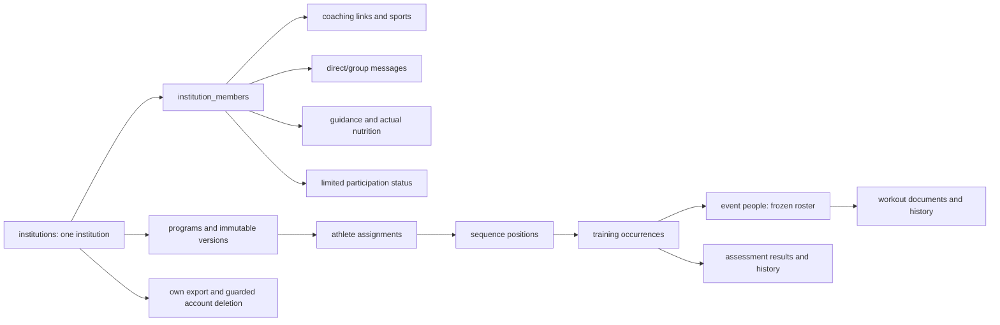

# Backend reference and audit

Reviewed 23 October 2026 for the unreleased beta.3 branch. This is a schema/source audit with focused runtime verification, not production-data, penetration, browser or Android acceptance. The published version remains beta.2.

## Start here

- [Schema and field catalog](schema.md): all 57 physical tables and 471 columns, reviewed purposes, native types/defaults/nullability, incoming relationships, SQL constraints/indexes/policies/triggers and source modules.
- [Routes and data dependencies](routes.md): 67 reviewed route records (some support multiple methods), authority, app/workflow, handlers, conservative transitive table touches, explicit profile/support/account operations and retired-route boundaries. This is broader than the field OpenAPI subset.
- [Reusable audit prompt](audit-prompt.md): scope, removal criteria and verification procedure for future contributors.
- [Canonical API contract](../../../apps/backend/openapi.json) and [API guide](../api.md): supported wire shapes and actual implemented behavior.

## Institutional data map



The [schema catalog](schema.md) gives every physical foreign key, including cross-domain links omitted from this overview. `institution_id` remains a durable institution boundary; it does not imply a chooser or multiple current institutions.

## Findings and changes

| Finding                                                                                                                     | Action and reason                                                                                                                                                                                                                                                             |
| --------------------------------------------------------------------------------------------------------------------------- | ----------------------------------------------------------------------------------------------------------------------------------------------------------------------------------------------------------------------------------------------------------------------------- |
| Four standalone read routes outlived their web UI.                                                                          | Removed coach recipients/analytics, standalone conversation reads and upcoming personal appointments, plus exclusive handlers and the independent-practice gate. No maintained web/Android runtime caller remains. Old frontend test references are separately flagged below. |
| HTTP operations were discovered entirely from SQL grants.                                                                   | The initial audit narrowed explicit allowlists; the retirement follow-up now removes both gateways in favor of named account/support services. SQL/RLS remain independent boundaries.                                                                                         |
| Provider simulation has no institutional purpose or historical record value.                                                | Forward migration removes `runtime_settings` and its two flag fields plus `simulate_business_event`/`apply_business_event`. The retirement follow-up removes commercial account/event storage as explicitly approved by the founder.                                          |
| Internal feature files still carried unnecessary organization prefixes.                                                     | Renamed ten modules to plain domains (calendar, assets, communication, feedback, follow-up, injuries, injury-retention, nutrition, sports and service-catalog), updating imports and maintained links. Wire/schema identifiers remain compatible.                             |
| Context responses still advertised old role/organization browser paths.                                                     | Return `/dashboard` while retaining workspace/member IDs and native owner/context identity.                                                                                                                                                                                   |
| Own institutional export omitted workout corrections and the new sequence metadata.                                         | Include subject-scoped workout history, positions and recurrence rules; an administrator's own export does not expose another athlete's records.                                                                                                                              |
| Prisma password-token relationships, native-session metadata and two historical partial-index reverse relations lagged SQL. | Align FK relations, index names/partial predicate and generated-ID default with SQL. Historical bookings/assignments use reverse arrays because uniqueness applies only to active rows. No identity/history rows are rewritten.                                               |
| Two HTTP runners exercised retired standalone bookings/commercial teams.                                                    | Remove those runners/scripts and CI/full-runner entries. Keep focused institutional suites and historical lifecycle SQL under an explicitly historical name. File-recovery coverage now uses current institutional assets.                                                    |

## Retired domains

The founder approved breaking retirement before customer adoption. [ADR 0030](../../decisions/ADR-0030-retire-standalone-storage-and-apis.md) supersedes the earlier historical retention recommendation. The forward migration removes 37 tables: personal coaching/assignments/plans/workouts, business accounts/events, teams, standalone communications/nutrition/resources and old file-store metadata. It removes their exclusive SQL functions and the generic commands/queries/files gateways. Published workspace/context and organization-prefixed aliases and old browser redirects are gone.

`institution_assignments` and all current institution workflows/history remain. Canonical shared exercises are `reference_exercises`; personal exercise copies/ownership are retired. Profile, Support and account export/deletion now use explicit own-account endpoints. Files use current institution assets/program media; existing byte keys remain stable. Old migration sources are immutable upgrade provenance, not runtime compatibility.

## Before beta.3 release

| Priority        | Evidence/status                                                                                                      | Required follow-up                                                                                                                                                                                                                 |
| --------------- | -------------------------------------------------------------------------------------------------------------------- | ---------------------------------------------------------------------------------------------------------------------------------------------------------------------------------------------------------------------------------- |
| P1              | Accepted beta.3 scope, not implemented by this audit                                                                 | Complete recurring/day-only scheduling, group workout sources/per-participant records, web controls and Android offline workout capture with capability/queue migration. See [beta.3 scope](../../requirements/beta3-sessions.md). |
| P2              | Exclusive standalone browser/SQL journeys and visual runners are removed; current fixtures use institution services. | The focused browser journey and source typecheck do not establish the entire remaining browser suite. Review broader beta.3 acceptance before release.                                                                             |
| P1              | Paired landing PR remains draft and contains the integrated design plus upcoming documentation.                      | Recheck main integration and replace branch references with the release tag during publication.                                                                                                                                    |
| P1              | Existing default-branch dependency alerts were reported by GitHub; no dependency audit was repeated in this cleanup. | Resolve or assess current advisories in the release dependency pass; do not describe them as fixed here.                                                                                                                           |
| P2              | Breaking retirement replaces historical dependencies.                                                                | Verify current account/support and institutional lifecycle against ADR 0030; package the matching Android client.                                                                                                                  |
| P2              | Source finding: institutional own export materializes complete subject arrays.                                       | Design bounded/streamed large-history export before operating at large scale. No large-scale performance claim is made.                                                                                                            |
| Deployment gate | Existing founder direction accepts non-code gates into the first-user backlog.                                       | Per-institution live-data/privacy approval, restore rehearsal and broader device/accessibility evidence stay in that backlog; they are not fabricated beta.1 blockers.                                                             |

## Keeping this reference current

From the repository root:

```bash
npm run backend:inventory
npm run backend:inventory:check
```

These are source-only and do not start an API/database. They require reviewed metadata for every model/route and a catalog matching the migration digest. After changing migrations, with local Docker running:

```bash
npm run backend:inventory:database
```

That command creates a disposable database, applies all migrations, captures schema metadata and generates matching client/transport types; it drops only that database. It never resets/seeds preview data. The raw [catalog receipt](../../verification/receipts/backend-schema-catalog.json) contains schema definitions and grants, not account/athlete rows.

Generated route touches are conservative, including known helper/SQL calls. Dynamic SQL, triggers and cascade lifecycle can have additional effects. Human review is still required when changing authority, names or retained data. Record actual checks and limits in [verification](../../verification/README.md).

## Institution rename follow-up

The founder approved physical naming cleanup after this initial audit. The forward rename covers 38 tables and scope columns across 44 tables; complete rows, nested documents, receipts and grants are preserved. Web and Android source use canonical APIs. Physical APK upgrade and wider beta.3 workflows remain release work; source/queue checks are not device acceptance. See ADR 0029 and verification.

## Breaking retirement follow-up

The populated verifier preserves complete snapshots across 44 current tables and confirms retired tables/functions are absent. The earlier audit recommendations above are historical findings; the current disposition is ADR 0030. Current API/browser/native checks and remaining acceptance are recorded in verification.

The recurring/day-only slice adds no tables: existing events gain explicit timing mode and nullable real bounds, while recurrence rules gain preparation checkpoints/diagnostics. The current rule route and worker call paths are catalogued above; native workout capture remains pending.
