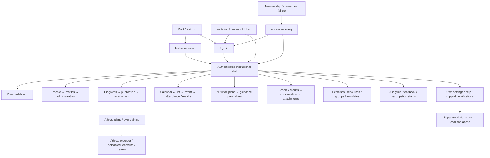

# Web frontend reference and audit

**Source audit: 22 October 2026, unreleased institution-cleanup branch.** This reference covers every local Vue component in `apps/frontend/src`, including routed screens, embedded screens, reusable controls and the application shell. It does not establish rendered acceptance of every screen or a backend security audit.

## Reference

- [Views and access](views.md): every route screen and substantial embedded screen, purpose, folder, role/resource access, incoming/outgoing links and external entry points.
- [Component catalog](components.md): every local Vue file, purpose, direct rendered consumers and transitive consuming views.
- [Routes and navigation](navigation.md): actual route registry, aliases, gates, adjacency tables, Mermaid maps and source expressions behind navigation.
- [Reusable audit prompt](../../development/frontend-audit-prompt.md): the audit instructions and completion standard.

The inventory contains **95 Vue files**, including **47 screen/dispatcher files**, and **45 route records**. A single record may have an alias or several view states. Several records intentionally reuse the same file; these counts are not the number of distinct product features. The route count includes redirects, DEV-only local preview and the not-found handler.

## Product and navigation overview



The diagram groups workflows; role restrictions still apply. Exact per-route edges and token/redirect exceptions are in the navigation reference. Parent screens with several tabs expose different controls by tab, subject and role. Their generated component relationships are the union of those states, not a claim that every control appears at once.

## Runtime ownership

| Source                                                                                                                                                                                    | Responsibility                                                                                                             |
| ----------------------------------------------------------------------------------------------------------------------------------------------------------------------------------------- | -------------------------------------------------------------------------------------------------------------------------- |
| [main.ts](../../../apps/frontend/src/main.ts), [App.vue](../../../apps/frontend/src/App.vue)                                                                                              | Mount Vue, load styles/fonts, initialize theme/session, compose shell and route outlet.                                    |
| [app/router.ts](../../../apps/frontend/src/app/router.ts)                                                                                                                                 | Flat route registry, compatibility redirects, safe internal next paths, membership refresh and scroll restoration.         |
| [app/auth.ts](../../../apps/frontend/src/app/auth.ts), [app/institution.ts](../../../apps/frontend/src/app/institution.ts)                                                                | Current identity, normalized single institution and role context.                                                          |
| [DashboardNav.vue](../../../apps/frontend/src/features/navigation/DashboardNav.vue)                                                                                                       | One institutional navigation implementation, reused for sidebar and phone drawer.                                          |
| [lib/backend.ts](../../../apps/frontend/src/lib/backend.ts)                                                                                                                               | Explicit API transport, error handling and private-media URLs.                                                             |
| [lib/commands.ts](../../../apps/frontend/src/lib/commands.ts), [lib/storage.ts](../../../apps/frontend/src/lib/storage.ts), [lib/training.ts](../../../apps/frontend/src/lib/training.ts) | Exact command state, browser drafts/workout persistence, acknowledgment and retry boundaries.                              |
| [lib/i18n.ts](../../../apps/frontend/src/lib/i18n.ts), [lib/branding.ts](../../../apps/frontend/src/lib/branding.ts)                                                                      | English/Arabic locale and direction, instance palette/logo and theme contrast.                                             |
| [style.css](../../../apps/frontend/src/style.css), [styles/](../../../apps/frontend/src/styles/)                                                                                          | Existing base styles, shell/layout, shared tokens and domain presentation. Visual conventions remain in the design system. |
| [app/updates.ts](../../../apps/frontend/src/app/updates.ts)                                                                                                                               | Whole-shell service-worker update coordination.                                                                            |

The local component catalog includes composed Reka controls, charts and icons through their Rafik wrappers. Vue Router, Reka UI, Phosphor icons, Unovis and SweetAlert2 are dependencies, not extra Rafik views to enumerate or rewrite. Food/exercise content and assets are data/media; their rights and generation remain in [content maintenance](../content-maintenance.md).

## Findings and changes

| Finding                                    | Evidence / impact                                                                                                                                     | Resolution                                                                                                                                                                                                                                                                                  |
| ------------------------------------------ | ----------------------------------------------------------------------------------------------------------------------------------------------------- | ------------------------------------------------------------------------------------------------------------------------------------------------------------------------------------------------------------------------------------------------------------------------------------------- |
| Duplicate navigation implementation        | `SectionNav.vue` repeated per-page navigation while `dashboard.css` hid it inside the actual shell. It maintained a second, differing role/path list. | Removed the component, its imports/tags and the hiding rule. Sidebar and phone drawer reuse DashboardNav.                                                                                                                                                                                   |
| Live link to deleted history               | Own Settings diagnostics linked `/history`, which no longer has a route.                                                                              | Link now opens athlete Training, where own recorded workouts can be reopened for retry.                                                                                                                                                                                                     |
| Legacy analytics destination               | Analytics retained a `/clients` fallback despite requiring the institution context.                                                                   | Removed the fallback; roster link is `/people`.                                                                                                                                                                                                                                             |
| Public guest recorder remnants             | `/workout/:id` had no route gate, and the recorder contained guest account-adoption UI after the sample entry was retired.                            | Added sign-in/membership gates, require the current owner/institution before rendering, removed guest adoption UI and unsupported guest/independent workout creation. Historical local data is not deleted.                                                                                 |
| Retired notification targets               | `notificationTarget()` could return independent `/coach/messages`, `/checkins` and `/appointments` URLs after those screens were removed.             | Suppress independent notification targets and exclude them before inbox pagination; hide retired check-in preference controls while retaining compatible stored preference fields. Preserve stored source history. Institution message, event/result and workout targets remain authorized. |
| Nested routes not always highlighted       | Person profiles and delegated recorder routes were not associated with their owning navigation section.                                               | Normalize profile/alias to People, new delegated recording to Athlete plans and existing delegated recording to Workout history.                                                                                                                                                            |
| Import-only reachability was weak evidence | The earlier graph proved imports, not that a component was actually rendered or that links resolved.                                                  | Inventory now checks Vue template/dynamic component use, routes, intentional entries and known targets; records unresolved/data-driven expressions for review.                                                                                                                              |

The preceding consolidation already removed 20 obsolete/duplicate Vue implementations. This audit checks the resulting tree rather than repeating that deletion as new work. No additional route is classified as an abandoned feature: the remaining non-menu entries have explicit purposes in the registry.

## Intentional reuse and retained boundaries

- `DashboardPage` owns overview, People, Activity and institution settings through route metadata. This is one implementation with distinct sections, not four duplicated files.
- `ServiceCatalog` shares group/template list/editor mechanics while using distinct route modes, data definitions and commands. `ExercisesPage` similarly shares list and dedicated editor routes.
- `TrainingRoute` and `NutritionRoute` are role/subject dispatchers. Their staff indexes and athlete/detail screens serve different tasks and permissions; combining them would restore the forced athlete-first workflow the founder rejected.
- `AthleteProfile` serves athletes, coaches and administrators with role-specific tabs; its historical filename is not evidence of a second profile implementation.
- Injury consent/details, nutrition diary sharing, private conversations, file reads and platform operations have narrower server boundaries than institutional membership. A menu item or a component import grants no authority.
- Account export/deletion, old stored-data cleanup and exact pending-workout synchronization retain compatibility helpers. This audit does not drop their data or rewrite historical migrations. Independent workflow creation is not reintroduced through those helpers.
- First-run setup, invitation/reset tokens, `/access`, privacy aliases, old supported institution bookmarks, local development preview and the not-found handler are intentional entries. They must not be removed merely for lacking a sidebar link.

## Backend trace boundary

Only the backend paths needed to explain access and generated navigation were inspected: [workspaces](../../../apps/backend/server/institution.ts), [people](../../../apps/backend/server/people.ts), [programming](../../../apps/backend/server/programming.ts), [athlete plans](../../../apps/backend/server/athlete-plans.ts), [nutrition index](../../../apps/backend/server/nutrition-plan-index.ts), [calendar](../../../apps/backend/server/calendar.ts), [assets](../../../apps/backend/server/assets.ts), [injuries](../../../apps/backend/server/injuries.ts) and [notifications](../../../apps/backend/server/notifications.ts). No general schema deletion or independent API retirement is implied. Supported Android endpoints and command payloads are unchanged.

## Refresh and review

From the repository root, with the root npm dependencies installed:

```sh
npm run frontend:inventory
npm run frontend:inventory:check
npm run docs:check
```

The first command regenerates the three catalogs. The check verifies source coverage, local imports, actual component consumers, known route entries/targets and generated-file freshness. Successful output reports the exact source counts and no coverage/navigation issues. It uses the actual router declarations with inert factories; it does not start Vue, contact an API or execute router guards.

When adding a file or changing its purpose/access, update [frontend-inventory.json](../../../apps/frontend/scripts/frontend-inventory.json). Review variable/server-generated navigation and conditional route sections in [frontend-navigation.json](../../../apps/frontend/scripts/frontend-navigation.json). The [inventory script](../../../apps/frontend/scripts/frontend-inventory.mjs) extracts mechanical relationships. Keep the semantic descriptions aligned in the same PR. Do not merely add an exception to silence a finding.

## Evidence and limits

The catalogs are exhaustive over checked-in local Vue files and registered route records. Static link inference is deliberately an over-approximation of conditional controls; variable-only and server-generated targets require the documented review entries. Shared-component consumers inherit their parent scope rather than independently granting access. This source audit does not prove every dialog state, keyboard journey, viewport, theme or Arabic rendering. Actual focused checks and any remaining failures are recorded in the [verification summary](../../verification/README.md).
