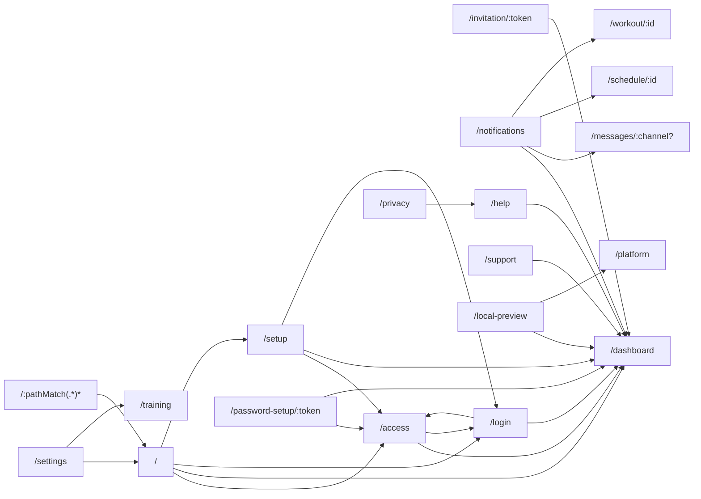
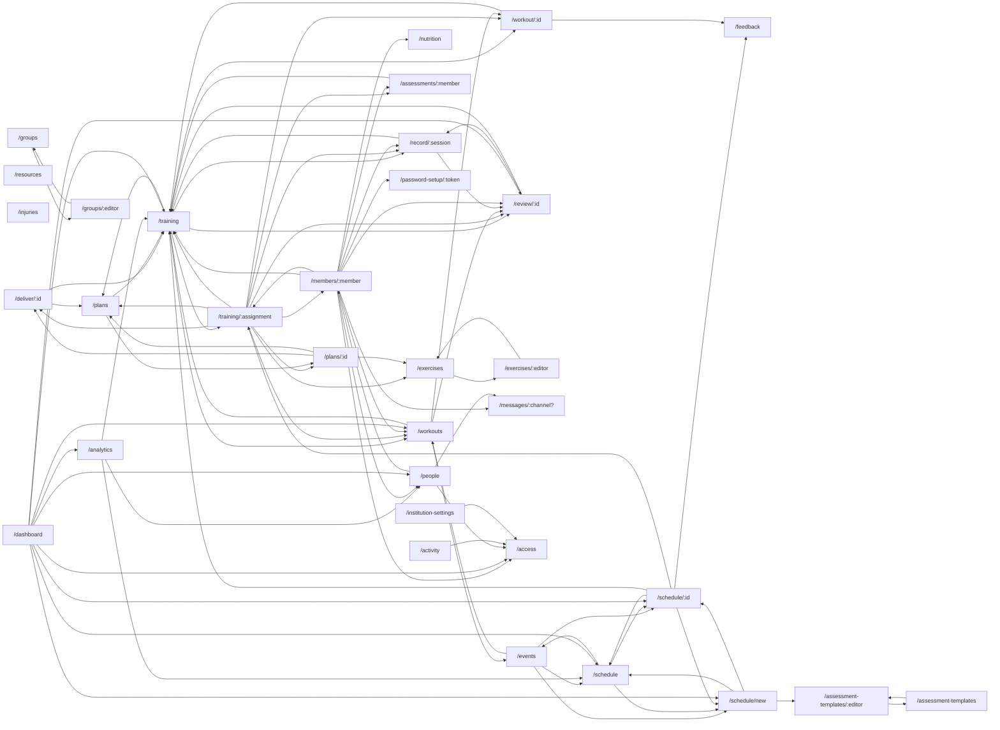

# Frontend routes and navigation map

Generated from maintained source and reviewed descriptions by `npm run frontend:inventory`. Do not edit this generated file; update the two inventory JSON files beside the script. Source audit, not rendered or security acceptance. See [scope and findings](README.md).

## Route registry

The router declaration is evaluated with inert factories to expand mapped sections and development-only routes. No guards or lifecycle callbacks are executed. `private` is sign-in gating; `institution` refreshes current membership; `adminOnly` is an additional router gate. Other role/resource restrictions belong to the view and server, not to these flags.

| Path                                           | Screen / redirect                                                                                                       | Router gates                    | Entry classification                                                |
| ---------------------------------------------- | ----------------------------------------------------------------------------------------------------------------------- | ------------------------------- | ------------------------------------------------------------------- |
| `/platform`                                    | [features/platform/PlatformPage.vue](../../../apps/frontend/src/features/platform/PlatformPage.vue)                     | private                         | In-app navigation.                                                  |
| `/deliver/:id`                                 | [features/coaching/DeliverPlan.vue](../../../apps/frontend/src/features/coaching/DeliverPlan.vue)                       | private, institution            | Published-program action; id is immutable version ID.               |
| `/training`                                    | [features/institution/TrainingRoute.vue](../../../apps/frontend/src/features/institution/TrainingRoute.vue)             | private, institution            | In-app navigation.                                                  |
| `/training/:assignment`                        | [features/institution/AssignedPlanPage.vue](../../../apps/frontend/src/features/institution/AssignedPlanPage.vue)       | private, institution, staff     | In-app navigation.                                                  |
| `/events`                                      | [features/institution/ScheduledEvents.vue](../../../apps/frontend/src/features/institution/ScheduledEvents.vue)         | private, institution            | In-app navigation.                                                  |
| `/workouts`                                    | [features/institution/SessionHistory.vue](../../../apps/frontend/src/features/institution/SessionHistory.vue)           | private, institution            | In-app navigation.                                                  |
| `/review/:id`                                  | [features/coaching/ReviewPage.vue](../../../apps/frontend/src/features/coaching/ReviewPage.vue)                         | private, institution            | In-app navigation.                                                  |
| `/plans`                                       | [features/coaching/PlansPage.vue](../../../apps/frontend/src/features/coaching/PlansPage.vue)                           | private, institution            | In-app navigation.                                                  |
| `/plans/:id`                                   | [features/coaching/PlanEditor.vue](../../../apps/frontend/src/features/coaching/PlanEditor.vue)                         | private, institution            | In-app navigation.                                                  |
| `/feedback`                                    | [features/institution/FeedbackPage.vue](../../../apps/frontend/src/features/institution/FeedbackPage.vue)               | private, institution            | In-app navigation.                                                  |
| `/exercises`                                   | [features/coaching/ExercisesPage.vue](../../../apps/frontend/src/features/coaching/ExercisesPage.vue)                   | private, institution            | In-app navigation.                                                  |
| `/exercises/:editor`                           | [features/coaching/ExercisesPage.vue](../../../apps/frontend/src/features/coaching/ExercisesPage.vue)                   | private, institution            | In-app navigation.                                                  |
| `/resources`                                   | [features/resources/ResourcesPage.vue](../../../apps/frontend/src/features/resources/ResourcesPage.vue)                 | private, institution            | In-app navigation.                                                  |
| `/nutrition`                                   | [features/nutrition/NutritionRoute.vue](../../../apps/frontend/src/features/nutrition/NutritionRoute.vue)               | private, institution            | In-app navigation.                                                  |
| `/injuries`                                    | [features/institution/InjuryStatus.vue](../../../apps/frontend/src/features/institution/InjuryStatus.vue)               | private, institution            | In-app navigation.                                                  |
| `/analytics`                                   | [features/analytics/AnalyticsPage.vue](../../../apps/frontend/src/features/analytics/AnalyticsPage.vue)                 | private, institution            | In-app navigation.                                                  |
| `/messages/:channel?`                          | [features/institution/ChannelsPage.vue](../../../apps/frontend/src/features/institution/ChannelsPage.vue)               | private, institution            | In-app navigation.                                                  |
| `/schedule`                                    | [features/institution/ScheduleCalendar.vue](../../../apps/frontend/src/features/institution/ScheduleCalendar.vue)       | private, institution            | In-app navigation.                                                  |
| `/schedule/new`                                | [features/institution/EventComposer.vue](../../../apps/frontend/src/features/institution/EventComposer.vue)             | private, institution            | In-app navigation.                                                  |
| `/schedule/:id`                                | [features/institution/EventDetail.vue](../../../apps/frontend/src/features/institution/EventDetail.vue)                 | private, institution            | In-app navigation.                                                  |
| `/groups`                                      | [features/institution/ServiceCatalog.vue](../../../apps/frontend/src/features/institution/ServiceCatalog.vue)           | private, institution            | In-app navigation.                                                  |
| `/groups/:editor`                              | [features/institution/ServiceCatalog.vue](../../../apps/frontend/src/features/institution/ServiceCatalog.vue)           | private, institution            | In-app navigation.                                                  |
| `/assessment-templates`                        | [features/institution/ServiceCatalog.vue](../../../apps/frontend/src/features/institution/ServiceCatalog.vue)           | private, institution            | In-app navigation.                                                  |
| `/assessment-templates/:editor`                | [features/institution/ServiceCatalog.vue](../../../apps/frontend/src/features/institution/ServiceCatalog.vue)           | private, institution            | In-app navigation.                                                  |
| `/record/:session`                             | [features/institution/DelegatedWorkout.vue](../../../apps/frontend/src/features/institution/DelegatedWorkout.vue)       | private, institution            | Staff assignment/recording workflow.                                |
| `/members/:member` (alias `/athletes/:member`) | [features/institution/AthleteProfile.vue](../../../apps/frontend/src/features/institution/AthleteProfile.vue)           | private, institution            | People row/profile action; staff authority.                         |
| `/assessments/:member`                         | [features/institution/AssessmentHistory.vue](../../../apps/frontend/src/features/institution/AssessmentHistory.vue)     | private, institution            | In-app navigation.                                                  |
| `/dashboard`                                   | [features/institution/DashboardPage.vue](../../../apps/frontend/src/features/institution/DashboardPage.vue)             | private, institution            | In-app navigation.                                                  |
| `/people`                                      | [features/institution/DashboardPage.vue](../../../apps/frontend/src/features/institution/DashboardPage.vue)             | private, institution            | In-app navigation.                                                  |
| `/activity`                                    | [features/institution/DashboardPage.vue](../../../apps/frontend/src/features/institution/DashboardPage.vue)             | private, institution, adminOnly | In-app navigation.                                                  |
| `/institution-settings`                        | [features/institution/DashboardPage.vue](../../../apps/frontend/src/features/institution/DashboardPage.vue)             | private, institution, adminOnly | In-app navigation.                                                  |
| `/access`                                      | [features/account/AccessPage.vue](../../../apps/frontend/src/features/account/AccessPage.vue)                           | private                         | Guard/recovery entry.                                               |
| `/invitation/:token`                           | [features/institution/InvitationPage.vue](../../../apps/frontend/src/features/institution/InvitationPage.vue)           | Public                          | Canonical external invitation token; intentionally absent from nav. |
| `/`                                            | [features/account/EntryPage.vue](../../../apps/frontend/src/features/account/EntryPage.vue)                             | Public                          | External/root dispatch.                                             |
| `/setup`                                       | [features/account/SetupPage.vue](../../../apps/frontend/src/features/account/SetupPage.vue)                             | Public                          | One-time first-run setup.                                           |
| `/password-setup/:token`                       | [features/account/PasswordSetupPage.vue](../../../apps/frontend/src/features/account/PasswordSetupPage.vue)             | Public                          | External reset/setup token; intentionally absent from nav.          |
| `/notifications`                               | [features/notifications/NotificationsPage.vue](../../../apps/frontend/src/features/notifications/NotificationsPage.vue) | private                         | In-app navigation.                                                  |
| `/workout/:id`                                 | [features/training/WorkoutPage.vue](../../../apps/frontend/src/features/training/WorkoutPage.vue)                       | private, institution            | From athlete plan/history or authorized workout notification.       |
| `/login`                                       | [features/account/LoginPage.vue](../../../apps/frontend/src/features/account/LoginPage.vue)                             | Public                          | In-app navigation.                                                  |
| `/settings`                                    | [features/account/SettingsPage.vue](../../../apps/frontend/src/features/account/SettingsPage.vue)                       | private                         | In-app navigation.                                                  |
| `/support`                                     | [features/support/SupportPage.vue](../../../apps/frontend/src/features/support/SupportPage.vue)                         | private                         | In-app navigation.                                                  |
| `/local-preview`                               | [features/account/LocalPreview.vue](../../../apps/frontend/src/features/account/LocalPreview.vue)                       | Public                          | Development only; local-preview backend must also be enabled.       |
| `/help`                                        | [features/account/HelpPage.vue](../../../apps/frontend/src/features/account/HelpPage.vue)                               | Public                          | In-app navigation.                                                  |
| `/privacy`                                     | [features/public/PrivacyPage.vue](../../../apps/frontend/src/features/public/PrivacyPage.vue)                           | Public                          | In-app navigation.                                                  |
| `/:pathMatch(.*)*`                             | [features/public/NotFound.vue](../../../apps/frontend/src/features/public/NotFound.vue)                                 | Public                          | Fallback; intentionally not linked.                                 |

## Complete route adjacency

Each row includes links in embedded components; shell navigation is listed separately to keep workflow edges readable. An inferred source-path edge means the source contains that destination; it does not prove the control is visible to every role. Query-only navigation stays on the same view. Conditional values and server-generated targets were reviewed and are recorded in the dynamic section.

| From                            | Opens                                                                                                                                                                                                  | Incoming views                                                                                                                                                                                                          |
| ------------------------------- | ------------------------------------------------------------------------------------------------------------------------------------------------------------------------------------------------------ | ----------------------------------------------------------------------------------------------------------------------------------------------------------------------------------------------------------------------- |
| `/platform`                     | None; see entry/dynamic rules.                                                                                                                                                                         | `/local-preview`                                                                                                                                                                                                        |
| `/deliver/:id`                  | `/plans`, `/training`                                                                                                                                                                                  | `/plans/:id`, `/training/:assignment`                                                                                                                                                                                   |
| `/training`                     | `/plans`, `/record/:session`, `/review/:id`, `/training`, `/training/:assignment`, `/workout/:id`, `/workouts`                                                                                         | `/analytics`, `/assessments/:member`, `/dashboard`, `/deliver/:id`, `/members/:member`, `/plans`, `/record/:session`, `/review/:id`, `/schedule/:id`, `/settings`, `/training/:assignment`, `/workout/:id`, `/workouts` |
| `/training/:assignment`         | `/assessments/:member`, `/deliver/:id`, `/exercises`, `/members/:member`, `/plans`, `/plans/:id`, `/record/:session`, `/review/:id`, `/training`, `/training/:assignment`, `/workout/:id`, `/workouts` | `/members/:member`, `/schedule/:id`, `/training`                                                                                                                                                                        |
| `/events`                       | `/events`, `/schedule`, `/schedule/:id`, `/schedule/new`, `/workouts`                                                                                                                                  | `/schedule`, `/workouts`                                                                                                                                                                                                |
| `/workouts`                     | `/events`, `/review/:id`, `/training`, `/workout/:id`                                                                                                                                                  | `/dashboard`, `/events`, `/members/:member`, `/training`, `/training/:assignment`                                                                                                                                       |
| `/review/:id`                   | `/record/:session`, `/training`                                                                                                                                                                        | `/dashboard`, `/members/:member`, `/record/:session`, `/training`, `/training/:assignment`, `/workouts`                                                                                                                 |
| `/plans`                        | `/plans/:id`, `/training`                                                                                                                                                                              | `/deliver/:id`, `/plans/:id`, `/training`, `/training/:assignment`                                                                                                                                                      |
| `/plans/:id`                    | `/deliver/:id`, `/exercises`, `/plans`, `/plans/:id`                                                                                                                                                   | `/plans`, `/training/:assignment`                                                                                                                                                                                       |
| `/feedback`                     | None; see entry/dynamic rules.                                                                                                                                                                         | `/schedule/:id`, `/workout/:id`                                                                                                                                                                                         |
| `/exercises`                    | `/exercises`, `/exercises/:editor`                                                                                                                                                                     | `/exercises/:editor`, `/plans/:id`, `/training/:assignment`                                                                                                                                                             |
| `/exercises/:editor`            | `/exercises`, `/exercises/:editor`                                                                                                                                                                     | `/exercises`                                                                                                                                                                                                            |
| `/resources`                    | None; see entry/dynamic rules.                                                                                                                                                                         | None; see entry/dynamic rules.                                                                                                                                                                                          |
| `/nutrition`                    | `/nutrition`                                                                                                                                                                                           | `/members/:member`                                                                                                                                                                                                      |
| `/injuries`                     | None; see entry/dynamic rules.                                                                                                                                                                         | None; see entry/dynamic rules.                                                                                                                                                                                          |
| `/analytics`                    | `/people`, `/schedule`, `/training`                                                                                                                                                                    | `/dashboard`                                                                                                                                                                                                            |
| `/messages/:channel?`           | `/messages/:channel?`                                                                                                                                                                                  | `/members/:member`, `/notifications`, `/people`                                                                                                                                                                         |
| `/schedule`                     | `/events`, `/schedule`, `/schedule/:id`, `/schedule/new`                                                                                                                                               | `/analytics`, `/dashboard`, `/events`, `/schedule/:id`, `/schedule/new`                                                                                                                                                 |
| `/schedule/new`                 | `/assessment-templates/:editor`, `/schedule`, `/schedule/:id`                                                                                                                                          | `/dashboard`, `/events`, `/schedule`, `/schedule/:id`                                                                                                                                                                   |
| `/schedule/:id`                 | `/feedback`, `/schedule`, `/schedule/new`, `/training`, `/training/:assignment`                                                                                                                        | `/dashboard`, `/events`, `/notifications`, `/schedule`, `/schedule/new`                                                                                                                                                 |
| `/groups`                       | `/groups`, `/groups/:editor`                                                                                                                                                                           | `/groups/:editor`                                                                                                                                                                                                       |
| `/groups/:editor`               | `/groups`, `/groups/:editor`                                                                                                                                                                           | `/groups`                                                                                                                                                                                                               |
| `/assessment-templates`         | `/assessment-templates`, `/assessment-templates/:editor`                                                                                                                                               | `/assessment-templates/:editor`                                                                                                                                                                                         |
| `/assessment-templates/:editor` | `/assessment-templates`, `/assessment-templates/:editor`                                                                                                                                               | `/assessment-templates`, `/schedule/new`                                                                                                                                                                                |
| `/record/:session`              | `/record/:session`, `/review/:id`, `/training`                                                                                                                                                         | `/members/:member`, `/review/:id`, `/training`, `/training/:assignment`                                                                                                                                                 |
| `/members/:member`              | `/access`, `/assessments/:member`, `/messages/:channel?`, `/nutrition`, `/password-setup/:token`, `/people`, `/record/:session`, `/review/:id`, `/training`, `/training/:assignment`, `/workouts`      | `/people`, `/training/:assignment`                                                                                                                                                                                      |
| `/assessments/:member`          | `/training`                                                                                                                                                                                            | `/members/:member`, `/training/:assignment`                                                                                                                                                                             |
| `/dashboard`                    | `/access`, `/analytics`, `/people`, `/review/:id`, `/schedule`, `/schedule/:id`, `/schedule/new`, `/training`, `/workouts`                                                                             | `/`, `/access`, `/help`, `/invitation/:token`, `/local-preview`, `/login`, `/notifications`, `/password-setup/:token`, `/setup`, `/support`                                                                             |
| `/people`                       | `/access`, `/members/:member`, `/messages/:channel?`                                                                                                                                                   | `/analytics`, `/dashboard`, `/members/:member`                                                                                                                                                                          |
| `/activity`                     | `/access`                                                                                                                                                                                              | None; see entry/dynamic rules.                                                                                                                                                                                          |
| `/institution-settings`         | `/access`                                                                                                                                                                                              | None; see entry/dynamic rules.                                                                                                                                                                                          |
| `/access`                       | `/dashboard`, `/login`                                                                                                                                                                                 | `/`, `/activity`, `/dashboard`, `/institution-settings`, `/login`, `/members/:member`, `/password-setup/:token`, `/people`, `/setup`                                                                                    |
| `/invitation/:token`            | `/dashboard`                                                                                                                                                                                           | None; see entry/dynamic rules.                                                                                                                                                                                          |
| `/`                             | `/access`, `/dashboard`, `/login`, `/setup`                                                                                                                                                            | `/:pathMatch(.*)*`, `/settings`                                                                                                                                                                                         |
| `/setup`                        | `/access`, `/dashboard`, `/login`                                                                                                                                                                      | `/`                                                                                                                                                                                                                     |
| `/password-setup/:token`        | `/access`, `/dashboard`                                                                                                                                                                                | `/members/:member`                                                                                                                                                                                                      |
| `/notifications`                | `/dashboard`, `/messages/:channel?`, `/schedule/:id`, `/workout/:id`                                                                                                                                   | None; see entry/dynamic rules.                                                                                                                                                                                          |
| `/workout/:id`                  | `/feedback`, `/training`                                                                                                                                                                               | `/notifications`, `/training`, `/training/:assignment`, `/workouts`                                                                                                                                                     |
| `/login`                        | `/access`, `/dashboard`                                                                                                                                                                                | `/`, `/access`, `/setup`                                                                                                                                                                                                |
| `/settings`                     | `/`, `/training`                                                                                                                                                                                       | None; see entry/dynamic rules.                                                                                                                                                                                          |
| `/support`                      | `/dashboard`                                                                                                                                                                                           | None; see entry/dynamic rules.                                                                                                                                                                                          |
| `/local-preview`                | `/dashboard`, `/platform`                                                                                                                                                                              | None; see entry/dynamic rules.                                                                                                                                                                                          |
| `/help`                         | `/dashboard`                                                                                                                                                                                           | `/privacy`                                                                                                                                                                                                              |
| `/privacy`                      | `/help`                                                                                                                                                                                                | None; see entry/dynamic rules.                                                                                                                                                                                          |
| `/:pathMatch(.*)*`              | `/`                                                                                                                                                                                                    | None; see entry/dynamic rules.                                                                                                                                                                                          |

## Shell navigation

| Component                                                                                               | Destinations                                                                                                                                                                                                                                                                                                                                                              |
| ------------------------------------------------------------------------------------------------------- | ------------------------------------------------------------------------------------------------------------------------------------------------------------------------------------------------------------------------------------------------------------------------------------------------------------------------------------------------------------------------- |
| [App.vue](../../../apps/frontend/src/App.vue)                                                           | `/`, `/activity`, `/analytics`, `/assessment-templates`, `/dashboard`, `/exercises`, `/feedback`, `/groups`, `/help`, `/injuries`, `/institution-settings`, `/local-preview`, `/login`, `/messages/:channel?`, `/notifications`, `/nutrition`, `/people`, `/plans`, `/platform`, `/privacy`, `/resources`, `/schedule`, `/settings`, `/support`, `/training`, `/workouts` |
| [features/navigation/DashboardNav.vue](../../../apps/frontend/src/features/navigation/DashboardNav.vue) | `/activity`, `/analytics`, `/assessment-templates`, `/dashboard`, `/exercises`, `/feedback`, `/groups`, `/injuries`, `/institution-settings`, `/messages/:channel?`, `/nutrition`, `/people`, `/plans`, `/resources`, `/schedule`, `/training`, `/workouts`                                                                                                               |

## Workflow maps

All registered screen routes are nodes below. Redirects and token/dev/error entries are classified separately in the registry; they need not appear in a sidebar. These are source-derived navigation maps, not a temporal requirement to visit each page.

### Entry and utilities

### Institution workflows

## Reviewed dynamic and external entries

- [features/navigation/DashboardNav.vue](../../../apps/frontend/src/features/navigation/DashboardNav.vue): Role-specific item arrays drive base + item[0]. Athlete, coach and administrator arrays differ; hidden items are not permissions. Targets: `/activity`, `/analytics`, `/assessment-templates`, `/dashboard`, `/exercises`, `/feedback`, `/groups`, `/injuries`, `/institution-settings`, `/messages/:channel?`, `/nutrition`, `/people`, `/plans`, `/resources`, `/schedule`, `/training`, `/workouts`.
- [features/account/EntryPage.vue](../../../apps/frontend/src/features/account/EntryPage.vue): Current context path comes from auth normalization; empty public instance opens setup, initialized instance sign-in. Targets: `/access`, `/dashboard`, `/login`, `/setup`.
- [features/account/LoginPage.vue](../../../apps/frontend/src/features/account/LoginPage.vue): safeNext accepts internal next paths; otherwise normalized context opens dashboard/access. This does not grant arbitrary target authority. Targets: `/access`, `/dashboard`.
- [features/account/SetupPage.vue](../../../apps/frontend/src/features/account/SetupPage.vue): Successful setup opens normalized administrator context; initialized setup redirects to sign-in. Targets: `/access`, `/dashboard`, `/login`.
- [features/account/PasswordSetupPage.vue](../../../apps/frontend/src/features/account/PasswordSetupPage.vue): After token acknowledgement the normalized context path decides the destination. Targets: `/access`, `/dashboard`.
- [features/coaching/ExercisesPage.vue](../../../apps/frontend/src/features/coaching/ExercisesPage.vue): listPath plus new, exercise ID or recovered draft ID drives dedicated editor navigation. Targets: `/exercises`, `/exercises/:editor`.
- [features/institution/ServiceCatalog.vue](../../../apps/frontend/src/features/institution/ServiceCatalog.vue): listPath depends on group/template route; new, existing and resumed editor IDs stay in the same catalog kind. Template creation may return via account/institution/event-scoped BroadcastChannel. Targets: `/assessment-templates`, `/assessment-templates/:editor`, `/groups`, `/groups/:editor`.
- [features/institution/AssessmentHistory.vue](../../../apps/frontend/src/features/institution/AssessmentHistory.vue): Back link preserves athlete member query. Result rows and chart points display values without opening event details. Targets: `/training`.
- [features/institution/AthleteProfile.vue](../../../apps/frontend/src/features/institution/AthleteProfile.vue): Authorized profile sections provide subject-scoped detail/action links; backPath only accepts the People route with its query. Targets: `/assessments/:member`, `/messages/:channel?`, `/nutrition`, `/people`, `/record/:session`, `/review/:id`, `/training`, `/workouts`.
- [features/institution/SessionHistory.vue](../../../apps/frontend/src/features/institution/SessionHistory.vue): Athlete rows open own recorder; staff rows open coach review. Query-only search/page changes stay on this route. Targets: `/review/:id`, `/workout/:id`.
- [features/notifications/NotificationsPage.vue](../../../apps/frontend/src/features/notifications/NotificationsPage.vue): item.href comes from notificationTarget after recipient/source authorization in server/notifications.ts. Retired independent sources are suppressed. Targets: `/messages/:channel?`, `/schedule/:id`, `/workout/:id`.
- [features/analytics/MetricChart.vue](../../../apps/frontend/src/features/analytics/MetricChart.vue): href is supplied by the caller. AnalyticsPage supplies People/Training links and TrainerDelivery supplies Schedule; AssessmentHistory supplies no chart links. Edges belong to the caller, not every chart consumer. Targets: None; see entry/dynamic rules..
- [App.vue](../../../apps/frontend/src/App.vue): Brand destination is normalized auth context; utility links and operator/development items are conditional. All route screens inherit shell utilities. Targets: `/`, `/dashboard`, `/help`, `/local-preview`, `/login`, `/notifications`, `/platform`, `/privacy`, `/settings`, `/support`.
- [features/coaching/ReviewPage.vue](../../../apps/frontend/src/features/coaching/ReviewPage.vue): back object carries Training path and the current view/search query. Targets: `/training`.
- [features/institution/ChannelsPage.vue](../../../apps/frontend/src/features/institution/ChannelsPage.vue): base is the canonical Messages route. Directory clicks and acknowledged conversation creation append the authorized channel ID. Targets: `/messages/:channel?`.
- [features/institution/ChannelThread.vue](../../../apps/frontend/src/features/institution/ChannelThread.vue): base returns to the conversation list; no standalone message-thread route exists. Targets: `/messages/:channel?`.
- [features/institution/DelegatedWorkout.vue](../../../apps/frontend/src/features/institution/DelegatedWorkout.vue): Acknowledged start replaces new with the durable session ID using the current empty institution URL base. Targets: `/record/:session`.
- [features/training/WorkoutPage.vue](../../../apps/frontend/src/features/training/WorkoutPage.vue): returnPath is the own Training view after completion or back navigation. Targets: `/training`.
- [features/analytics/TrainerDelivery.vue](../../../apps/frontend/src/features/analytics/TrainerDelivery.vue): Chart items receive the current institution Schedule path as href. Targets: `/schedule`.
- [features/institution/MemberManagement.vue](../../../apps/frontend/src/features/institution/MemberManagement.vue): An acknowledged admin reset issues an out-of-band password setup URL, not an automatic navigation. Account fields and token validation remain server-owned. Targets: `/password-setup/:token`.

## Source link evidence

These expressions are recorded rather than guessed when variable-only. A reviewed dynamic entry can account for several expressions. External URLs, byte URLs, hash anchors and API calls are not application routes.

| Source                                                                                                                      | Kind                  | Expression                                                                                                                                                                                                                                                                                                                                                                                       | Matched route shapes                                                                                                                                                                                                                                        |
| --------------------------------------------------------------------------------------------------------------------------- | --------------------- | ------------------------------------------------------------------------------------------------------------------------------------------------------------------------------------------------------------------------------------------------------------------------------------------------------------------------------------------------------------------------------------------------ | ----------------------------------------------------------------------------------------------------------------------------------------------------------------------------------------------------------------------------------------------------------- |
| [App.vue](../../../apps/frontend/src/App.vue):82                                                                            | anchor                | `"#main"`                                                                                                                                                                                                                                                                                                                                                                                        | None; see entry/dynamic rules.                                                                                                                                                                                                                              |
| [App.vue](../../../apps/frontend/src/App.vue):113                                                                           | RouterLink            | `"/platform"`                                                                                                                                                                                                                                                                                                                                                                                    | `/platform`                                                                                                                                                                                                                                                 |
| [App.vue](../../../apps/frontend/src/App.vue):116                                                                           | RouterLink            | `"/help"`                                                                                                                                                                                                                                                                                                                                                                                        | `/help`                                                                                                                                                                                                                                                     |
| [App.vue](../../../apps/frontend/src/App.vue):117                                                                           | RouterLink            | `"/settings"`                                                                                                                                                                                                                                                                                                                                                                                    | `/settings`                                                                                                                                                                                                                                                 |
| [App.vue](../../../apps/frontend/src/App.vue):118                                                                           | RouterLink            | `"/local-preview"`                                                                                                                                                                                                                                                                                                                                                                               | `/local-preview`                                                                                                                                                                                                                                            |
| [App.vue](../../../apps/frontend/src/App.vue):121                                                                           | RouterLink            | `"/privacy"`                                                                                                                                                                                                                                                                                                                                                                                     | `/privacy`                                                                                                                                                                                                                                                  |
| [App.vue](../../../apps/frontend/src/App.vue):136                                                                           | RouterLink            | `user ? currentContext?.path \|\| '/dashboard' : '/'`                                                                                                                                                                                                                                                                                                                                            | `/dashboard`                                                                                                                                                                                                                                                |
| [App.vue](../../../apps/frontend/src/App.vue):162                                                                           | RouterLink            | `"/notifications"`                                                                                                                                                                                                                                                                                                                                                                               | `/notifications`                                                                                                                                                                                                                                            |
| [App.vue](../../../apps/frontend/src/App.vue):168                                                                           | RouterLink            | `"/settings"`                                                                                                                                                                                                                                                                                                                                                                                    | `/settings`                                                                                                                                                                                                                                                 |
| [App.vue](../../../apps/frontend/src/App.vue):177                                                                           | RouterLink            | `"/login"`                                                                                                                                                                                                                                                                                                                                                                                       | `/login`                                                                                                                                                                                                                                                    |
| [App.vue](../../../apps/frontend/src/App.vue):190                                                                           | RouterLink            | `"/platform"`                                                                                                                                                                                                                                                                                                                                                                                    | `/platform`                                                                                                                                                                                                                                                 |
| [App.vue](../../../apps/frontend/src/App.vue):193                                                                           | RouterLink            | `"/support"`                                                                                                                                                                                                                                                                                                                                                                                     | `/support`                                                                                                                                                                                                                                                  |
| [App.vue](../../../apps/frontend/src/App.vue):194                                                                           | RouterLink            | `"/help"`                                                                                                                                                                                                                                                                                                                                                                                        | `/help`                                                                                                                                                                                                                                                     |
| [App.vue](../../../apps/frontend/src/App.vue):195                                                                           | RouterLink            | `"/settings"`                                                                                                                                                                                                                                                                                                                                                                                    | `/settings`                                                                                                                                                                                                                                                 |
| [App.vue](../../../apps/frontend/src/App.vue):196                                                                           | RouterLink            | `"/local-preview"`                                                                                                                                                                                                                                                                                                                                                                               | `/local-preview`                                                                                                                                                                                                                                            |
| [App.vue](../../../apps/frontend/src/App.vue):197                                                                           | RouterLink            | `"/privacy"`                                                                                                                                                                                                                                                                                                                                                                                     | `/privacy`                                                                                                                                                                                                                                                  |
| [App.vue](../../../apps/frontend/src/App.vue):227                                                                           | RouterLink            | `"/help"`                                                                                                                                                                                                                                                                                                                                                                                        | `/help`                                                                                                                                                                                                                                                     |
| [App.vue](../../../apps/frontend/src/App.vue):228                                                                           | RouterLink            | `"/privacy"`                                                                                                                                                                                                                                                                                                                                                                                     | `/privacy`                                                                                                                                                                                                                                                  |
| [App.vue](../../../apps/frontend/src/App.vue):229                                                                           | RouterLink            | `"/local-preview"`                                                                                                                                                                                                                                                                                                                                                                               | `/local-preview`                                                                                                                                                                                                                                            |
| [components/ExerciseDemo.vue](../../../apps/frontend/src/components/ExerciseDemo.vue):76                                    | anchor                | `"https://github.com/bryllim/workout-guide"`                                                                                                                                                                                                                                                                                                                                                     | None; see entry/dynamic rules.                                                                                                                                                                                                                              |
| [components/ExerciseDemo.vue](../../../apps/frontend/src/components/ExerciseDemo.vue):79                                    | anchor                | `media.licenseUrl`                                                                                                                                                                                                                                                                                                                                                                               | None; see entry/dynamic rules.                                                                                                                                                                                                                              |
| [components/ExerciseDemo.vue](../../../apps/frontend/src/components/ExerciseDemo.vue):84                                    | anchor                | `exercise.media_url`                                                                                                                                                                                                                                                                                                                                                                             | None; see entry/dynamic rules.                                                                                                                                                                                                                              |
| [components/ExerciseDemo.vue](../../../apps/frontend/src/components/ExerciseDemo.vue):100                                   | anchor                | `credit.sourceUrl`                                                                                                                                                                                                                                                                                                                                                                               | None; see entry/dynamic rules.                                                                                                                                                                                                                              |
| [components/ExerciseDemo.vue](../../../apps/frontend/src/components/ExerciseDemo.vue):103                                   | anchor                | `credit.licenseUrl`                                                                                                                                                                                                                                                                                                                                                                              | None; see entry/dynamic rules.                                                                                                                                                                                                                              |
| [components/ExerciseDemo.vue](../../../apps/frontend/src/components/ExerciseDemo.vue):109                                   | anchor                | `"https://github.com/hasaneyldrm/exercises-dataset/tree/7455efae41b330c265e7cd4b78dfa848e7ce5ebd"`                                                                                                                                                                                                                                                                                               | None; see entry/dynamic rules.                                                                                                                                                                                                                              |
| [components/ExerciseVideo.vue](../../../apps/frontend/src/components/ExerciseVideo.vue):160                                 | anchor                | `item.source.apiRecordUrl`                                                                                                                                                                                                                                                                                                                                                                       | None; see entry/dynamic rules.                                                                                                                                                                                                                              |
| [components/ExerciseVideo.vue](../../../apps/frontend/src/components/ExerciseVideo.vue):163                                 | anchor                | `item.licenseUrl`                                                                                                                                                                                                                                                                                                                                                                                | None; see entry/dynamic rules.                                                                                                                                                                                                                              |
| [components/ExerciseVideo.vue](../../../apps/frontend/src/components/ExerciseVideo.vue):171                                 | anchor                | `exerciseAssetUrl(item.video.path)`                                                                                                                                                                                                                                                                                                                                                              | None; see entry/dynamic rules.                                                                                                                                                                                                                              |
| [components/ResourceAsset.vue](../../../apps/frontend/src/components/ResourceAsset.vue):64                                  | anchor                | `source`                                                                                                                                                                                                                                                                                                                                                                                         | None; see entry/dynamic rules.                                                                                                                                                                                                                              |
| [components/ScheduleViewSwitch.vue](../../../apps/frontend/src/components/ScheduleViewSwitch.vue):11                        | RouterLink            | `{ path: base + (view === 'calendar' ? '/events' : '/schedule'), query: route.query }`                                                                                                                                                                                                                                                                                                           | `/events`, `/schedule`                                                                                                                                                                                                                                      |
| [features/account/AccessPage.vue](../../../apps/frontend/src/features/account/AccessPage.vue):15                            | router.replace        | `'/dashboard'`                                                                                                                                                                                                                                                                                                                                                                                   | `/dashboard`                                                                                                                                                                                                                                                |
| [features/account/AccessPage.vue](../../../apps/frontend/src/features/account/AccessPage.vue):24                            | router.replace        | `'/login'`                                                                                                                                                                                                                                                                                                                                                                                       | `/login`                                                                                                                                                                                                                                                    |
| [features/account/EntryPage.vue](../../../apps/frontend/src/features/account/EntryPage.vue):17                              | router.replace        | `contexts.value[0]?.path \|\| '/access'`                                                                                                                                                                                                                                                                                                                                                         | `/access`                                                                                                                                                                                                                                                   |
| [features/account/EntryPage.vue](../../../apps/frontend/src/features/account/EntryPage.vue):21                              | router.replace        | `status.initialized ? '/login' : '/setup'`                                                                                                                                                                                                                                                                                                                                                       | `/login`, `/setup`                                                                                                                                                                                                                                          |
| [features/account/HelpPage.vue](../../../apps/frontend/src/features/account/HelpPage.vue):68                                | RouterLink            | `"/dashboard"`                                                                                                                                                                                                                                                                                                                                                                                   | `/dashboard`                                                                                                                                                                                                                                                |
| [features/account/HelpPage.vue](../../../apps/frontend/src/features/account/HelpPage.vue):215                               | anchor                | `"/exercise-media/CREDITS.txt"`                                                                                                                                                                                                                                                                                                                                                                  | None; see entry/dynamic rules.                                                                                                                                                                                                                              |
| [features/account/LocalPreview.vue](../../../apps/frontend/src/features/account/LocalPreview.vue):18                        | router.push           | `role === 'operator' ? '/platform' : '/dashboard'`                                                                                                                                                                                                                                                                                                                                               | `/dashboard`, `/platform`                                                                                                                                                                                                                                   |
| [features/account/LoginPage.vue](../../../apps/frontend/src/features/account/LoginPage.vue):23                              | router.replace        | `route.query.next ? next.value : contexts.value[0]?.path \|\| next.value`                                                                                                                                                                                                                                                                                                                        | None; see entry/dynamic rules.                                                                                                                                                                                                                              |
| [features/account/PasswordSetupPage.vue](../../../apps/frontend/src/features/account/PasswordSetupPage.vue):32              | router.replace        | `contexts.value[0]?.path \|\| '/access'`                                                                                                                                                                                                                                                                                                                                                         | `/access`                                                                                                                                                                                                                                                   |
| [features/account/SettingsPage.vue](../../../apps/frontend/src/features/account/SettingsPage.vue):194                       | RouterLink            | `"/training"`                                                                                                                                                                                                                                                                                                                                                                                    | `/training`                                                                                                                                                                                                                                                 |
| [features/account/SettingsPage.vue](../../../apps/frontend/src/features/account/SettingsPage.vue):79                        | router.replace        | `'/'`                                                                                                                                                                                                                                                                                                                                                                                            | `/`                                                                                                                                                                                                                                                         |
| [features/account/SettingsPage.vue](../../../apps/frontend/src/features/account/SettingsPage.vue):97                        | router.replace        | `'/'`                                                                                                                                                                                                                                                                                                                                                                                            | `/`                                                                                                                                                                                                                                                         |
| [features/account/SetupPage.vue](../../../apps/frontend/src/features/account/SetupPage.vue):180                             | RouterLink            | `"/login"`                                                                                                                                                                                                                                                                                                                                                                                       | `/login`                                                                                                                                                                                                                                                    |
| [features/account/SetupPage.vue](../../../apps/frontend/src/features/account/SetupPage.vue):25                              | router.replace        | `'/login'`                                                                                                                                                                                                                                                                                                                                                                                       | `/login`                                                                                                                                                                                                                                                    |
| [features/account/SetupPage.vue](../../../apps/frontend/src/features/account/SetupPage.vue):57                              | router.replace        | `admin?.path \|\| '/access'`                                                                                                                                                                                                                                                                                                                                                                     | `/access`                                                                                                                                                                                                                                                   |
| [features/analytics/AnalyticsPage.vue](../../../apps/frontend/src/features/analytics/AnalyticsPage.vue):235                 | RouterLink            | `base + '/people'`                                                                                                                                                                                                                                                                                                                                                                               | `/people`                                                                                                                                                                                                                                                   |
| [features/analytics/AnalyticsPage.vue](../../../apps/frontend/src/features/analytics/AnalyticsPage.vue):240                 | RouterLink            | `base + '/training'`                                                                                                                                                                                                                                                                                                                                                                             | `/training`                                                                                                                                                                                                                                                 |
| [features/analytics/AnalyticsPage.vue](../../../apps/frontend/src/features/analytics/AnalyticsPage.vue):255                 | RouterLink            | `base + '/training'`                                                                                                                                                                                                                                                                                                                                                                             | `/training`                                                                                                                                                                                                                                                 |
| [features/analytics/AnalyticsPage.vue](../../../apps/frontend/src/features/analytics/AnalyticsPage.vue):321                 | RouterLink            | `base + '/people'`                                                                                                                                                                                                                                                                                                                                                                               | `/people`                                                                                                                                                                                                                                                   |
| [features/analytics/AnalyticsPage.vue](../../../apps/frontend/src/features/analytics/AnalyticsPage.vue):327                 | RouterLink            | `base + '/training'`                                                                                                                                                                                                                                                                                                                                                                             | `/training`                                                                                                                                                                                                                                                 |
| [features/analytics/MetricChart.vue](../../../apps/frontend/src/features/analytics/MetricChart.vue):278                     | RouterLink            | `item.href`                                                                                                                                                                                                                                                                                                                                                                                      | None; see entry/dynamic rules.                                                                                                                                                                                                                              |
| [features/coaching/DeliverPlan.vue](../../../apps/frontend/src/features/coaching/DeliverPlan.vue):343                       | RouterLink            | `context.base + '/plans'`                                                                                                                                                                                                                                                                                                                                                                        | `/plans`                                                                                                                                                                                                                                                    |
| [features/coaching/DeliverPlan.vue](../../../apps/frontend/src/features/coaching/DeliverPlan.vue):392                       | RouterLink            | `context.base + '/training'`                                                                                                                                                                                                                                                                                                                                                                     | `/training`                                                                                                                                                                                                                                                 |
| [features/coaching/ExercisesPage.vue](../../../apps/frontend/src/features/coaching/ExercisesPage.vue):388                   | RouterLink            | `listPath`                                                                                                                                                                                                                                                                                                                                                                                       | None; see entry/dynamic rules.                                                                                                                                                                                                                              |
| [features/coaching/ExercisesPage.vue](../../../apps/frontend/src/features/coaching/ExercisesPage.vue):429                   | RouterLink            | `listPath + '/' + availableDraft`                                                                                                                                                                                                                                                                                                                                                                | None; see entry/dynamic rules.                                                                                                                                                                                                                              |
| [features/coaching/ExercisesPage.vue](../../../apps/frontend/src/features/coaching/ExercisesPage.vue):851                   | anchor                | `'https://wger.de/api/v2/exerciseinfo/' + selectedExercise.id.slice(5) + '/'`                                                                                                                                                                                                                                                                                                                    | None; see entry/dynamic rules.                                                                                                                                                                                                                              |
| [features/coaching/ExercisesPage.vue](../../../apps/frontend/src/features/coaching/ExercisesPage.vue):859                   | anchor                | `"https://github.com/hasaneyldrm/exercises-dataset/tree/7455efae41b330c265e7cd4b78dfa848e7ce5ebd"`                                                                                                                                                                                                                                                                                               | None; see entry/dynamic rules.                                                                                                                                                                                                                              |
| [features/coaching/ExercisesPage.vue](../../../apps/frontend/src/features/coaching/ExercisesPage.vue):191                   | router.push           | `listPath + '/new'`                                                                                                                                                                                                                                                                                                                                                                              | None; see entry/dynamic rules.                                                                                                                                                                                                                              |
| [features/coaching/ExercisesPage.vue](../../../apps/frontend/src/features/coaching/ExercisesPage.vue):220                   | router.push           | `listPath + '/' + encodeURIComponent(e.id)`                                                                                                                                                                                                                                                                                                                                                      | None; see entry/dynamic rules.                                                                                                                                                                                                                              |
| [features/coaching/ExercisesPage.vue](../../../apps/frontend/src/features/coaching/ExercisesPage.vue):234                   | router.push           | `listPath`                                                                                                                                                                                                                                                                                                                                                                                       | None; see entry/dynamic rules.                                                                                                                                                                                                                              |
| [features/coaching/ExercisesPage.vue](../../../apps/frontend/src/features/coaching/ExercisesPage.vue):280                   | router.replace        | `listPath`                                                                                                                                                                                                                                                                                                                                                                                       | None; see entry/dynamic rules.                                                                                                                                                                                                                              |
| [features/coaching/PlanEditor.vue](../../../apps/frontend/src/features/coaching/PlanEditor.vue):445                         | RouterLink            | `context.base + '/plans'`                                                                                                                                                                                                                                                                                                                                                                        | `/plans`                                                                                                                                                                                                                                                    |
| [features/coaching/PlanEditor.vue](../../../apps/frontend/src/features/coaching/PlanEditor.vue):502                         | RouterLink            | `context.base + '/deliver/' + assignableVersionId`                                                                                                                                                                                                                                                                                                                                               | `/deliver/:id`                                                                                                                                                                                                                                              |
| [features/coaching/PlanEditor.vue](../../../apps/frontend/src/features/coaching/PlanEditor.vue):549                         | RouterLink            | `             context.base +             '/deliver/' +             published.id +             (route.query.member ? '?member=' + route.query.member : '')           `                                                                                                                                                                                                                            | `/deliver/:id`                                                                                                                                                                                                                                              |
| [features/coaching/PlanEditor.vue](../../../apps/frontend/src/features/coaching/PlanEditor.vue):702                         | RouterLink            | `context.base + '/exercises'`                                                                                                                                                                                                                                                                                                                                                                    | `/exercises`                                                                                                                                                                                                                                                |
| [features/coaching/PlanEditor.vue](../../../apps/frontend/src/features/coaching/PlanEditor.vue):416                         | router.push           | `context.base + '/plans/new' + (route.query.member ? '?member=' + route.query.member : '')`                                                                                                                                                                                                                                                                                                      | `/plans/:id`                                                                                                                                                                                                                                                |
| [features/coaching/PlansPage.vue](../../../apps/frontend/src/features/coaching/PlansPage.vue):86                            | RouterLink            | `context.base + '/plans/new'`                                                                                                                                                                                                                                                                                                                                                                    | `/plans/:id`                                                                                                                                                                                                                                                |
| [features/coaching/PlansPage.vue](../../../apps/frontend/src/features/coaching/PlansPage.vue):118                           | RouterLink            | `context.base + '/plans/' + p.id`                                                                                                                                                                                                                                                                                                                                                                | `/plans/:id`                                                                                                                                                                                                                                                |
| [features/coaching/PlansPage.vue](../../../apps/frontend/src/features/coaching/PlansPage.vue):174                           | RouterLink            | `context.base + '/training'`                                                                                                                                                                                                                                                                                                                                                                     | `/training`                                                                                                                                                                                                                                                 |
| [features/coaching/PlansPage.vue](../../../apps/frontend/src/features/coaching/PlansPage.vue):194                           | RouterLink            | `context.base + '/plans/new'`                                                                                                                                                                                                                                                                                                                                                                    | `/plans/:id`                                                                                                                                                                                                                                                |
| [features/coaching/ReviewPage.vue](../../../apps/frontend/src/features/coaching/ReviewPage.vue):89                          | RouterLink            | `back`                                                                                                                                                                                                                                                                                                                                                                                           | None; see entry/dynamic rules.                                                                                                                                                                                                                              |
| [features/coaching/ReviewPage.vue](../../../apps/frontend/src/features/coaching/ReviewPage.vue):109                         | RouterLink            | `'/record/' + session.id`                                                                                                                                                                                                                                                                                                                                                                        | `/record/:session`                                                                                                                                                                                                                                          |
| [features/coaching/ReviewPage.vue](../../../apps/frontend/src/features/coaching/ReviewPage.vue):179                         | RouterLink            | `back`                                                                                                                                                                                                                                                                                                                                                                                           | None; see entry/dynamic rules.                                                                                                                                                                                                                              |
| [features/institution/AssessmentHistory.vue](../../../apps/frontend/src/features/institution/AssessmentHistory.vue):101     | RouterLink            | `base + '/training?member=' + member`                                                                                                                                                                                                                                                                                                                                                            | `/training`                                                                                                                                                                                                                                                 |
| [features/institution/AssignedPlanPage.vue](../../../apps/frontend/src/features/institution/AssignedPlanPage.vue):96        | RouterLink            | `{         path: '/training',         query: {           search: route.query.search,           status: route.query.status,           limit: route.query.limit,           offset: route.query.offset,         },       }`                                                                                                                                                                         | `/training`                                                                                                                                                                                                                                                 |
| [features/institution/AssignedPlanPage.vue](../../../apps/frontend/src/features/institution/AssignedPlanPage.vue):144       | RouterLink            | `'/workouts?member=' + detail.member_id`                                                                                                                                                                                                                                                                                                                                                         | `/workouts`                                                                                                                                                                                                                                                 |
| [features/institution/AssignedPlanPage.vue](../../../apps/frontend/src/features/institution/AssignedPlanPage.vue):149       | RouterLink            | `'/assessments/' + detail.member_id`                                                                                                                                                                                                                                                                                                                                                             | `/assessments/:member`                                                                                                                                                                                                                                      |
| [features/institution/AssignedPlanPage.vue](../../../apps/frontend/src/features/institution/AssignedPlanPage.vue):154       | RouterLink            | `'/athletes/' + detail.member_id`                                                                                                                                                                                                                                                                                                                                                                | `/members/:member`                                                                                                                                                                                                                                          |
| [features/institution/AssignedPlanPage.vue](../../../apps/frontend/src/features/institution/AssignedPlanPage.vue):78        | router.replace        | `{     query: {       ...route.query,       adapt: adapting.value ? undefined : '1',       member: detail.value!.member_id,     },   }`                                                                                                                                                                                                                                                          | None; see entry/dynamic rules.                                                                                                                                                                                                                              |
| [features/institution/AthletePlans.vue](../../../apps/frontend/src/features/institution/AthletePlans.vue):126               | RouterLink            | `context.base + '/workouts'`                                                                                                                                                                                                                                                                                                                                                                     | `/workouts`                                                                                                                                                                                                                                                 |
| [features/institution/AthletePlans.vue](../../../apps/frontend/src/features/institution/AthletePlans.vue):129               | RouterLink            | `context.base + '/plans'`                                                                                                                                                                                                                                                                                                                                                                        | `/plans`                                                                                                                                                                                                                                                    |
| [features/institution/AthletePlans.vue](../../../apps/frontend/src/features/institution/AthletePlans.vue):190               | RouterLink            | `context.base + '/plans'`                                                                                                                                                                                                                                                                                                                                                                        | `/plans`                                                                                                                                                                                                                                                    |
| [features/institution/AthletePlans.vue](../../../apps/frontend/src/features/institution/AthletePlans.vue):71                | router.push           | `{     query: {       limit: route.query.limit,       ...(search.value.trim() ? { search: search.value.trim() } : {}),       ...(status.value !== 'active' ? { status: status.value } : {}),       ...(offset ? { offset } : {}),       ...(route.query.assignment ? { assignment: route.query.assignment } : {}),     },   }`                                                                   | None; see entry/dynamic rules.                                                                                                                                                                                                                              |
| [features/institution/AthletePlans.vue](../../../apps/frontend/src/features/institution/AthletePlans.vue):83                | router.push           | `{       path: '/training/' + id,       query: { ...route.query, assignment: undefined },     }`                                                                                                                                                                                                                                                                                                 | `/training/:assignment`                                                                                                                                                                                                                                     |
| [features/institution/AthletePlans.vue](../../../apps/frontend/src/features/institution/AthletePlans.vue):100               | router.replace        | `{       path: '/training/' + String(route.query.assignment),       query: { ...route.query, assignment: undefined },     }`                                                                                                                                                                                                                                                                     | `/training/:assignment`                                                                                                                                                                                                                                     |
| [features/institution/AthleteProfile.vue](../../../apps/frontend/src/features/institution/AthleteProfile.vue):217           | RouterLink            | `backPath`                                                                                                                                                                                                                                                                                                                                                                                       | None; see entry/dynamic rules.                                                                                                                                                                                                                              |
| [features/institution/AthleteProfile.vue](../../../apps/frontend/src/features/institution/AthleteProfile.vue):258           | RouterLink            | `             base +             '/messages?to=' +             encodeURIComponent(member.id) +             '&title=' +             encodeURIComponent(member.name)           `                                                                                                                                                                                                                   | `/messages/:channel?`                                                                                                                                                                                                                                       |
| [features/institution/AthleteProfile.vue](../../../apps/frontend/src/features/institution/AthleteProfile.vue):354           | RouterLink            | `base + '/training?member=' + member.id`                                                                                                                                                                                                                                                                                                                                                         | `/training`                                                                                                                                                                                                                                                 |
| [features/institution/AthleteProfile.vue](../../../apps/frontend/src/features/institution/AthleteProfile.vue):375           | RouterLink            | `base + '/training/' + plan.id`                                                                                                                                                                                                                                                                                                                                                                  | `/training/:assignment`                                                                                                                                                                                                                                     |
| [features/institution/AthleteProfile.vue](../../../apps/frontend/src/features/institution/AthleteProfile.vue):396           | RouterLink            | `base + '/workouts?member=' + member.id`                                                                                                                                                                                                                                                                                                                                                         | `/workouts`                                                                                                                                                                                                                                                 |
| [features/institution/AthleteProfile.vue](../../../apps/frontend/src/features/institution/AthleteProfile.vue):411           | RouterLink            | `base + (s.recorded_mode === 'delegated' ? '/record/' : '/review/') + s.id`                                                                                                                                                                                                                                                                                                                      | `/record/:session`, `/review/:id`                                                                                                                                                                                                                           |
| [features/institution/AthleteProfile.vue](../../../apps/frontend/src/features/institution/AthleteProfile.vue):442           | RouterLink            | `base + '/assessments/' + member.id`                                                                                                                                                                                                                                                                                                                                                             | `/assessments/:member`                                                                                                                                                                                                                                      |
| [features/institution/AthleteProfile.vue](../../../apps/frontend/src/features/institution/AthleteProfile.vue):474           | RouterLink            | `base + '/nutrition?member=' + member.id`                                                                                                                                                                                                                                                                                                                                                        | `/nutrition`                                                                                                                                                                                                                                                |
| [features/institution/AthleteTraining.vue](../../../apps/frontend/src/features/institution/AthleteTraining.vue):40          | RouterLink            | `'/workout/' + work.id`                                                                                                                                                                                                                                                                                                                                                                          | `/workout/:id`                                                                                                                                                                                                                                              |
| [features/institution/ChannelThread.vue](../../../apps/frontend/src/features/institution/ChannelThread.vue):279             | RouterLink            | `base`                                                                                                                                                                                                                                                                                                                                                                                           | None; see entry/dynamic rules.                                                                                                                                                                                                                              |
| [features/institution/ChannelsPage.vue](../../../apps/frontend/src/features/institution/ChannelsPage.vue):314               | RouterLink            | `base + '/' + c.id + (search ? '?search=' + encodeURIComponent(search) : '')`                                                                                                                                                                                                                                                                                                                    | None; see entry/dynamic rules.                                                                                                                                                                                                                              |
| [features/institution/ChannelsPage.vue](../../../apps/frontend/src/features/institution/ChannelsPage.vue):93                | router.push           | `base + '/' + args.id`                                                                                                                                                                                                                                                                                                                                                                           | None; see entry/dynamic rules.                                                                                                                                                                                                                              |
| [features/institution/ChannelsPage.vue](../../../apps/frontend/src/features/institution/ChannelsPage.vue):107               | router.push           | `base + '/' + (result as { id: string }).id`                                                                                                                                                                                                                                                                                                                                                     | None; see entry/dynamic rules.                                                                                                                                                                                                                              |
| [features/institution/ChannelsPage.vue](../../../apps/frontend/src/features/institution/ChannelsPage.vue):139               | router.replace        | `base + '/' + channel.id`                                                                                                                                                                                                                                                                                                                                                                        | None; see entry/dynamic rules.                                                                                                                                                                                                                              |
| [features/institution/CoachDesk.vue](../../../apps/frontend/src/features/institution/CoachDesk.vue):95                      | RouterLink            | `"/schedule"`                                                                                                                                                                                                                                                                                                                                                                                    | `/schedule`                                                                                                                                                                                                                                                 |
| [features/institution/CoachDesk.vue](../../../apps/frontend/src/features/institution/CoachDesk.vue):166                     | RouterLink            | `"/injuries"`                                                                                                                                                                                                                                                                                                                                                                                    | `/injuries`                                                                                                                                                                                                                                                 |
| [features/institution/DashboardPage.vue](../../../apps/frontend/src/features/institution/DashboardPage.vue):399             | RouterLink            | `"/people"`                                                                                                                                                                                                                                                                                                                                                                                      | `/people`                                                                                                                                                                                                                                                   |
| [features/institution/DashboardPage.vue](../../../apps/frontend/src/features/institution/DashboardPage.vue):403             | RouterLink            | `"/training"`                                                                                                                                                                                                                                                                                                                                                                                    | `/training`                                                                                                                                                                                                                                                 |
| [features/institution/DashboardPage.vue](../../../apps/frontend/src/features/institution/DashboardPage.vue):406             | RouterLink            | `"/analytics"`                                                                                                                                                                                                                                                                                                                                                                                   | `/analytics`                                                                                                                                                                                                                                                |
| [features/institution/DashboardPage.vue](../../../apps/frontend/src/features/institution/DashboardPage.vue):512             | RouterLink            | `base + '/people'`                                                                                                                                                                                                                                                                                                                                                                               | `/people`                                                                                                                                                                                                                                                   |
| [features/institution/DashboardPage.vue](../../../apps/frontend/src/features/institution/DashboardPage.vue):519             | RouterLink            | `base + '/people?filter=trainer'`                                                                                                                                                                                                                                                                                                                                                                | `/people`                                                                                                                                                                                                                                                   |
| [features/institution/DashboardPage.vue](../../../apps/frontend/src/features/institution/DashboardPage.vue):522             | RouterLink            | `base + '/people'`                                                                                                                                                                                                                                                                                                                                                                               | `/people`                                                                                                                                                                                                                                                   |
| [features/institution/DashboardPage.vue](../../../apps/frontend/src/features/institution/DashboardPage.vue):528             | RouterLink            | `base + '/training'`                                                                                                                                                                                                                                                                                                                                                                             | `/training`                                                                                                                                                                                                                                                 |
| [features/institution/DashboardPage.vue](../../../apps/frontend/src/features/institution/DashboardPage.vue):536             | RouterLink            | `base + '/analytics'`                                                                                                                                                                                                                                                                                                                                                                            | `/analytics`                                                                                                                                                                                                                                                |
| [features/institution/DashboardPage.vue](../../../apps/frontend/src/features/institution/DashboardPage.vue):579             | RouterLink            | `base + '/people'`                                                                                                                                                                                                                                                                                                                                                                               | `/people`                                                                                                                                                                                                                                                   |
| [features/institution/DashboardPage.vue](../../../apps/frontend/src/features/institution/DashboardPage.vue):710             | RouterLink            | `                           base +                           '/members/' +                           member.id +                           '?returnTo=' +                           encodeURIComponent(route.fullPath)                         `                                                                                                                                                 | `/members/:member`                                                                                                                                                                                                                                          |
| [features/institution/DashboardPage.vue](../../../apps/frontend/src/features/institution/DashboardPage.vue):724             | RouterLink            | `                           base +                           '/messages?to=' +                           encodeURIComponent(member.id) +                           '&title=' +                           encodeURIComponent(member.name)                         `                                                                                                                               | `/messages/:channel?`                                                                                                                                                                                                                                       |
| [features/institution/DashboardPage.vue](../../../apps/frontend/src/features/institution/DashboardPage.vue):738             | RouterLink            | `                           base +                           '/members/' +                           member.id +                           '?tab=manage&returnTo=' +                           encodeURIComponent(route.fullPath)                         `                                                                                                                                      | `/members/:member`                                                                                                                                                                                                                                          |
| [features/institution/DashboardPage.vue](../../../apps/frontend/src/features/institution/DashboardPage.vue):957             | RouterLink            | `"/access"`                                                                                                                                                                                                                                                                                                                                                                                      | `/access`                                                                                                                                                                                                                                                   |
| [features/institution/DashboardPage.vue](../../../apps/frontend/src/features/institution/DashboardPage.vue):195             | router.replace        | `{         query: {           ...route.query,           filter: filter.value === 'trainee' ? undefined : filter.value,           state: memberState.value === 'active' ? undefined : memberState.value,           search: search.value \|\| undefined,           sport: sportFilter.value \|\| undefined,           offset: offset \|\| undefined,         },       }`                           | None; see entry/dynamic rules.                                                                                                                                                                                                                              |
| [features/institution/DashboardPage.vue](../../../apps/frontend/src/features/institution/DashboardPage.vue):281             | router.push           | `'/access'`                                                                                                                                                                                                                                                                                                                                                                                      | `/access`                                                                                                                                                                                                                                                   |
| [features/institution/DelegatedWorkout.vue](../../../apps/frontend/src/features/institution/DelegatedWorkout.vue):244       | RouterLink            | `base + '/training'`                                                                                                                                                                                                                                                                                                                                                                             | `/training`                                                                                                                                                                                                                                                 |
| [features/institution/DelegatedWorkout.vue](../../../apps/frontend/src/features/institution/DelegatedWorkout.vue):316       | RouterLink            | `'/review/' + session.id`                                                                                                                                                                                                                                                                                                                                                                        | `/review/:id`                                                                                                                                                                                                                                               |
| [features/institution/DelegatedWorkout.vue](../../../apps/frontend/src/features/institution/DelegatedWorkout.vue):142       | router.replace        | `'${base}/record/${started.value}'`                                                                                                                                                                                                                                                                                                                                                              | None; see entry/dynamic rules.                                                                                                                                                                                                                              |
| [features/institution/DelegatedWorkout.vue](../../../apps/frontend/src/features/institution/DelegatedWorkout.vue):158       | router.replace        | `'/review/' + id`                                                                                                                                                                                                                                                                                                                                                                                | `/review/:id`                                                                                                                                                                                                                                               |
| [features/institution/EventComposer.vue](../../../apps/frontend/src/features/institution/EventComposer.vue):273             | RouterLink            | `base + '/schedule'`                                                                                                                                                                                                                                                                                                                                                                             | `/schedule`                                                                                                                                                                                                                                                 |
| [features/institution/EventComposer.vue](../../../apps/frontend/src/features/institution/EventComposer.vue):363             | RouterLink            | `base + '/assessment-templates/new?forEvent=' + draft.id`                                                                                                                                                                                                                                                                                                                                        | `/assessment-templates/:editor`                                                                                                                                                                                                                             |
| [features/institution/EventComposer.vue](../../../apps/frontend/src/features/institution/EventComposer.vue):163             | router.push           | `base + '/schedule/' + (result as CalendarEvent[])[0]!.id`                                                                                                                                                                                                                                                                                                                                       | `/schedule/:id`                                                                                                                                                                                                                                             |
| [features/institution/EventDetail.vue](../../../apps/frontend/src/features/institution/EventDetail.vue):276                 | RouterLink            | `base + '/schedule' + (route.query.from ? '?from=' + route.query.from : '')`                                                                                                                                                                                                                                                                                                                     | `/schedule`                                                                                                                                                                                                                                                 |
| [features/institution/EventDetail.vue](../../../apps/frontend/src/features/institution/EventDetail.vue):338                 | RouterLink            | `base + '/feedback'`                                                                                                                                                                                                                                                                                                                                                                             | `/feedback`                                                                                                                                                                                                                                                 |
| [features/institution/EventDetail.vue](../../../apps/frontend/src/features/institution/EventDetail.vue):345                 | RouterLink            | `             view === 'trainee'               ? '/training'               : '/training/' + data.event.workout_snapshot.assignment_id           `                                                                                                                                                                                                                                                | `/training`, `/training/:assignment`                                                                                                                                                                                                                        |
| [features/institution/EventDetail.vue](../../../apps/frontend/src/features/institution/EventDetail.vue):608                 | RouterLink            | `base + '/schedule/new?makeup=' + eid + '&member=' + p.member_id`                                                                                                                                                                                                                                                                                                                                | `/schedule/new`                                                                                                                                                                                                                                             |
| [features/institution/FollowUpPanel.vue](../../../apps/frontend/src/features/institution/FollowUpPanel.vue):100             | RouterLink            | `context.base + '/schedule/new?makeup=' + s.id + '&member=' + s.member_id`                                                                                                                                                                                                                                                                                                                       | `/schedule/new`                                                                                                                                                                                                                                             |
| [features/institution/FollowUpPanel.vue](../../../apps/frontend/src/features/institution/FollowUpPanel.vue):110             | RouterLink            | `context.base + '/schedule'`                                                                                                                                                                                                                                                                                                                                                                     | `/schedule`                                                                                                                                                                                                                                                 |
| [features/institution/FollowUpPanel.vue](../../../apps/frontend/src/features/institution/FollowUpPanel.vue):128             | RouterLink            | `context.base + '/review/' + s.id`                                                                                                                                                                                                                                                                                                                                                               | `/review/:id`                                                                                                                                                                                                                                               |
| [features/institution/FollowUpPanel.vue](../../../apps/frontend/src/features/institution/FollowUpPanel.vue):140             | RouterLink            | `context.base + '/workouts'`                                                                                                                                                                                                                                                                                                                                                                     | `/workouts`                                                                                                                                                                                                                                                 |
| [features/institution/FollowUpPanel.vue](../../../apps/frontend/src/features/institution/FollowUpPanel.vue):164             | RouterLink            | `context.base + '/schedule/' + s.id`                                                                                                                                                                                                                                                                                                                                                             | `/schedule/:id`                                                                                                                                                                                                                                             |
| [features/institution/FollowUpPanel.vue](../../../apps/frontend/src/features/institution/FollowUpPanel.vue):173             | RouterLink            | `context.base + '/schedule'`                                                                                                                                                                                                                                                                                                                                                                     | `/schedule`                                                                                                                                                                                                                                                 |
| [features/institution/FollowUpPanel.vue](../../../apps/frontend/src/features/institution/FollowUpPanel.vue):189             | RouterLink            | `context.base + '/training?member=' + m.id`                                                                                                                                                                                                                                                                                                                                                      | `/training`                                                                                                                                                                                                                                                 |
| [features/institution/FollowUpPanel.vue](../../../apps/frontend/src/features/institution/FollowUpPanel.vue):200             | RouterLink            | `context.base + '/people'`                                                                                                                                                                                                                                                                                                                                                                       | `/people`                                                                                                                                                                                                                                                   |
| [features/institution/InvitationPage.vue](../../../apps/frontend/src/features/institution/InvitationPage.vue):49            | router.push           | `'/dashboard'`                                                                                                                                                                                                                                                                                                                                                                                   | `/dashboard`                                                                                                                                                                                                                                                |
| [features/institution/InvitationPage.vue](../../../apps/frontend/src/features/institution/InvitationPage.vue):79            | router.replace        | `'/dashboard'`                                                                                                                                                                                                                                                                                                                                                                                   | `/dashboard`                                                                                                                                                                                                                                                |
| [features/institution/MemberManagement.vue](../../../apps/frontend/src/features/institution/MemberManagement.vue):58        | router.replace        | `'/access'`                                                                                                                                                                                                                                                                                                                                                                                      | `/access`                                                                                                                                                                                                                                                   |
| [features/institution/ScheduleCalendar.vue](../../../apps/frontend/src/features/institution/ScheduleCalendar.vue):162       | RouterLink            | `base + '/schedule/new'`                                                                                                                                                                                                                                                                                                                                                                         | `/schedule/new`                                                                                                                                                                                                                                             |
| [features/institution/ScheduleCalendar.vue](../../../apps/frontend/src/features/institution/ScheduleCalendar.vue):294       | RouterLink            | `base + '/schedule/' + e.id + '?from=' + start`                                                                                                                                                                                                                                                                                                                                                  | `/schedule/:id`                                                                                                                                                                                                                                             |
| [features/institution/ScheduleCalendar.vue](../../../apps/frontend/src/features/institution/ScheduleCalendar.vue):108       | router.replace        | `{       query: { ...route.query, from: start.value, day: selectedDay.value, mode: mode.value },     }`                                                                                                                                                                                                                                                                                          | None; see entry/dynamic rules.                                                                                                                                                                                                                              |
| [features/institution/ScheduleCalendar.vue](../../../apps/frontend/src/features/institution/ScheduleCalendar.vue):139       | router.replace        | `{ query: { ...route.query, day: selectedDay.value } }`                                                                                                                                                                                                                                                                                                                                          | None; see entry/dynamic rules.                                                                                                                                                                                                                              |
| [features/institution/ScheduledEvents.vue](../../../apps/frontend/src/features/institution/ScheduledEvents.vue):139         | RouterLink            | `base + '/schedule/new'`                                                                                                                                                                                                                                                                                                                                                                         | `/schedule/new`                                                                                                                                                                                                                                             |
| [features/institution/ScheduledEvents.vue](../../../apps/frontend/src/features/institution/ScheduledEvents.vue):226         | RouterLink            | `base + '/schedule/' + event.id`                                                                                                                                                                                                                                                                                                                                                                 | `/schedule/:id`                                                                                                                                                                                                                                             |
| [features/institution/ScheduledEvents.vue](../../../apps/frontend/src/features/institution/ScheduledEvents.vue):242         | RouterLink            | `base + '/workouts'`                                                                                                                                                                                                                                                                                                                                                                             | `/workouts`                                                                                                                                                                                                                                                 |
| [features/institution/ScheduledEvents.vue](../../../apps/frontend/src/features/institution/ScheduledEvents.vue):94          | router.push           | `{     query: {       from: route.query.from,       day: route.query.day,       mode: route.query.mode,       limit: route.query.limit,       ...(search.value.trim() ? { search: search.value.trim() } : {}),       ...(kind.value !== 'all' ? { kind: kind.value } : {}),       ...(state.value !== 'all' ? { state: state.value } : {}),       ...(page ? { offset: page } : {}),     },   }` | None; see entry/dynamic rules.                                                                                                                                                                                                                              |
| [features/institution/ServiceCatalog.vue](../../../apps/frontend/src/features/institution/ServiceCatalog.vue):222           | RouterLink            | `listPath`                                                                                                                                                                                                                                                                                                                                                                                       | None; see entry/dynamic rules.                                                                                                                                                                                                                              |
| [features/institution/ServiceCatalog.vue](../../../apps/frontend/src/features/institution/ServiceCatalog.vue):399           | RouterLink            | `listPath + '/' + resume`                                                                                                                                                                                                                                                                                                                                                                        | None; see entry/dynamic rules.                                                                                                                                                                                                                              |
| [features/institution/ServiceCatalog.vue](../../../apps/frontend/src/features/institution/ServiceCatalog.vue):476           | RouterLink            | `base + '/messages?group=' + encodeURIComponent(item.id)`                                                                                                                                                                                                                                                                                                                                        | `/messages/:channel?`                                                                                                                                                                                                                                       |
| [features/institution/ServiceCatalog.vue](../../../apps/frontend/src/features/institution/ServiceCatalog.vue):491           | RouterLink            | `base + '/schedule/new'`                                                                                                                                                                                                                                                                                                                                                                         | `/schedule/new`                                                                                                                                                                                                                                             |
| [features/institution/ServiceCatalog.vue](../../../apps/frontend/src/features/institution/ServiceCatalog.vue):132           | router.replace        | `listPath`                                                                                                                                                                                                                                                                                                                                                                                       | None; see entry/dynamic rules.                                                                                                                                                                                                                              |
| [features/institution/ServiceCatalog.vue](../../../apps/frontend/src/features/institution/ServiceCatalog.vue):141           | router.push           | `{       path: listPath + '/' + (item?.id \|\| 'new'),       query: { ...(forEvent ? { forEvent } : {}), ...(item?.archived ? { archived: '1' } : {}) },     }`                                                                                                                                                                                                                                  | None; see entry/dynamic rules.                                                                                                                                                                                                                              |
| [features/institution/ServiceCatalog.vue](../../../apps/frontend/src/features/institution/ServiceCatalog.vue):165           | router.push           | `listPath`                                                                                                                                                                                                                                                                                                                                                                                       | None; see entry/dynamic rules.                                                                                                                                                                                                                              |
| [features/institution/ServiceCatalog.vue](../../../apps/frontend/src/features/institution/ServiceCatalog.vue):199           | router.replace        | `{ path: listPath + '/new', query: forEvent ? { forEvent } : {} }`                                                                                                                                                                                                                                                                                                                               | None; see entry/dynamic rules.                                                                                                                                                                                                                              |
| [features/institution/SessionHistory.vue](../../../apps/frontend/src/features/institution/SessionHistory.vue):105           | RouterLink            | `context.base + '/events'`                                                                                                                                                                                                                                                                                                                                                                       | `/events`                                                                                                                                                                                                                                                   |
| [features/institution/SessionHistory.vue](../../../apps/frontend/src/features/institution/SessionHistory.vue):108           | RouterLink            | `context.base + '/training'`                                                                                                                                                                                                                                                                                                                                                                     | `/training`                                                                                                                                                                                                                                                 |
| [features/institution/SessionHistory.vue](../../../apps/frontend/src/features/institution/SessionHistory.vue):173           | RouterLink            | `                 context.view === 'trainee'                   ? '/workout/' + session.id + '?institution=' + context.institution                   : context.base + '/review/' + session.id               `                                                                                                                                                                                     | `/review/:id`, `/workout/:id`                                                                                                                                                                                                                               |
| [features/institution/SessionHistory.vue](../../../apps/frontend/src/features/institution/SessionHistory.vue):63            | router.push           | `{     query: {       limit: route.query.limit,       ...(search.value.trim() ? { search: search.value.trim() } : {}),       ...(page ? { offset: page } : {}),     },   }`                                                                                                                                                                                                                      | None; see entry/dynamic rules.                                                                                                                                                                                                                              |
| [features/institution/UpcomingSessions.vue](../../../apps/frontend/src/features/institution/UpcomingSessions.vue):54        | RouterLink            | `base + '/schedule'`                                                                                                                                                                                                                                                                                                                                                                             | `/schedule`                                                                                                                                                                                                                                                 |
| [features/institution/UpcomingSessions.vue](../../../apps/frontend/src/features/institution/UpcomingSessions.vue):76        | RouterLink            | `base + '/schedule/' + e.id`                                                                                                                                                                                                                                                                                                                                                                     | `/schedule/:id`                                                                                                                                                                                                                                             |
| [features/institution/WorkoutAgenda.vue](../../../apps/frontend/src/features/institution/WorkoutAgenda.vue):359             | RouterLink            | `"/workouts"`                                                                                                                                                                                                                                                                                                                                                                                    | `/workouts`                                                                                                                                                                                                                                                 |
| [features/institution/WorkoutAgenda.vue](../../../apps/frontend/src/features/institution/WorkoutAgenda.vue):363             | RouterLink            | `"/training"`                                                                                                                                                                                                                                                                                                                                                                                    | `/training`                                                                                                                                                                                                                                                 |
| [features/institution/WorkoutAgenda.vue](../../../apps/frontend/src/features/institution/WorkoutAgenda.vue):516             | RouterLink            | `'/training/' + item.assignment_id`                                                                                                                                                                                                                                                                                                                                                              | `/training/:assignment`                                                                                                                                                                                                                                     |
| [features/institution/WorkoutAgenda.vue](../../../apps/frontend/src/features/institution/WorkoutAgenda.vue):522             | RouterLink            | `sessionLink(item)`                                                                                                                                                                                                                                                                                                                                                                              | None; see entry/dynamic rules.                                                                                                                                                                                                                              |
| [features/institution/WorkoutAgenda.vue](../../../apps/frontend/src/features/institution/WorkoutAgenda.vue):230             | router.push           | `context.view === 'trainee'         ? '/workout/${started.value}?institution=${context.institution}'         : startedMode.value === 'delegated'           ? '/record/${started.value}'           : '/review/${started.value}'`                                                                                                                                                                  | `/record/:session`, `/review/:id`, `/workout/:id`                                                                                                                                                                                                           |
| [features/navigation/DashboardNav.vue](../../../apps/frontend/src/features/navigation/DashboardNav.vue):142                 | RouterLink            | `base + String(item[0])`                                                                                                                                                                                                                                                                                                                                                                         | None; see entry/dynamic rules.                                                                                                                                                                                                                              |
| [features/notifications/NotificationsPage.vue](../../../apps/frontend/src/features/notifications/NotificationsPage.vue):132 | RouterLink            | `"/dashboard"`                                                                                                                                                                                                                                                                                                                                                                                   | `/dashboard`                                                                                                                                                                                                                                                |
| [features/notifications/NotificationsPage.vue](../../../apps/frontend/src/features/notifications/NotificationsPage.vue):71  | router.push           | `item.href`                                                                                                                                                                                                                                                                                                                                                                                      | None; see entry/dynamic rules.                                                                                                                                                                                                                              |
| [features/nutrition/NutritionPage.vue](../../../apps/frontend/src/features/nutrition/NutritionPage.vue):409                 | RouterLink            | `'/nutrition'`                                                                                                                                                                                                                                                                                                                                                                                   | `/nutrition`                                                                                                                                                                                                                                                |
| [features/nutrition/NutritionPage.vue](../../../apps/frontend/src/features/nutrition/NutritionPage.vue):241                 | router.replace        | `{ query: selected.value ? { member: selected.value } : {} }`                                                                                                                                                                                                                                                                                                                                    | None; see entry/dynamic rules.                                                                                                                                                                                                                              |
| [features/nutrition/NutritionPlans.vue](../../../apps/frontend/src/features/nutrition/NutritionPlans.vue):256               | RouterLink            | `base + '/nutrition?member=' + plan.member_id + '&plan=' + plan.id`                                                                                                                                                                                                                                                                                                                              | `/nutrition`                                                                                                                                                                                                                                                |
| [features/nutrition/NutritionPlans.vue](../../../apps/frontend/src/features/nutrition/NutritionPlans.vue):91                | router.push           | `{     query: {       limit: route.query.limit,       ...(search.value ? { search: search.value } : {}),       ...(status.value !== 'active' ? { status: status.value } : {}),       ...(page ? { offset: page } : {}),     },   }`                                                                                                                                                              | None; see entry/dynamic rules.                                                                                                                                                                                                                              |
| [features/nutrition/NutritionPlans.vue](../../../apps/frontend/src/features/nutrition/NutritionPlans.vue):114               | router.push           | `{ path: base + '/nutrition', query: { member: ids[0] } }`                                                                                                                                                                                                                                                                                                                                       | `/nutrition`                                                                                                                                                                                                                                                |
| [features/public/NotFound.vue](../../../apps/frontend/src/features/public/NotFound.vue):18                                  | RouterLink            | `"/"`                                                                                                                                                                                                                                                                                                                                                                                            | `/`                                                                                                                                                                                                                                                         |
| [features/public/PrivacyPage.vue](../../../apps/frontend/src/features/public/PrivacyPage.vue):49                            | RouterLink            | `"/help"`                                                                                                                                                                                                                                                                                                                                                                                        | `/help`                                                                                                                                                                                                                                                     |
| [features/support/SupportPage.vue](../../../apps/frontend/src/features/support/SupportPage.vue):90                          | RouterLink            | `"/dashboard"`                                                                                                                                                                                                                                                                                                                                                                                   | `/dashboard`                                                                                                                                                                                                                                                |
| [features/training/WorkoutPage.vue](../../../apps/frontend/src/features/training/WorkoutPage.vue):379                       | RouterLink            | `returnPath`                                                                                                                                                                                                                                                                                                                                                                                     | None; see entry/dynamic rules.                                                                                                                                                                                                                              |
| [features/training/WorkoutPage.vue](../../../apps/frontend/src/features/training/WorkoutPage.vue):768                       | RouterLink            | `'/feedback'`                                                                                                                                                                                                                                                                                                                                                                                    | `/feedback`                                                                                                                                                                                                                                                 |
| [features/training/WorkoutPage.vue](../../../apps/frontend/src/features/training/WorkoutPage.vue):771                       | RouterLink            | `returnPath`                                                                                                                                                                                                                                                                                                                                                                                     | None; see entry/dynamic rules.                                                                                                                                                                                                                              |
| [features/navigation/DashboardNav.vue](../../../apps/frontend/src/features/navigation/DashboardNav.vue):1                   | reviewed dynamic link | `Role-specific item arrays drive base + item[0]. Athlete, coach and administrator arrays differ; hidden items are not permissions.`                                                                                                                                                                                                                                                              | `/activity`, `/analytics`, `/assessment-templates`, `/dashboard`, `/exercises`, `/feedback`, `/groups`, `/injuries`, `/institution-settings`, `/messages/:channel?`, `/nutrition`, `/people`, `/plans`, `/resources`, `/schedule`, `/training`, `/workouts` |
| [features/account/EntryPage.vue](../../../apps/frontend/src/features/account/EntryPage.vue):1                               | reviewed dynamic link | `Current context path comes from auth normalization; empty public instance opens setup, initialized instance sign-in.`                                                                                                                                                                                                                                                                           | `/access`, `/dashboard`, `/login`, `/setup`                                                                                                                                                                                                                 |
| [features/account/LoginPage.vue](../../../apps/frontend/src/features/account/LoginPage.vue):1                               | reviewed dynamic link | `safeNext accepts internal next paths; otherwise normalized context opens dashboard/access. This does not grant arbitrary target authority.`                                                                                                                                                                                                                                                     | `/access`, `/dashboard`                                                                                                                                                                                                                                     |
| [features/account/SetupPage.vue](../../../apps/frontend/src/features/account/SetupPage.vue):1                               | reviewed dynamic link | `Successful setup opens normalized administrator context; initialized setup redirects to sign-in.`                                                                                                                                                                                                                                                                                               | `/access`, `/dashboard`, `/login`                                                                                                                                                                                                                           |
| [features/account/PasswordSetupPage.vue](../../../apps/frontend/src/features/account/PasswordSetupPage.vue):1               | reviewed dynamic link | `After token acknowledgement the normalized context path decides the destination.`                                                                                                                                                                                                                                                                                                               | `/access`, `/dashboard`                                                                                                                                                                                                                                     |
| [features/coaching/ExercisesPage.vue](../../../apps/frontend/src/features/coaching/ExercisesPage.vue):1                     | reviewed dynamic link | `listPath plus new, exercise ID or recovered draft ID drives dedicated editor navigation.`                                                                                                                                                                                                                                                                                                       | `/exercises`, `/exercises/:editor`                                                                                                                                                                                                                          |
| [features/institution/ServiceCatalog.vue](../../../apps/frontend/src/features/institution/ServiceCatalog.vue):1             | reviewed dynamic link | `listPath depends on group/template route; new, existing and resumed editor IDs stay in the same catalog kind. Template creation may return via account/institution/event-scoped BroadcastChannel.`                                                                                                                                                                                              | `/assessment-templates`, `/assessment-templates/:editor`, `/groups`, `/groups/:editor`                                                                                                                                                                      |
| [features/institution/AssessmentHistory.vue](../../../apps/frontend/src/features/institution/AssessmentHistory.vue):1       | reviewed dynamic link | `Back link preserves athlete member query. Result rows and chart points display values without opening event details.`                                                                                                                                                                                                                                                                           | `/training`                                                                                                                                                                                                                                                 |
| [features/institution/AthleteProfile.vue](../../../apps/frontend/src/features/institution/AthleteProfile.vue):1             | reviewed dynamic link | `Authorized profile sections provide subject-scoped detail/action links; backPath only accepts the People route with its query.`                                                                                                                                                                                                                                                                 | `/assessments/:member`, `/messages/:channel?`, `/nutrition`, `/people`, `/record/:session`, `/review/:id`, `/training`, `/workouts`                                                                                                                         |
| [features/institution/SessionHistory.vue](../../../apps/frontend/src/features/institution/SessionHistory.vue):1             | reviewed dynamic link | `Athlete rows open own recorder; staff rows open coach review. Query-only search/page changes stay on this route.`                                                                                                                                                                                                                                                                               | `/review/:id`, `/workout/:id`                                                                                                                                                                                                                               |
| [features/notifications/NotificationsPage.vue](../../../apps/frontend/src/features/notifications/NotificationsPage.vue):1   | reviewed dynamic link | `item.href comes from notificationTarget after recipient/source authorization in server/notifications.ts. Retired independent sources are suppressed.`                                                                                                                                                                                                                                           | `/messages/:channel?`, `/schedule/:id`, `/workout/:id`                                                                                                                                                                                                      |
| [features/analytics/MetricChart.vue](../../../apps/frontend/src/features/analytics/MetricChart.vue):1                       | reviewed dynamic link | `href is supplied by the caller. AnalyticsPage supplies People/Training links and TrainerDelivery supplies Schedule; AssessmentHistory supplies no chart links. Edges belong to the caller, not every chart consumer.`                                                                                                                                                                           | None; see entry/dynamic rules.                                                                                                                                                                                                                              |
| [App.vue](../../../apps/frontend/src/App.vue):1                                                                             | reviewed dynamic link | `Brand destination is normalized auth context; utility links and operator/development items are conditional. All route screens inherit shell utilities.`                                                                                                                                                                                                                                         | `/`, `/dashboard`, `/help`, `/local-preview`, `/login`, `/notifications`, `/platform`, `/privacy`, `/settings`, `/support`                                                                                                                                  |
| [features/coaching/ReviewPage.vue](../../../apps/frontend/src/features/coaching/ReviewPage.vue):1                           | reviewed dynamic link | `back object carries Training path and the current view/search query.`                                                                                                                                                                                                                                                                                                                           | `/training`                                                                                                                                                                                                                                                 |
| [features/institution/ChannelsPage.vue](../../../apps/frontend/src/features/institution/ChannelsPage.vue):1                 | reviewed dynamic link | `base is the canonical Messages route. Directory clicks and acknowledged conversation creation append the authorized channel ID.`                                                                                                                                                                                                                                                                | `/messages/:channel?`                                                                                                                                                                                                                                       |
| [features/institution/ChannelThread.vue](../../../apps/frontend/src/features/institution/ChannelThread.vue):1               | reviewed dynamic link | `base returns to the conversation list; no standalone message-thread route exists.`                                                                                                                                                                                                                                                                                                              | `/messages/:channel?`                                                                                                                                                                                                                                       |
| [features/institution/DelegatedWorkout.vue](../../../apps/frontend/src/features/institution/DelegatedWorkout.vue):1         | reviewed dynamic link | `Acknowledged start replaces new with the durable session ID using the current empty institution URL base.`                                                                                                                                                                                                                                                                                      | `/record/:session`                                                                                                                                                                                                                                          |
| [features/training/WorkoutPage.vue](../../../apps/frontend/src/features/training/WorkoutPage.vue):1                         | reviewed dynamic link | `returnPath is the own Training view after completion or back navigation.`                                                                                                                                                                                                                                                                                                                       | `/training`                                                                                                                                                                                                                                                 |
| [features/analytics/TrainerDelivery.vue](../../../apps/frontend/src/features/analytics/TrainerDelivery.vue):1               | reviewed dynamic link | `Chart items receive the current institution Schedule path as href.`                                                                                                                                                                                                                                                                                                                             | `/schedule`                                                                                                                                                                                                                                                 |
| [features/institution/MemberManagement.vue](../../../apps/frontend/src/features/institution/MemberManagement.vue):1         | reviewed dynamic link | `An acknowledged admin reset issues an out-of-band password setup URL, not an automatic navigation. Account fields and token validation remain server-owned.`                                                                                                                                                                                                                                    | `/password-setup/:token`                                                                                                                                                                                                                                    |
