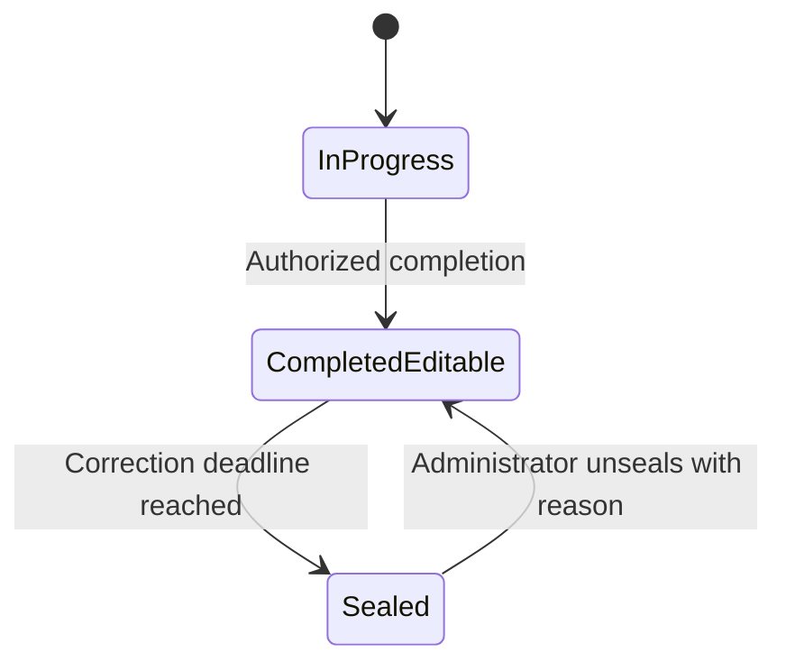

# Record sealing — next-release specification

**Status: planned, not implemented.** Founder decisions confirmed 30 October 2026. This work belongs to the release after beta.3; it is not a beta.3 acceptance gate. The exact release version is not assigned. Current completed records remain subject to existing correction permissions, without an automatic three-day lock.

## Confirmed product decisions

- Cover completed individual workouts, group-session recordings and assessments.
- Institution settings define the correction window, defaulting to three days.
- After the window expires, coaches and athletes can view the completed summary but cannot change the recording.
- Any institution administrator may unseal. The first-run account currently has the same administrator role as other admins; do not add a separate super-admin grant or reuse the unrelated platform-operator grant for this feature.
- Unsealing starts a fresh correction window using the institution's currently configured days. It does not leave the record open indefinitely.
- Show a lock icon and the visible word **Sealed / مختوم**, following shared status, theme and accessibility conventions.

## Why it follows beta.3

Sealing changes write authority across workout actuals, assessment results, attendance corrections, reviews and offline replay. A badge or browser-only check would leave other clients able to write. Beta.3 is consolidating these workflows and preparing native workout recording; sealing should use that shared lifecycle after it is accepted, rather than adding another policy during that consolidation.

The next release must deliver server enforcement, correction recovery, web and native behavior, history and public documentation together. No schema migration, API capability or automatic sealing is introduced by this proposal.

## Recommended lifecycle — implementation design, not yet enabled

Use a deadline checked by the server, rather than relying on a scheduled worker to make records read-only. A worker may assist reporting, but a delayed worker must never permit an expired write.

Completed editable and sealed are both completed records. Unsealing must not reopen attendance as a new session, remove completion, repeat assignment progression, rewrite the prescription or count another completion in analytics.

Recommended clock: three days means 72 elapsed hours from an authoritative first-completion anchor, displayed in the viewer's preferred timezone. Corrections must not restart that clock. Do not calculate it from the scheduled start, a client's clock or a mutable updated-at field.

For individual workouts, anchor to the workout's first completion. For a group session or assessment, anchor to explicit event finish and seal its related attendance/results as one bundle. This avoids having a shared attendance sheet editable while its participant results are sealed. Never seal an unfinished record merely because its appointment date has passed; preserve incomplete work for explicit resolution.

Capture the deadline when completing or explicitly unsealing. Recommended policy changes affect future completion/unseal windows; increasing the setting must not silently unseal existing records. Confirm the input bounds and historical-record policy during implementation review.

## Authorization and data boundaries

- A sealed record is read-only for ordinary recording, attendance, assessment, review and note commands. Audit every supported write path, including native endpoints; disabling web controls is insufficient.
- Administrator unseal requires an active administrator membership, an explicit confirmation/reason, current revision and durable operation identity. Recheck authority on retries. Record actor, time, reason and new deadline in history/activity without including clinical details.
- Unsealing restores only each person's existing permissions. It does not let an administrator record as a coach, let an athlete edit group actuals, or give a supporting coach broader access.
- Preserve current visibility rules for summaries, private files and history. Sealing does not replace consent, retention, account deletion or backup policy.
- Preserve immutable prescriptions, participant adaptations, record IDs, authors and completion attribution. History remains append-only through the existing revision services.

Current storage includes `institution_sessions.completed_at`, assessment result/history rows and event state/revision. Events do not currently have a dedicated completion timestamp. The migration must provide a trustworthy completion/deadline anchor instead of treating a later attendance correction as event completion. See the [current schema reference](../reference/backend/schema.md) and [architecture](../architecture/README.md).

Before implementation, review existing completed data: identify reliable workout completion timestamps and event-finish audit records, produce a dry-run backfill count, and decide whether older completed records seal on upgrade or are grandfathered. Missing timestamps require explicit handling; never invent them or reset the database.

## Saved requests and offline recovery

An already acknowledged operation may return its existing receipt after the deadline, with current authority checked, without applying another write. A genuinely new operation received after sealing is rejected, including an older offline draft that the server has never acknowledged. Client-authored timestamps must not bypass sealing.

Web and Android must explain the sealed conflict and retain unacknowledged edits for explicit recovery. Do not discard queues, adopt another account's draft, announce success before acknowledgment or automatically retry a sealed write forever. After an administrator unseals, the client must refresh current authority/revision before offering correction; stale data must not overwrite newer acknowledged results.

## Interface scope

- Add a clearly labelled Record sealing setting with the default, validation and an explanation of prospective effect.
- Show completion and sealing separately: keep completed calendar styling/counts, then add the lock/text indicator where relevant. Sealed is not a replacement for completed in analytics.
- Sealed detail pages lead with the completed summary, recorded actuals, permitted feedback/history and deadline; hide or disable unauthorized edit/start/finish controls with a useful explanation.
- Administrators get an explicit Unseal action on the record/event detail, using the existing confirmation-dialog and action-specific toast conventions. The new correction deadline stays visible after acknowledgment.
- Group records keep one shared preview and their existing athlete selector. Sealing must not reintroduce per-athlete preparation navigation or show other athletes' private results.

## Required implementation and acceptance checks

| Area                    | Required evidence                                                                                                                                                                |
| ----------------------- | -------------------------------------------------------------------------------------------------------------------------------------------------------------------------------- |
| Deadline                | Before, exactly at and after expiry; first completion is stable across corrections; timezone/DST display does not change eligibility.                                            |
| Settings                | Default three days; invalid input rejected; changes do not reopen existing records; the next unseal uses the current setting.                                                    |
| Permissions             | Athlete, designated coach, unrelated coach, administrator and revoked administrator; direct requests are checked as well as UI controls.                                         |
| Group/assessment bundle | Attendance, participant actuals, skips, assessment results and feedback cannot bypass a sealed parent; unfinished work is not silently completed.                                |
| Unseal                  | Reason/history, fresh deadline, idempotent retry, concurrent unseal/write and permission revocation; no duplicate progression or completion counts.                              |
| Offline                 | Acknowledged receipt versus never-acknowledged command; queue preservation, sealed conflict, administrator intervention and revision-safe recovery on a physical Android device. |
| Existing data           | Populated forward migration, dry-run/backfill policy, missing timestamps and retained histories/private-file identities; matching backup/upgrade guidance.                       |
| UI                      | English/Arabic, both themes, desktop/phone, keyboard/focus, non-color status explanation and retained group selection.                                                           |
| Contracts               | Canonical OpenAPI, generated shared types, matched web/native capability/error handling and paired English/Arabic landing documentation.                                         |

When implementation is ready, extend the administrator, coach and athlete steps in the [canonical instance walkthrough](../testing/instance-validation.md). Do not publish a separate manual checklist or describe these proposed controls as available today.
